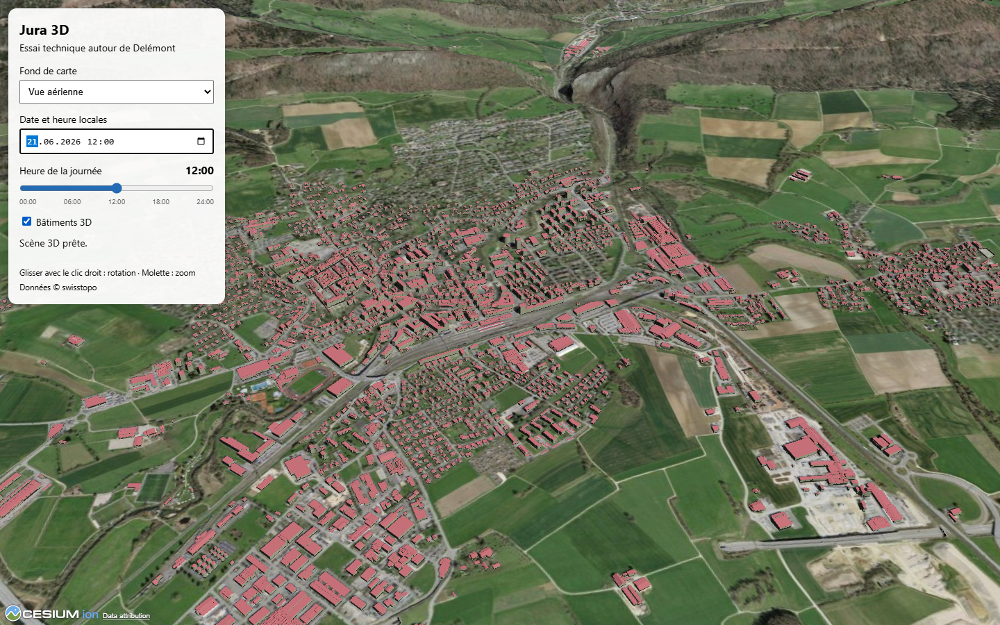

# Jura 3D

Prototype web ouvert pour explorer en 3D le canton du Jura. L'état actuel est une **preuve technique autour de Delémont** : il ne couvre pas encore tout le canton et ne contient pas encore de jeu. Le code est nouveau ; aucun code de SunTrail 3D ou de Geneva 3D n'a été copié.



## Ce qui fonctionne

- Relief 3D : `ch.swisstopo.terrain.3d` (quantized mesh)
- Bâtiments : `ch.swisstopo.swissbuildings3d.3d` (3D Tiles)
- Vue aérienne jusqu'au niveau de tuile 20 ; fond topographique limité à 18 (voir [données et limites](docs/DONNEES.md)).
- Éclairage et ombres selon une date et une heure choisies
- Curseur pour faire varier l'heure et voir la lumière et les ombres pendant le déplacement
- Commande pour masquer les bâtiments
- Glisser au clic droit pour tourner et incliner la caméra ; molette pour zoomer

Les services de données sont accessibles en ligne. Le prototype ne demande ni clé MapTiler ni compte Cesium ion. Une connexion Internet et un navigateur avec WebGL sont nécessaires.

## Démarrage

Node.js 22 ou plus récent :

```powershell
npm ci
npm run dev
```

Ouvrir `http://127.0.0.1:5173/`. Le chargement exige une connexion Internet. La commande `npm run build` produit la version statique, et `npm run preview` la sert sur `http://127.0.0.1:4173/`.

Le contrôle automatisé utilise Chrome installé à `C:\Program Files\Google\Chrome\Application\chrome.exe` ; il est actuellement adapté à Windows et nécessite le réseau :

```powershell
npm run probe
```

GitHub Actions reconstruit le projet à chaque push ou pull request. Ce contrôle distant ne teste pas la scène 3D en direct.

Pour contrôler la version compilée :

```powershell
$env:JURA3D_URL='http://127.0.0.1:4173/'
npm run probe
```

## Reprendre le projet

Lire dans cet ordre :

1. [État du projet et points ouverts](docs/ETAT_DU_PROJET.md)
2. [Architecture du prototype](docs/ARCHITECTURE.md)
3. [Données, niveaux de tuiles et conditions d'usage](docs/DONNEES.md)
4. [Décisions techniques](docs/DECISIONS.md)
5. [Historique des changements](CHANGELOG.md)

Les règles pour maintenir ces documents à chaque évolution figurent dans [AGENTS.md](AGENTS.md). La prochaine étape est une discussion avec le propriétaire pour définir le plan du produit ; les points ouverts ne constituent pas encore un plan approuvé.

## État vérifié le 29 septembre 2026

`npm run build` et `npm run probe` ont réussi. Dans Chrome de bureau sans interface, la scène a atteint « Scène 3D prête. », les trois services ont répondu et aucune erreur réseau ou JavaScript n'a été relevée. Le contrôle a vérifié les gestes de caméra, le curseur horaire et des requêtes réelles de tuiles aériennes jusqu'au niveau 20. Captures conservées pour référence :

- [Vue à midi](docs/images/delemont-midi.png)
- [Vue à minuit](docs/images/delemont-nuit.png)
- [Fenêtre étroite](docs/images/delemont-mobile.png)

Cette vérification décrit une session de navigateur automatisé. La fluidité, la mémoire et la consommation d'énergie sur un téléphone réel restent à mesurer. Les ombres du relief et le changement d'éclairage sont visibles ; l'exactitude des ombres portées par chaque bâtiment n'est pas encore qualifiée. Les ombres déjà présentes sur la photographie aérienne ne changent pas avec l'heure sélectionnée. Le projet ne couvre pour l'instant ni le canton entier, ni les données en direct, ni le mode hors ligne.

## Licence et données

- [Terrain swisstopo](https://docs.geo.admin.ch/visualize-data/terrain-service.html)
- [Bâtiments 3D swisstopo](https://docs.geo.admin.ch/visualize-data/3d-tiles.html)
- [Tuiles XYZ swisstopo](https://docs.geo.admin.ch/visualize-data/xyz.html)
- [Conditions d'utilisation geo.admin.ch](https://www.geo.admin.ch/en/general-terms-of-use-fsdi)

Le code propre à ce dépôt est publié sous [licence MIT](LICENSE). Les bibliothèques et les données tierces restent soumises à leurs propres conditions. Les données sont créditées « © swisstopo » dans l'interface. Avant une publication à large audience, vérifier les mentions requises pour chaque couche et le respect des règles de fair use ; voir [DONNEES.md](docs/DONNEES.md).

La vue aérienne était auparavant limitée au niveau 18 par le prototype. Le service fournit des tuiles au niveau 20 près de Delémont. La couche topographique annonce un niveau 19, mais la tuile vérifiée à Delémont est vide ; le prototype conserve donc le plafond 18 pour cette couche.
