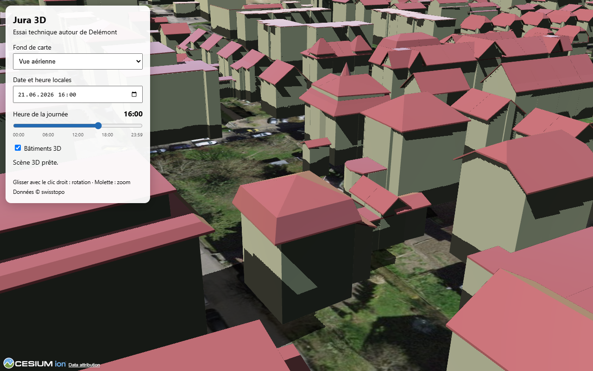
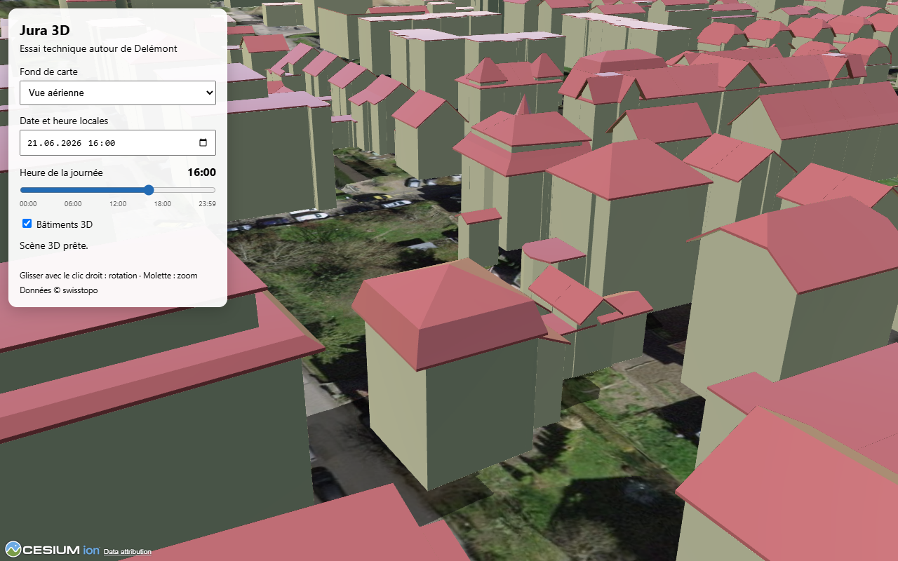
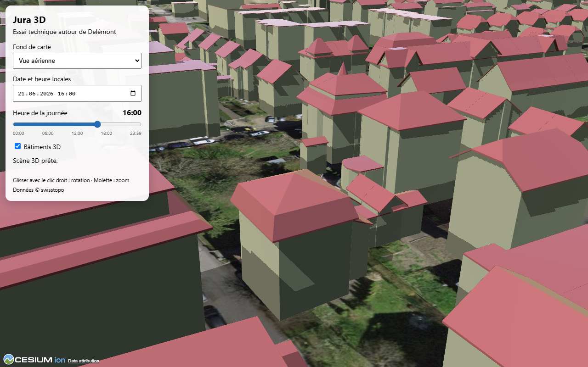

# Architecture du prototype

## Contrôle de publication ciblé — 30 octobre 2026

`scripts/probe-presentation.mjs` accepte `JURA3D_PROBE_SCOPE=all|jura` (`all` par défaut), avec portée et territoires exclus dans le rapport. `jura` vérifie la présentation, le parcours, le toucher simulé et le retour au Jura normal, sans réclamer de disponibilité Bâle. Le mode global et les incidents Bâle sont conservés ; aucun changement applicatif ou contournement réseau. [Publication autorisée](PUBLICATION_PRESENTATION_JURA.md).

## Finition de présentation — 30 octobre 2026

L’image d’accueil est désormais `docs/images/presentation-delemont-original-2026-10-30.jpg`, copiée sous `presentation/delemont.jpg`. Capture réelle1440×900, rendu Original et ombres simulées désactivées pour cette capture seulement, conformément à sa légende ; aucune modification des réglages de démarrage. JPEG346967octets contre PNG1729093octets précédemment. Texte de la page et deux libellés du guide raccourcis ; gestionnaires, styles, scène et données inchangés. Ancienne livraison/probes préservés ; copie et preuves nouvelles sous `.vite/presentation-polish-2026-10-30/`.

## Démonstration Jura — 29 octobre 2026

`site/presentation/` est une page statique ajoutée par `scripts/build-site.mjs` sous `presentation/`, avec préfixe adapté pour la racine et Pages. Capture réelle issue de C1 copiée depuis `docs/images/presentation-delemont-2026-10-29.png`. Aucun moteur 3D ou géoservice chargé sur cette page ; accueil Jura/Bâle préservé.

`src/presentation.js` s’active pour Jura avec `presentation=1`, après branchement du compteur : compteur masqué, réglages repliés, lien de retour adapté et trois accès aux commandes existantes. Aucun nouvel état persistant, ordonnanceur, source ou rendu ; filtres/fiches/réessais restent ceux des composants habituels. Une couche déjà cochée n’est pas réactivée. `scripts/probe-presentation.mjs` contrôle page, parcours, fiches, autre destination, retours, toucher simulé et entrées normales. [Guide et preuves](PRESENTATION_JURA.md).

## C1 — Habillage local de Delémont, 28 octobre 2026

`visual-trial.js` est instancié uniquement pour le Jura. Il ajoute un panneau opt-in près des couches et un badge explicite ; aucune préférence persistée, aucun shader au démarrage. `main.js` lui transmet les bâtiments après chaque chargement, le profil effectif, les changements de destination et l'accès aux fiches P3. Les vols de cadrage utilisent une altitude échantillonnée du terrain ; génération/annulation empêchent un vol ou une sélection tardive après navigation.

Un `CustomShader` modifie les seuls matériaux dans l'emprise `[7.3405,47.3628,7.3485,47.3672]`, avec transition de 28 m à l'intérieur. La transformation œil → ENU est calculée sur CPU ; positions et normales sources sont inchangées. Les couleurs source distinguent deux familles visuelles, sans classification patrimoniale. Pas de `Cesium3DTileStyle` conjoint. La couleur jaune de sélection passe sans habillage. Grain filtré par dérivées et distance, désactivé en Faible ; aucune texture additionnelle ni géométrie ajoutée.

Élevé/Ultra permettent la projection seule des ombres (`CAST_ONLY`, au lieu de réception/projection). Ce réglage affecte toute la vue, seulement lorsque son centre au sol est dans l’emprise et la caméra sous 6 000 m ; il revient à sa valeur initiale hors cadrage, en Original ou en quittant Delémont. Densité de culling, seuils géométriques, résolution, soleil et heure ne changent pas. Faible garde la palette seule ; Moyen permet le grain. Les shaders sont détachés/détruits lors des bascules, réessais et destruction ; une erreur de rendu désactive l’essai avec message.

Après retour du propriétaire et comparaison visuelle OFF/ON/OFF, « Ambiance douce » est retirée le 28 octobre : l’essai ne modifie plus `fog.visualDensityScalar`. La brume native Cesium reste intacte. Le diagnostic conserve `atmosphere: false` pour les lecteurs des anciens rapports ; le probe vérifie l’absence du contrôle et une brume inchangée dans chaque profil. Le script de mesure supprime cette variante et les doublons de sa séquence par défaut.

Sous `?probe=1`, `__jura3dVisual()` expose l'état effectif et `__jura3dVisualOrbit(angle)` reproduit une trajectoire autour du même centre. Aucun de ces accès n'est exposé dans une visite normale. [Probes, mesures et limites](VALIDATION_C1.md).

## Revue PUB2 enrichie du27octobre

L’accueil statique explicite désormais la limite centrale des bâtiments bâlois et les données de visite/sanitaires statiques. Aucun changement du flux de navigation, des cartes ou sources. Le probe de site normal vérifie les marqueurs accueil/enfants et les couches parkings/lieux/sanitaires/quais/tracés avec leurs fiches/liens/crédits, pour servir aussi au contrôle HTTPS après une future publication autorisée. [Bilan et copies figées](REVUE_PUB2_BALE.md).

## B3 — Sanitaires et composant de points partagé

`sanitary-data.js` lit100031 à la demande, vérifie licence/attribution, compte/pagination/identifiants et concordance des deux positions natives. Les attributs restent dans `native`/`feature.properties`, champs français et conditions d'usage dans `display`. `point-places.js` généralise le renderer B2 par préfixe de contrôles, symbole, loader et filtres supplémentaires, avec le même cycle de vie/cache/annulation et regroupement44px/min2. `basel-places.js` reste le wrapper B2 ; `sanitary.js` fournit WC et filtre Eurokey, couleurs dont fermeture grise. Distance commune dans `point-geometry.js`, réexport B2 conservé.

`main.js` rend les fiches et groupes de services avec états non temps réel, tarif sans montant inventé, accès source et compléments absents ; le registre possède une couche `services` indépendante. Pas de nouvelle source Jura ou modèle3D, les fontaines IWB restent hors lot. [État des contrôles et limites](VALIDATION_B3.md).

## B2 — Adaptateur Basel Info, 27 octobre 2026

`basel-places-data.js` lit les licences BIFO/BIPO puis trois collections OGC publiques à la demande, avec compte/pagination complets, validation Point WGS84/nom/identifiants et préfixage par collection. Les attributs/géométries natifs restent dans `feature` ; noms normalisés, catégories françaises et URL contrôlées sont séparés dans `display`. Aucun instantané de positions livré, pas de polling ; cache de session seulement. Les index du service ne promettent pas une identité stable entre publications.

`basel-places.js` implémente le contrat du registre dans l'emplacement `heritage`, avec repères L et groupes ancrés au relief (44pixels, minimum2 pour inclure les paires proches de sources distinctes), filtrage catégorie/distance5km ou toutes les sources, surbrillance propre et vol annulable par génération. `main.js` choisit cet adaptateur pour `basel-places`, conserve le composant Jura et rend des fiches natives Bâle avec lien fourni et métadonnées officielles distincts. Désactivation/destruction retirent seulement la source et les écouteurs propres ; les réponses périmées sont ignorées. Jura garde son schéma et ses contrôles. [Vérifications et qualification avec réserves](VALIDATION_B2.md).

## Découpage Bâle A53 — 27 octobre 2026

`building-clip.js` utilise quatre plans verticaux pour le petit rectangle géoréférencé de Bâle, dans le repère ENU central converti vers celui du tileset. Le chemin s'applique aux transformations racine/modèle identité et aux petites emprises ; les autres conventions gardent l'ancien polygone. Cadre, fournisseur, seuil de sélection et informations conservés ; approximation au bord explicitée et testée. [Implémentation et vérifications](CORRECTION_BALE_A53.md). B1 clos avec réserves après contrôles PC et acceptation A53 portrait/paysage ; les descriptions polygonales P8 suivantes restent celles de la référence antérieure.

## Complément P6 — Rendu des tracés Jura, 27 octobre 2026

Les configurations Jura et Bâle déclarent désormais `lineRenderer: 'terrain-imagery'`. Le choix du rendu est indépendant du schéma de données ; l'absence de cette option ou `ground-polyline` conserve la voie vectorielle. Une valeur inconnue est rejetée à la validation. Les filtres et fiches propres aux deux territoires restent séparés.

Jura réutilise le fournisseur local décrit ci-dessous : géométries1m/5,25km inchangées, arrêts/groupes Cesium, lignes jour bleues et nuit seule violettes en pointillés, surbrillance native temporaire. Les deux zones Noctambus restent des polygones Cesium avec trous et sélection propres. Lorsqu'une zone de fond est sous le clic, les tracés proches peuvent être choisis ; arrêts, bâtiments et autres objets au premier plan gardent la priorité. Le fournisseur et ses limites de cache/épaisseur restent ceux de B1. [Vérifications et mesures Jura](OPTIMISATION_JURA.md). Les paragraphes datés du26octobre décrivent l'étape Bâle antérieure à cette généralisation.

La résolution d'un objet pointé vérifie le type de son identifiant avant `EntityCollection.contains` : un groupe Cesium porte un tableau et ne doit pas être interprété comme une entité unique. Ce contrôle s'applique aussi aux cibles diagnostiques ; il évite une exception rencontrée pendant le balayage des tracés près d'un groupe d'arrêts.

## B1 — Tracés bâlois en tuiles calculées localement

`transport-imagery.js` fournit à Cesium une couche d'imagerie transparente, en tuiles512×512 WebMercator/niveaux0–20, produite par Canvas2D à partir de la géométrie d'affichage déjà simplifiée1m et découpée5,25km. Pas de serveur de tuiles, nouvel accès distant, nouvelle source ou modification du relief. Cache propre au fournisseur limité à24 canvas non vides ; cela ne borne pas toute la mémoire de Cesium ni ses textures. Le moteur conserve sa gestion des tuiles visibles. Couleurs tram/bus et pointillés nocturnes, contour blanc ; l'épaisseur de rasterisation dépend du niveau de tuile et de la vue.

Seule la branche Bâle utilise cette couche pour le réseau de fond ; le Jura garde ses polylignes terrain P6. Les quais restent des entités Cesium regroupables. Les propriétés source, filtres, liste de tracés et cache API sont conservés. `transport-raster-geometry.js` projette les chemins, filtre les tuiles et recherche les identifiants proches sans raccorder deux portions disjointes. Au clic sur le terrain libre, intersection terrain puis test géométrique et contrôle à8pixels CSS ; un objet Cesium au premier plan garde la priorité. Les tracés superposés ouvrent la liste des identités source. Une ligne choisie reçoit une surbrillance terrain native temporaire ; sa fermeture ne reconstruit pas le réseau de fond.

Chaque filtre/secteur remplace son fournisseur ; désactivation, erreur et destruction retirent uniquement cette couche d'imagerie et libèrent son cache. Génération synchrone dans une promesse rejetable, erreurs relayées vers le réessai des couches ; une erreur tardive d'un fournisseur remplacé est ignorée par identité. Le contrat et le registre P7 restent identiques. `scripts/test-transport-raster.mjs` couvre projection/frontières/proximité/identités/parties disjointes ; le probe B1 vérifie clics, groupes, surbrillance, absence d'accumulation de couches et récupération après panne Canvas2D. [Validation et mesures](OPTIMISATION_B1.md).

## B1 — Adaptation du réseau bâlois

`basel-transit-data.js` lit les deux API 100064/100065 à la première activation, vérifie licence/pagination/identifiants/géométries/listes et normalise Point/LineString/MultiLineString pour le renderer commun. Les propriétés restent natives ; nom, modes et date de catalogue sont séparés dans `display`. Pas de copie du schéma Jura dans les attributs bâlois, pas de données réseau livrées dans le build. Cache mémoire jusqu'au rechargement, délai/abort/génération du contrat existant ; aucun polling.

`transport.js` partage la géométrie P6, le regroupement, le picking, les surbrillances et le cycle de vie. Branche `basel-transit` : modes tram/bus, pas de zones Noctambus ou filtre jour/nuit supposé ; quais seuls au départ, tracés à la demande. `main.js` rend des fiches adaptées aux attributs bâlois et des liens horaires généraux vérifiés ; `territory.js` configure champs/légende et crédits CC BY/ODbL. Source/configuration Jura conservées ; régression contrôlée par le probe complet. [Qualification B1](VALIDATION_B1.md).

Sur Bâle, les conditions détaillées sont placées dans la rubrique défilante « Sources et conditions ». Le pied du panneau conserve l'attribution swisstopo/Basel-Stadt et les crédits des couches actives, dont OpenStreetMap. Cette présentation évite que les textes de licence occupent presque toute la hauteur en paysage ; les liens détaillés gardent une cible tactile de 44 px. La présentation du Jura est conservée.

## Assemblage du site commun — PUB2

`site/index.html` et `site/site.css` constituent un accueil statique sans Cesium ni données distantes. `scripts/build-site.mjs` assemble deux builds indépendants dans le dossier fixe ignoré `dist-site/` : `jura/` et `bale/`, chacun avec ses ressources Cesium, données et marqueur ; même révision pour l'accueil et les enfants. Le build par territoire existant reste disponible. Aucun changement de configuration en cours d'exécution ni deux Viewer simultanés dans la page.

La racine commune est `JURA3D_BASE_PATH` ; le constructeur fixe les bases enfants et `JURA3D_SITE_HOME`. Vite valide cette dernière, injecte un lien de retour dans le panneau défilant et l'enregistre au marqueur. Sans elle, l'application autonome garde sa présentation habituelle. Navigation par liens de pages, stockage de qualité partagé par origine comme auparavant ; cycle de vie P7 conservé. `check-site.mjs` vérifie l'accueil et les marqueurs/bases/ressources des deux enfants, puis réutilise `check-build.mjs`. `probe-site.mjs` contrôle les trajets sans paramètre diagnostic et le retour au choix, au clavier et au toucher simulé. [Détails et état de validation](PUBLICATION_PUB2.md).

## Composants

| Fichier | Responsabilité |
| --- | --- |
| `index.html` | Conteneur Cesium, destinations, commandes caméra, réglages repliables, état/réessai et sélection. |
| `src/main.js` | Scène Cesium, branchement des adaptateurs, navigation, chargement/réessai 3D, fiches, heure et éclairage. |
| `src/territories/*.js` | Configuration du territoire, destinations, fournisseurs, crédits et instantanés des couches. |
| `src/territory.js` | Validation de configuration et initialisation des commandes propres au territoire. |
| `src/layers.js` | Contrat et registre du cycle de vie des adaptateurs. |
| `src/heritage.js` | Chargement facultatif P3, filtres/liste, entités et groupes, sélection/cadrage de lieu et contrôle des liens officiels. |
| `src/transport.js` | P4 : chargement facultatif, filtres, arrêts/groupes, tracés/zones, sélection et liens officiels. |
| `scripts/probe-transport.mjs` | Parcours P4 intégré au probe complet : clics réels, filtres, coexistence, erreurs et toucher simulé. |
| `src/style.css` | Mise en page de la scène et du panneau de contrôle. |
| `vite.config.js` | Copie les ressources statiques Cesium nécessaires aux Workers et widgets sous `/cesiumStatic`. |
| `scripts/probe.mjs` | Contrôle de bout en bout dans Chrome, avec les services réseau réels. |
| `scripts/probe-heritage.mjs` | Parcours patrimoine P3, appelé par le probe complet et exécutable seul ; données locales, pannes séparées et toucher simulé. |
| `scripts/measure-performance.mjs` | P5 : parcours PC ou Android explicitement déclaré, chargements normaux/cache et configurations instrumentées, rapports partiels uniques ; aucune modification de viewport Android. |
| `scripts/probe-android.mjs` | Parcours et relevés FPS dans Chrome sur appareil Android physique, via un endpoint CDP déjà préparé. Aucun redimensionnement ou émulateur. |

Reprise P5 du 1er octobre : chaque onglet de mesure reçoit `__p5MeasurementStartedAt` pour permettre une récupération ciblée après perte CDP. Les rapports consignent séparément restauration de préférence, restauration du cache HTTP et fermeture de l'onglet. Un onglet devenu inaccessible produit `cleanupFailure`, même si Playwright le considère fermé : cela ne prouve pas la fermeture physique du Chrome Android. Après reconnexion, ne restaurer/fermer qu'un onglet identifié sans ambiguïté. Les anciens rapports restent intacts ; leur absence de `cleanupFailure` ne suffit pas à garantir un nettoyage après perte de transport.

Reprise du soir : la préférence initiale est gardée dans une clé `sessionStorage` propre à la session, conservée aux rechargements, puis enregistrée comme `originalQuality` dans le rapport dès sa lecture. Assertions après rechargement et navigation diagnostic ; la clé temporaire est retirée au nettoyage. Les rapports anciens sans ce champ gardent leur limite, aucune valeur d'origine n'est réinventée.

Le projet est une application JavaScript côté navigateur, construite avec Vite. Aucune API ou base de données propre à Jura 3D n'existe encore. `npm run build` produit des fichiers statiques dans `dist/` ; ce répertoire n'est pas versionné.

## Essai Bâle P8 — 25 octobre 2026

`territories/basel.js` remplace uniquement la configuration : terrain/fonds swisstopo, bâtiments 3D Tiles cantonaux, trois cadrages et adaptateur `basel-parking`. Le build n'instancie qu'un tileset bâtiments ; aucun doublon swissBUILDINGS3D. Un `ClippingPolygonCollection` inverse découpe le rendu au cadre déclaré, avec contrôle de compatibilité WebGL 2 et message propre si indisponible. Pas de transformation verticale devinée. Attributions et conditions du modèle sont séparées du crédit swisstopo ; les adresses bâtiment utilisent les seuls champs source configurés, sans jointure ni nom de lieu inventé.

`parking-data.js` valide réponse complète, identifiants, coordonnées du cadre, compteurs, date d'observation et liens officiels. `parking.js` possède requête annulable 20 s, source Cesium de repères ancrés au terrain, sélection/cadrage, écouteurs et minuteur. Chargement à l'activation puis toutes les 60 s lorsque l'onglet est visible ; aucune requête automatique en onglet caché, pas de stockage persistant. Échec : cache mémoire conservé et statut d'erreur. Réponse identique en identifiants : entités/fiche réutilisées et champs actualisés, sans vol/fermeture intempestive. Destruction définitive : générations, requête, cadrage en attente/vol, écouteurs, source et minuteur annulés.

L'état de transport de la réponse (`off/loading/ready/error`) ne prouve pas sa fraîcheur. Celle-ci dépend de `published`, avec seuil local 5 min et tolérance de futur 2 min ; jamais de `last_downloaded` ni de la dernière lecture du client. Valeurs absentes/incohérentes : inconnues, sans zéro inventé. Repères bruns et fiche signalent ancienneté/indisponibilité ; le bleu de sélection ne représente pas une disponibilité. Les textes source restent des textes DOM, seuls les liens HTTPS du domaine/chemin permis sont activés.

La fiche partagée ajoute une rubrique parkings. Le registre P7 distribue son picking avant bâtiments/terrain ; alertes/réessais et crédits tiennent compte des seules couches configurées. Panneaux Jura masqués dans Bâle et parkings masqués dans Jura. Vite ignore les assets locaux pour l'adaptateur distant ; seuls les GeoJSON déclarés des adaptateurs Jura sont copiés dans leur build. `check-build.mjs` accepte un territoire attendu facultatif, `jura` par défaut. `probe-territory.mjs` reçoit un dossier de sortie optionnel pour préserver les anciennes preuves. [Contrôles et limites](VALIDATION_P8.md).

## Publication GitHub Pages — 25 octobre 2026

Le build accepte `JURA3D_BASE_PATH`, `/` par défaut et `/jura3d/` sur Pages. Ce préfixe configure Vite et `CESIUM_BASE_URL`, y compris les Workers/Assets ; les GeoJSON/conditions utilisent `import.meta.env.BASE_URL`. Le lien de conditions HTML emploie `%BASE_URL%`. Un asset `build-info.json` fournit le commit `GITHUB_SHA` quand construit par Actions, sinon `null`, ainsi que base/territoire.

La CI de compilation reste séparée du workflow manuel `pages.yml` (branche `main`, environnement `github-pages`, artifact `dist/`). Un contrôle des fichiers précède le déploiement. Les ressources lourdes terrain/bâtiments/images restent chargées directement chez swisstopo, les instantanés cantonaux sont servis par Pages. Les fichiers de licence CesiumJS et son inventaire tiers sont joints sous `cesiumStatic/`. Aucun serveur applicatif, suivi d'audience, clé ou base de données introduit. [Publication et contrôle de la version servie](PUBLICATION.md).

## Configuration et couches P7 — 25 octobre 2026

`vite.config.js` résout `#territory` vers `src/territories/<VITE_TERRITORY>.js`, `jura` par défaut. La configuration est validée côté compilation puis navigateur. Les assets sont dérivés des déclarations des couches : données sous `data/<base>`, index de liens sous `checksSource`, conditions communes dédupliquées. `stripBase: true` garantit leur livraison sous les mêmes URL publiques qu'en P6. Aucun chargement des GeoJSON avant activation.

`configureTerritoryUi` remplit titre, navigation, fonds, localités et crédits depuis la configuration, masque les panneaux absents. `main.js` convertit la caméra en objets Cesium et garde réglages/algorithmes P6. Les identifiants et attributs de diagnostic existants restent compatibles. Le registre distribue effacement, navigation et picking, avec priorité patrimoine puis transports ; les callbacks de fiches restent spécialisés.

Chaque adaptateur reçoit son descripteur (`config`) et possède ses requêtes, abonnements et entités. `setEnabled` active/retire ; `refresh` réaffiche l'instantané validé ou retente son chargement ; `destroy` annule requêtes/cadrages/générations, retire les écouteurs DOM et Cesium, les sources et caches forts, de façon idempotente. Les réponses tardives ne réactivent pas une couche détruite. `pagehide` détruit les couches sauf conservation de la page dans le cache de navigation. Ce nettoyage concerne les couches ; il ne prétend pas fournir un démontage/remontage complet du Viewer.

Le témoin `navigation-control` emploie la même application sans données cantonales, avec deux destinations et une autre caméra initiale. Il prouve l'usage de la configuration ; aucun rendu de Bâle n'est acquis. Le choix territorial intervient à la compilation, sans sélecteur multicité dans l'interface. Les panneaux/adaptateurs Jura ne sont pas un système de plugins universel : parkings, données périmées et nouvelles sources exigent leurs propres règles et contrôles. [Contrat, commandes et preuves](VALIDATION_P7.md).

## Préparation de données P2 — 30 septembre 2026

Traitement séparé de l'application : `data/sources-jura.json` verrouille URL, empreintes des deux ZIP et conditions, tables/counts attendus et les trois anomalies RBC connues. `scripts/prepare-jura-data.py` télécharge sur demande, vérifie les empreintes, lit les GeoPackage par SQLite en lecture seule et transforme EPSG:2056 vers WGS84 avec pyproj/Shapely. Environnement Python 3.12+ isolé dans `.vite/p2-venv`, versions dans `scripts/requirements-data.txt` ; aucun paquet SIG ajouté au navigateur ou à npm.

Les quatre GeoJSON, conditions et `manifest.json` sont préparés sous `data/jura/`, hors `public/`. Toute la validation précède leur écriture, remplacement fichier par fichier puis manifeste ; après interruption, vérifier l'ensemble avant usage. P3/P4 copient les quatre GeoJSON et les conditions dans `dist/jura/`, avec deux fichiers de contrôles de liens. Le manifeste et les archives ne sont pas servis. Aucun nouvel hébergement ni redéploiement.

Attributs source intégraux, ID composé de la table et de la clé locale de cet instantané, identifiants métier préservés. MultiPoint / MultiLineString / MultiPolygon en longitude/latitude, pas de hauteur supposée. Sans simplification ni arrondi ; anneaux orientés selon RFC 7946. Trois fiches RBC aux coordonnées aberrantes ont `geometry: null`, sans perte d'identité ni correction devinée ; géométrie d'origine et motif dans le manifeste. Toute nouvelle anomalie, variation de schéma/type/comptage, URL absente ou sortie invalide arrête la préparation. Noctambus reste une couche de zones distincte des tracés.

`scripts/validate-jura-data.py` reconvertit à l'identique, compare tous les attributs à SQLite et huit repères aux réponses REFRAME indépendantes enregistrées dans `data/jura-control-points.json` ; `--online` relit ces réponses. Rapport local ignoré `.vite/p2-validation.json`, protocole et figure dans [VALIDATION_P2.md](VALIDATION_P2.md). Les données préparées ne constituent pas une jointure aux bâtiments 3D et n'ont pas encore de validation de rendu/mobile.

## Flux de rendu

### Patrimoine P3

`createHeritageLayer` reçoit la scène et callbacks de sélection/effacement/destination. Avant activation : aucune requête patrimoine ni source Cesium. À l'activation, `fetch` lit `/jura/heritage.geojson` et `/jura/heritage-link-checks.json`, délai maximum 20 s, type/count/coordonnées/identifiants contrôlés. `AbortController` et générations neutralisent les réponses tardives ; un état/réessai patrimoine séparé garde les statuts P1 indépendants. Les fichiers sont mis en cache mémoire seulement après validation. Vite copie aussi le PDF de conditions ; le manifeste complet reste hors `dist/`. P4 livre les transports séparément.

`CustomDataSource` recrée les seules entités des filtres courants : localité liée à la destination P1 ou explicite, catégorie et liste native de lieux. Trois géométries nulles dans la liste, sans entité. Billboards « P » et groupes ancrés au terrain avec `CLAMP_TO_TERRAIN`, sans altitude patrimoniale publiée ; groupes à partir de quatre marqueurs proches. Les coordonnées des entités n’ont pas de Z : les primitives de groupe Cesium doivent recevoir explicitement la référence de hauteur, sinon leur centroïde reste près de l’ellipsoïde. Couleur distincte pour le lieu sélectionné. Un groupe n'est pas une identité de bâtiment : son clic ouvre les noms source de ses membres avec boutons de consultation. La liste est limitée aux membres réellement retournés par le picking et effacée avec la sélection. Le regroupement en pixels peut changer à la rotation/au zoom ; son ancre suit le terrain, et le zoom n'est pas une condition d'accès aux fiches. Distance maximale d'affichage des marqueurs 80 km, liste toujours disponible.

`selectAt` traite les entités patrimoine avant la sélection 3D Tiles/terrain existante. `showHeritage` insère uniquement du texte, propriétés et lien cantonal validé (HTTPS, hôte/chemin autorisés) ; titre/fermeture/crédit fixes, corps défilant. Sur téléphone, consultation replie le menu. Une demande de cadrage échantillonne le relief, puis vérifie génération/activation/sélection avant le vol ; une sélection effacée annule le cadrage propre au patrimoine. Source et conditions visibles. Désactiver retire la source/callbacks et sa sélection, garde les fichiers en mémoire ; garde supplémentaire si un ajout asynchrone arrive après retrait.

`__jura3dHeritage` et les recherches de cible/groupe réel existent seulement sous `?probe=1`. Les contrôles vérifient source retirée sans doublons/bascules rapides, données/réessais et toucher ; [VALIDATION_P3.md](VALIDATION_P3.md). Pas de cache persistant ni de jointure aux bâtiments.

### Transports P4

`createTransportLayer` charge à l’activation `/jura/bus-stops.geojson`, `bus-lines.geojson`, `noctambus-zones.geojson` et `transport-link-checks.json`. Même validation, délai de 20 s, annulation et génération que P3 ; état/réessai distinct, retrait et réponses tardives contrôlés. Cache en mémoire après validation, aucun serveur de base de données, actualisation automatique ou cache persistant propre au projet. Les GeoPackage SQLite sont lus uniquement par la préparation Python.

Le secteur actif est un voisinage approximatif de 5 km de la dernière destination P1, pas une limite communale : points et distance aux segments, fiches/tracés sélectionnés s’ils touchent le secteur. Depuis P6, leur copie d’affichage est découpée à 5,25 km (marge de 250 m) ; « Tout le réseau » garde les tracés entiers. Le filtre jour/nuit utilise les champs source explicitement « Oui » ; blancs affichés « Non renseigné ». Arrêts et tracés indépendants, deux zones Noctambus facultatives indépendantes du secteur et du filtre d’offre. Les 140 tracés ne sont pas 140 lignes commerciales.

Arrêts « B » de 44 px et groupes « B + nombre » dès trois entités proches, ancrés `CLAMP_TO_TERRAIN`. Chaque partie MultiLineString crée une polyline de 5 px, `clampToGround` et classification terrain ; nocturne seul violet tireté, jour/jour-nuit bleu, offre inconnue gris. Polygones Noctambus avec trous, transparents et classifiés terrain. GeoJSON source sans simplification ni altitude publiée. Copie d’affichage des tracés simplifiée par Douglas–Peucker itératif avec écart maximal de 1 m dans la projection locale, après découpe éventuelle ; source/propriétés/identifiants/attributions immuables. `transport-geometry.js` calcule cette copie, mémorisée par feature et destination (ou réseau entier). Les sorties/rentrées du secteur créent des morceaux indépendants sans raccord inventé. Focus et cibles de diagnostic utilisent les portions affichées ; fiches et liens restent ceux de la feature entière. Statistiques source/affichage exposées seulement par le snapshot diagnostic. Surbrillance de tracé par polylignes temporaires distinctes, pour conserver le matériau/largeur des primitives de base et éviter leur reconstruction asynchrone à chaque sélection. Le picking précède l’effacement de la sélection. Sélection distincte ; clic sur groupe liste ses membres réels, `drillPick` dédoublonne les tracés sous un clic pour proposer le choix en cas de superposition.

`selectAt` traite patrimoine puis transports avant bâtiments/terrain. Le cadrage demandé depuis la liste échantillonne le relief et peut être annulé sans vol tardif. Fiche commune avec titre/fermeture/crédit fixes, propriétés textuelles et liens HTTPS sur hôtes/chemins autorisés ; ID CarPostal comparé au champ source. Les URL connues 404/410 ou PDF invalides restent inactives. Crédit cantonal commun visible tant que P3 ou P4 est activé ; © swisstopo conservé. Les PDF/horaires sont externes, aucun contenu de fiche individuelle ou départ recopié.

Sous `?probe=1`, état et recherche de cible vérifient des entités réellement présentes dans le picking Cesium ; ces aides ne créent pas de sélection fictive. [Résultats et protocole P4](VALIDATION_P4.md).

### Socle 3D

1. `Viewer` Cesium démarre sans fond, puis reçoit un fond XYZ swisstopo et le terrain quantized mesh de `3d.geo.admin.ch`. Le chargement asynchrone séparé permet de réessayer une source en échec.
2. `Cesium3DTileset.fromUrl` charge les bâtiments swissBUILDINGS3D ; ils sont ajoutés aux primitives de la scène.
3. `UrlTemplateImageryProvider` demande les tuiles selon la distance de caméra, sous les limites définies par couche dans `MAX_IMAGERY_LEVEL` : aérien 20, topo 18.
4. `viewer.scene.globe.enableLighting` active l'éclairage à l'heure de `viewer.clock.currentTime`. `shadows` est commandé par les presets et la case d'ombres ; `terrainShadows` et bâtiments gardent `ShadowMode.ENABLED`. Lorsque les ombres sont actives, filtrage doux et obscurité moindre (`darkness = 0.65`) sont conservés.
5. Le contrôle natif du zoom par glisser droit est retiré. `ScreenSpaceTiltOrbitCameraController` utilise ce geste pour tourner et incliner la caméra ; la molette et le pincement gardent le zoom.

Le sélecteur de fond remplace la couche d'imagerie. Le sélecteur de date et le curseur horaire synchronisent leurs valeurs ; l'événement `input` du curseur met à jour l'horloge Cesium pendant le glissement. `viewer.clock.shouldAnimate = false` garde l'heure choisie fixe jusqu'à une nouvelle action. Le `datetime-local` est interprété dans le fuseau du navigateur.

## Panneau tactile — correction du 1er octobre

En-tête avec destination compacte, zone de commandes défilante avec indication persistante, résumés P3/P4 et réessais locaux dans leurs rubriques. Le bas du panneau conserve les crédits complets et conditions. Un `MutationObserver` suit uniquement les attributs/texte des deux états de couches : chargements/erreurs sont repris dans une alerte hors du défilement et son bouton déclenche les réessais des seules couches en erreur. Les états prêts ne remplissent plus le bandeau replié ; l’état 3D prêt est masqué en fenêtre compacte, chargement/erreurs restent visibles. Portrait ouvert limité à 80 % de hauteur utile, paysage ouvert ancré jusqu’aux crédits Cesium, largeur 360 px ; replié 320 px. Aucun changement des sources, presets ou de l’algorithme de rendu.

## Instrumentation de mesure P5

Script externe au site, aucune bibliothèque ou API supplémentaire en production. Deux visites normales au preset sauvegardé temporairement pour les délais de chargement (cache HTTP contourné puis normal), puis une visite `?probe=1` au preset explicitement appliqué pour les couches. Le probe existant démarre en Élevé ; ne pas déduire un preset des seules options CLI, vérifier profil/résolution/MSAA. Sept configurations, quatre destinations et phases repos/mouvement/repos ; mouvement par commandes de l’application déclenchées par script.

FPS Cesium en fenêtres courtes, callbacks RAF pour pauses distinctes, mémoire JS CDP/tileset et octets encodés ; limites explicites dans le rapport. Android : identité ADB et correspondance du tunnel vérifiées, user-agent Android obligatoire, lectures batterie/thermique aux limites des configurations. Pas de redimensionnement Android, purge du cache global, réglage Android ou `Browser.close` physique. Cache HTTP réactivé et préférence d’origine restaurée si la liaison le permet ; erreur de nettoyage signalée. Rapports `.vite/p5/` progressifs et uniques ; branche Android et première session complète A53 vérifiées le 1er octobre. L’index servi est récupéré par `fetch` dans le navigateur mesuré, puis comparé au SHA256 du build ; aucun appel HTTP PC vers le port reverse Android. [Protocole et préparation validée](VALIDATION_P5.md).

## Navigation et interface P1 — 30 septembre 2026

`PLACES`, désormais issu de `territories/jura.js`, contient quatre repères approximatifs de cadrage (longitude, latitude, altitude), sans fiche de lieu. `flyToBoundingSphere` vise leur centre à une distance de 1 800 m ; `INITIAL_VIEW` conserve la caméra d'origine au sud de Delémont. La destination active est la dernière navigation terminée, pas une détection automatique de la commune après déplacement libre. Une nouvelle demande annule le vol précédent ; un compteur empêche ses callbacks de modifier la destination courante. La préférence de réduction des animations supprime le vol animé.

Les boutons de caméra complètent les gestes Cesium : zoom, rotation autour du point de terrain au centre de l'écran et alternance d'inclinaison. Le clic droit conserve le contrôleur préexistant ; glissement à un doigt et pincement restent disponibles. Les cibles ont au moins 44 px de hauteur. Le panneau est limité en hauteur et son contenu défile indépendamment de la scène ; l'état, le réessai et le crédit restent en dehors de la zone défilante. Les réglages démarrent repliés sur une fenêtre étroite ou basse. La sélection apparaît séparément en bas, se ferme par bouton ou Échap et s'efface au changement de destination ou de visibilité des bâtiments.

Le bouton `#toggle-controls` masque `#controls-body` et synchronise `aria-expanded`. Le panneau entier démarre compact jusqu'à 600 px de largeur ; après une ouverture/fermeture explicite, le choix reste conservé pendant les changements de largeur. Titre, destination et crédit restent visibles ; seul l'état « prêt » est masqué en mode compact. Chargement, erreur et réessai restent accessibles. Cette commande ne modifie aucun réglage de rendu.

En paysage avec un pointeur tactile disponible (`orientation: landscape` et `any-pointer: coarse`), le menu **ouvert** `.controls:not(.is-collapsed)` est ancré en bas, à 40 px minimum pour préserver les crédits Cesium et la zone sûre. `max-height: none` remplace la limite de 55dvh qui arrêtait le menu à mi-écran sur tablette ; son contenu flexible occupe le reste de la hauteur et défile. État/réessai/crédit restent hors du défilement, la largeur reste celle du menu. Le panneau replié garde son format compact. Les contrôles simulés couvrent téléphone 844 × 390, tablette 1 205 × 600, ouverture/fermeture et erreur/réessai paysage. La première interprétation pleine largeur du bandeau replié a été retirée après clarification du propriétaire.

### Niveau de détail des bâtiments — contrôle du 30 septembre

Le code vise une tolérance de 16 pixels CSS : `maximumScreenSpaceError = 16 × resolutionScale`. Cesium choisit les tuiles selon l'erreur projetée à l'écran ; il ne fabrique pas de maillages simplifiés. La racine swisstopo pointe actuellement vers `20260520/tileset.json`, puis la région de Delémont vers `tileset29.json` et `tileset27.json`. Ce dernier manifeste contient 10 822 contenus B3DM sous `11/`, tous avec `geometricError: 0` et raffinement hérité `ADD`, sans `REPLACE`. La tuile du repère central est `11/625/1597.b3dm`. Cette branche ne fournit donc pas une succession de versions simplifiées remplaçant chaque bâtiment. Le raffinement peut sélectionner/ajouter d'autres groupes d'objets selon la vue ; dézoomer élargit aussi la zone visible. Les compteurs de triangles sélectionnés par la passe principale des bâtiments ont été relevés, sans compter le terrain ou les répétitions d'ombres. Voir [la source](DONNEES.md#hiérarchie-des-bâtiments-et-distance) et [le diagnostic](DIAGNOSTIC_PERFORMANCE.md).

### Qualité adaptative

`QUALITY_PRESETS` définit résolution/MSAA/ombres de Faible à Ultra. Le renderer WebGL effectif est affiché ; un GPU dédié reconnu sert d'indice pour commencer Auto en Élevé, sinon en Moyen. Après chargement, quatre secondes de stabilisation précèdent six fenêtres `postRender` d'au moins une seconde. Deux recommandations consécutives concordantes sont nécessaires : Élevé <35 FPS propose Moyen ; Moyen <20 propose Faible et ≥55 propose Élevé ; Faible ≥45 propose Moyen. Chaque nouveau niveau est mesuré ; une boucle vers un niveau déjà essayé termine au niveau inférieur. Chargement/navigation/onglet masqué ou sans focus réinitialisent les lectures. Le bouton de réévaluation recommence ; modifier bâtiments ou ombres annule Auto et affiche Personnalisé. Le compteur FPS visuel est indépendant. Le choix explicite du preset est conservé dans `localStorage` (`jura3d.quality.v1`), sans enregistrer un classement matériel ni les cases personnalisées. Aucun réglage Android modifié.

Les presets gardent la case des bâtiments et la géométrie de source. Leur seuil proportionnel au tampon vise une tolérance en pixels CSS constante ; les heuristiques Cesium peuvent malgré cela faire varier les groupes sélectionnés. Le rendu CSS de l'interface reste à sa taille normale. Ultra augmente le tampon, pas le détail intrinsèque du bâtiment. Le mode de test `?probe=1` démarre en Élevé pour les régressions ; `?probe=1&auto=1` suit le démarrage Auto normal. `__jura3dPerformance` expose des commandes bornées de diagnostic et les statistiques privées de la passe RENDER de Cesium 1.145, exclusivement sous ce paramètre. `scripts/probe-android.mjs` propose modes `performance`, `quality`, `presets`, restaure les variantes de diagnostic et laisse le choix Auto après essai des presets. [Méthode et tableaux](DIAGNOSTIC_PERFORMANCE.md).

Le probe Android capture par défaut. `JURA3D_ANDROID_SCREENSHOTS=0` permet de garder les contrôles et relevés en supprimant les six points de capture ; `screenshots: false` est consigné dans le rapport. Cela permet un essai sans transfert d'images sur une liaison instable, sans attester sa réparation ou une revue visuelle. La tentative Tab S8 dans ce mode a perdu le canal avant chargement ; le propriétaire signale ensuite que le mode USB revient de transfert de fichiers à recharge seule. La raison de cette bascule n'est pas vérifiée.

Un clic/toucher interroge `scene.pick` : seuls les objets `Cesium3DTileFeature` du tileset bâtiments reçoivent une surbrillance. Les propriétés de nom non vides (`NAME_KOMPLETT`, puis variantes de `name`/`nom`) et l'EGID sont affichés lorsqu'ils sont fournis. Aucun nom n'est déduit de la géométrie, de l'EGID ou du repère localité. À défaut de bâtiment, `globe.pick` donne un point de terrain ; à défaut de point, la fiche indique l'absence d'objet sélectionnable. Les chaînes sont insérées avec `textContent`. La couleur antérieure est restaurée à la fermeture, si la tuile existe encore.

L'état de chargement vérifie le fournisseur de terrain, `globe.tilesLoaded` (terrain/imagerie visibles) et `buildings.tilesLoaded` lorsque les bâtiments sont affichés. Il ne garantit ni la couverture exhaustive ni l'identification des objets. Les erreurs de racine et de tuiles sont suivies par source (`errorEvent` des fournisseurs, `tileFailed` des bâtiments) et restent visibles jusqu'au réessai ou remplacement du fond concerné. Réessayer recrée seulement les sources en échec ; après 30 secondes sans fin de chargement, le réessai peut recréer les trois. Les compteurs de chargement neutralisent les réponses asynchrones dépassées. En cas d'échec initial de WebGL, le réessai recharge la page.

## Contrôle automatisé

Le compteur utilise `scene.debugShowFramesPerSecond` de CesiumJS, activé par défaut et lié à la case `#fps`. Cesium calcule sa valeur sur des fenêtres d'environ une seconde ; l'affichage des millisecondes est masqué pour garder uniquement les FPS. Le style place le compteur en haut à droite ; sur une fenêtre étroite, le panneau de navigation descend pour éviter une superposition. Désactiver le compteur détruit son widget natif. Aucun réglage de qualité ou de cadence n'est modifié par cette commande. Ce relevé court n'est pas une campagne de performance, ni une mesure des pauses à lui seul.

`scripts/probe.mjs` ouvre l'application avec `?probe=1`. Ce paramètre expose un relevé caméra/heure/chargement/sélection et une recherche de cible bâtiment réelle, sans créer de fausses données. Le script garde les contrôles de régression (réseau, heure, clic droit, molette, niveaux), puis contrôle destinations, navigation rapprochée, retour initial, fonds, sélection et effacement. Un contexte Chrome au toucher simulé vérifie les boutons, glissement, pincement, portrait/paysage et visibilité du crédit. Cinq pannes HTTP 503 injectées couvrent racine et tuile du terrain, racine et tuile des bâtiments, imagerie ; chaque réessai retrouve les services réels. Ces erreurs attendues sont séparées du parcours normal. Captures `probe-*.png` et rapport `probe-p1-report.json` sont ignorés par Git ; les preuves choisies sont conservées dans `docs/images/` et [VALIDATION_P1.md](VALIDATION_P1.md).

Ce contrôle dépend des services en ligne et de Chrome Windows. Il ne mesure pas les performances réelles sur appareil mobile ni la justesse physique des ombres.

### Comparaison locale des tracés P6

`scripts/measure-transport.mjs` compare quatre destinations et cinq états de bus sur une fenêtre/preset/heure fixes, sans appareil Android. La référence éventuelle est contrôlée (GPU, dimensions, DPR et paramètres de rendu). CPU RAF/CDP et timer WebGL de la scène entière sont consignés, queries disjoint exclues ; ce n’est pas un profil complet de couche. Les preuves ignorées vont dans `.vite/p6/` ; [bilan et limites](VALIDATION_P6.md). `JURA3D_PROBE_GPU=high` permet une préférence GPU Chromium limitée au processus du probe fonctionnel ; elle n’est pas utilisée pour la comparaison Intel et ne change pas Windows.

## Qualité visuelle des ombres

Le 29 septembre 2026, une comparaison dans Chrome sans interface, au même cadrage et à distance d'une maison de Delémont, a reproduit des zones d'ombre triangulaires et dentelées sur les façades avec les réglages initiaux. Le mode `CAST_ONLY` les masquait, mais supprimait aussi les ombres portées sur les bâtiments voisins. Après retour du propriétaire, ce compromis a été abandonné : le prototype garde `ShadowMode.ENABLED`, active le filtrage doux et éclaircit les ombres avec `darkness = 0.65`. Leurs zones restent visibles et les contours proches peuvent encore être anguleux. Une carte 4096 px ou un niveau de détail plus fin n'ont pas apporté d'amélioration nette à ce cadrage ; réduire la portée ou désactiver le biais a créé des motifs parasites sur les toits. Les ombres intégrées à l'orthophoto restent fixes.

| Réglages initiaux | Mode simplifié écarté | Mode complet actuel |
| --- | --- | --- |
|  |  |  |

Ces captures vérifient la différence visuelle dans Chrome de bureau à un endroit et une heure précis ; elles ne prouvent ni la justesse physique ni la qualité dans tout le canton. Une pénombre plus naturelle sur les façades exigerait un travail de rendu supplémentaire. Le coût du filtrage doux sur les Galaxy A53 et S23, ainsi que le résultat à d'autres heures et lieux, restent à tester.

### Comparaison Android P6

scripts/measure-transport-android.mjs se connecte uniquement à l’appareil ADB et au tunnel CDP explicitement déclarés ; Chrome physique et écran existant, aucune émulation/redimensionnement. Deux previews USB distinctes conservent les versions originale et optimisée. Quatre localités × cinq états × deux versions, ordre avant/après inversé une localité sur deux ; instrumentation FPS/RAF/CPU identique, sans timer GPU. Chaque origine garde sa préférence initiale dans sessionStorage et dans le rapport ; restauration contrôlée, fermeture du seul onglet créé, jamais Browser.close Android. Le contrôle court --smoke reste une préparation. [Conditions et preuves](VALIDATION_P6.md).

La comparaison Android P6 prend le preset via `JURA3D_PRESET` (`low` A53, `medium` Tab S8), le numéro ADB via `JURA3D_SERIAL` et le socket Chrome actuellement observé via `JURA3D_CHROME_SOCKET`. Conserver la référence `.vite/p6/before-dist` et les empreintes avant tout futur build de comparaison. Les contrôles manuels et clics ciblés peuvent utiliser les helpers CDP temporaires de `.vite/p6`, limités aux targets explicitement créés ; leurs méthodes et limites sont consignées en validation P6. Les scènes A53/Tab S8 restent des références distinctes, pas un rapport de puissance matérielle.
