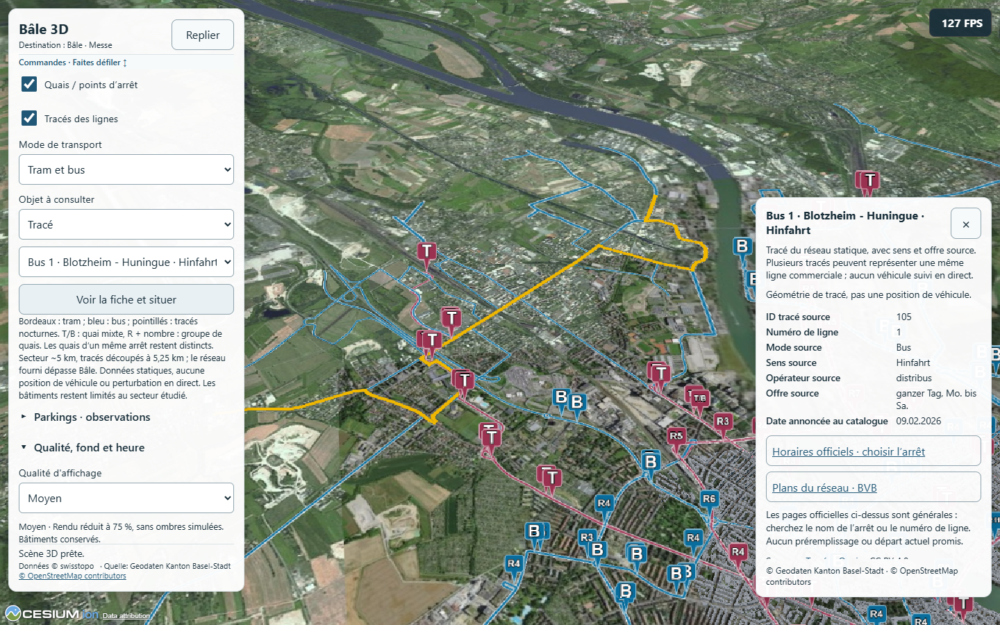
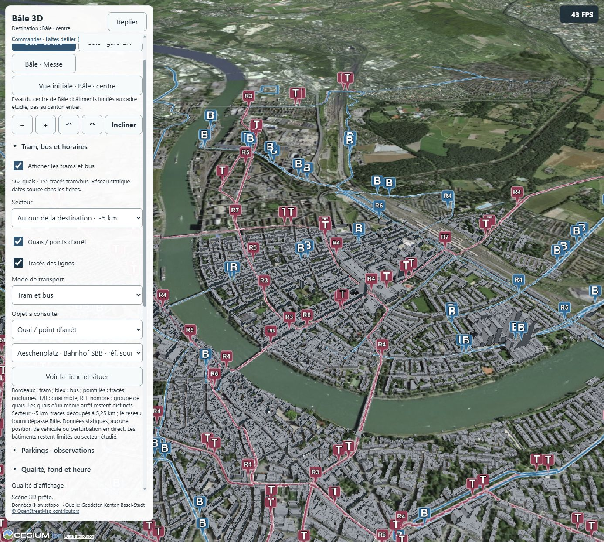

# B1 — Optimisation du fond des tracés Bâle

**Retour du 27 octobre :** le propriétaire indique que cela semble correct sur PC. Retour global positif, sans mesure ou détail de gestes supplémentaire déduit. La qualification A53 reste ouverte ; [l'extension aux tracés Jura](OPTIMISATION_JURA.md) est désormais planifiée, non encore implémentée.

26 octobre 2026, autorisée par « ok » après le [diagnostic Intel/RTX](DIAGNOSTIC_B1_TRACES.md). Base Git `60f78fe`, modèle/effort conservés, aucun sous-agent. **Ce lot change le rendu des tracés Bâle, pas les données ni le GPU Windows.** La qualification A53 reste à faire ; aucune nouvelle couche B2/B3 ou publication.

## Changement retenu

Le réseau de fond Bâle est dessiné dans des tuiles transparentes locales512×512, niveaux0–20, puis échantillonné sur le terrain par Cesium. Cela remplace les nombreuses polylignes terrain du fond, responsables du coût GPU observé sur Intel. Même géométrie d'affichage simplifiée1m/découpée5,25km ; toutes les identités et fiches source restent disponibles. Quais et regroupements inchangés. Pas de précision géographique ou verticale supplémentaire revendiquée, pas de donnée retirée pour améliorer le compteur.

Le clic recherche les tracés proches sur le terrain, vérifie une distance de8pixels CSS et conserve la priorité des objets Cesium au premier plan. Les superpositions proposent la liste des identités ; la ligne choisie reçoit une surbrillance vectorielle terrain temporaire. Couleurs tram/bus, contour blanc et pointillés nocturnes conservés. Largeur/lissage du réseau de fond dépendants de la tuile et du cadrage : ce n'est plus une épaisseur vectorielle constante à tous les niveaux. Le Jura garde son renderer P6.

Capture illustrative du probe PC ; son compteur instantané ne remplace pas les campagnes comparatives.

Fournisseur/cache propres au réseau retirés à chaque filtre/secteur, désactivation, erreur et destruction. Cache applicatif limité à24canvas non vides (512² pixels chacun), sans prétendre borner toute la mémoire de Cesium, les textures ou les images qu'il détient. Pas de persistance, nouveau service ou téléchargement d'images de réseau. Les erreurs de génération de tuile activent le réessai existant. [Architecture](ARCHITECTURE.md), [données et attributions](DONNEES.md).

## Contrôles

- `test-transport-raster.mjs` : projection, frontières de tuiles, proximité, identités multiples, absence de raccord entre portions disjointes et propriétés/géométrie source intactes. Tests territoires,18contrôles parkings, données B1 et géométrie P6/140tracés Jura conservés.
- `probe-transport-tiles.mjs` : pixels continus de part et d'autre d'une jointure, pointillés nocturnes présents, réutilisation du canvas,32tuiles générées/cache plafonné24, cache vidé et aucun rendu/recherche ressuscité après destruction idempotente. Rapport `.vite/b1-opt/tiles/probe-tiles.json`.
- Probe B1 compilé : six groupes/zéro erreur, terminé **20:51:56 Europe/Zurich**. Vrai clic sur un tracé proposant **six identités**, choix de fiche et surbrillance/fermeture, groupe de six quais, trois cadrages, mode/réseau entier/local, cache API, parkings simultanés. Une seule couche de fond après désactivation/destruction, deux avec les tracés ; pas d'accumulation. Panne API/réponse partielle et panne Canvas2D de tuiles injectées, erreur/réessai récupérés. Destruction pendant requête. Toucher simulé390×844 et722×274, commandes126px et crédits/conditions accessibles avec les deux couches.
- Compilations autonome `npm run build` et site Pages `npm run build:site`, contrôle fichiers/données/licences réussis. Avertissement de taille Cesium connu. Les tests purs sont ajoutés aux workflows existants ; aucun workflow distant déclenché.
- Probe complet Jura P1/P3/P4/P6 terminé à **20:58:22 Europe/Zurich**, zéro problème, sur le nouveau bundle (`probe-jura-final.json`). Parcours normal accueil/deux cartes/fiches/retours et tactile simulé terminé à **20:54:16**, quatre groupes/zéro erreur (`site-probe/probe-site.json`). Ces résultats ne sont pas réutilisés depuis le build précédent.

Les rapports initiaux ne sont pas des preuves finales : première version expérimentale accumulant des couches, corrigée avant le rapport final ; injection de panne d'abord trop large sur tous les canvas2D, recentrée sur les tuiles512. Rapports/journaux conservés séparément (`dev-check`, `dev-check2`, `failure-check`). Les gains du prototype (`prototype-intel`) ne remplacent pas les mesures finales du build compilé.

## Mesures finales

Chrome156 éphémère, renderer lu à chaque fenêtre, préférence GPU du processus seulement. Faible0,6/MSAA1/sans ombres,1386×1244 CSS/DPR1/tampon831×746, soleil21juin14UTC, secteur local et bâtiments actifs. Builds conservés avant index-C4MRW3TR.js / après index-Cq63BSHA.js. Leurs empreintes sont contrôlées avant un ajout éphémère d'accès au Viewer pour l'instrumentation, identique dans les deux variantes ; aucun paramètre de rendu changé par cet accès. Aucun autre test GPU lancé pendant les campagnes.

Trois vues × deux variantes ; ordre avant/après inversé à la gare. Réseau coupé puis complet, rotation supplémentaire au centre et référence coupée répétée ;2,5s de stabilisation puis8lectures à1s. **16fenêtres/128lectures par GPU**, Intel **21:01:33–21:07:07**, RTX **21:07:51–21:13:29 Europe/Zurich**. Caméras, géométries affichées et identités filtrées égales dans les paires complètes. Aucune erreur JavaScript ou requête échouée enregistrée.

| GPU | Vue, quais et tracés | FPS médian avant → après | GPU médian ms avant → après | CPU soumission ms avant → après |
| --- | --- | --- | --- | --- |
| Intel UHD | Centre | 14 → 64 | 70.02 → 15.25 | 2.60 → 2.60 |
| Intel UHD | Gare CFF | 14 → 48 | 69.12 → 20.34 | 2.80 → 3.20 |
| Intel UHD | Messe | 23 → 84 | 41.95 → 10.83 | 2.20 → 2.00 |
| RTX4080Laptop | Centre | 143 → 143 | 5.35 → 4.65 | 3.10 → 2.80 |
| RTX4080Laptop | Gare CFF | 140 → 143 | 5.21 → 4.73 | 5.90 → 2.70 |
| RTX4080Laptop | Messe | 143 → 144 | 4.94 → 4.07 | 2.50 → 2.00 |

Rotation centre Intel : **14 → 60FPS**, GPU65.41 → 14.71ms, intervalles ≥100ms8 → 1.

Rotation centre RTX : **138 → 127FPS**, GPU4.96 → 3.88ms, intervalles ≥100ms1 → 1.

GPU : requêtes EXT_disjoint_timer_query_webgl2 non disjointes entre preRender/postRender ; CPU : durée de soumission de ce rendu, pas profil CPU complet. Les intervalles sont ceux de preRender, pas une observation de blocages indépendants par un humain. Instrumentation susceptible d'affecter la cadence. Caches ordinaires, charge externe, fréquences et puissance non verrouillées ; références répétées conservées dans les rapports. Pas de pourcentage causal global, de garantie30FPS ou de conclusion Android déduite. Le GPU de l'onglet intégré utilisateur n'est pas forcé ; sa fluidité après rechargement reste un retour distinct à recueillir.

Les références Intel sans réseau varient aussi : au centre64–65FPS dans ces fenêtres, gare49avant/48après, Messe97avant/82après. La baisse à Messe sans réseau n'est pas masquée par le gain des tracés ; charge/fréquences/conditions non verrouillées. Sur RTX en rotation,138→127FPS malgré un temps GPU moindre : pas de gain uniforme revendiqué ni de cause isolée de cette variation.

Rapports `.vite/b1-opt/paired-low.json` et `paired-high.json`, script `measure-final.mjs`, empreintes `built-inputs.json`. Premier lancement de l'instrumentation du bundle échoué avant toute mesure (`paired-low-instrumentation-error.json`) : conservé et exclu. Prototypes et contrôles de développement distincts des campagnes compilées finales.

## Contrôle de l'onglet intégré ChatGPT

Après remplacement de la preview4306, rechargement du seul onglet Bâle existant avec la procédure computer-use et les API navigateur dédiées. Nouveau bundle `index-Cq63BSHA.js` relu dans le DOM, état « Scène 3D prête »,562quais/155tracés, GPU toujours Intel UHD0xA788. **Compteurs ponctuels43–48FPS avec les tracés**, Auto terminé en **Moyen**, dernière mesure Auto44FPS. L'ancien relevé14–17 était en Faible : cette observation positive n'est pas une comparaison instrumentée à preset constant, et ne remplace pas les campagnes ci-dessus. Pas de réglage GPU Windows ou de qualité forcé.

La case Tracés était désactivée à la reprise de l'onglet. Elle a été activée pour le contrôle puis remise désactivée ; transports actifs, préférenceAuto et destination centre conservés. `.vite/b1-opt/iab-final.json`, capture choisie ci-dessous. Aucun onglet utilisateur fermé, aucun nouvel onglet ouvert. Retour PC global positif reçu le27octobre ; qualification A53 physique toujours ouverte.

## Reprise

Conserver `.vite/b1-opt/` : prototype et journaux d'échec, builds, rapports B1/Jura/site/tuiles, campagnes GPU, empreintes et contrôle final. La preview4306 sert `.vite/b1-opt/site-final/`. Ancien B1 `.vite/b1/site-delivery/` conservé. Ne pas réutiliser aveuglément des ports Android : aucun appareil utilisé dans ce lot. Après qualification PC, A53 en Faible, trois cadrages/quais/tracés/ensemble, groupes/fiches/liens, deux orientations, durée/chauffe et restauration des accès/préférences. B1 reste ouvert jusqu'à ce contrôle ; B2/B3 différés, aucun push/déploiement.
