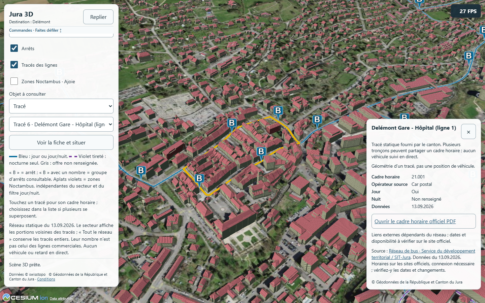

# Complément P6 — Rendu en tuiles des tracés du Jura

27 octobre 2026. Extension autorisée après le retour PC positif sur Bâle et la demande du propriétaire. Base `582f666`, dépôt trouvé propre ; même modèle/effort, aucun sous-agent. Les preuves P5/P6/P7 historiques restent attachées à leurs versions et réserves. Aucune publication ni modification Android dans ce lot.

## Réalisation

Les configurations Jura et Bâle choisissent explicitement `lineRenderer: 'terrain-imagery'`. Le renderer ne dépend plus du schéma bâlois ; `ground-polyline` ou l'absence d'option conserve la voie native, une valeur inconnue est rejetée. La normalisation et les fiches propres aux territoires restent séparées.

Le Jura réutilise `transport-imagery.js` et `transport-raster-geometry.js`, sans les modifier : tuiles Canvas 512², niveaux 0–20, cache propre limité à 24 canvas non vides, aucune requête de tuile supplémentaire ni persistance. Cette limite ne borne pas toute la mémoire/textures de Cesium. Géométries P6 simplifiées à 1 m et découpées à 5,25 km en secteur local, identités et attributs conservés. Les sept fichiers Jura livrés ont des empreintes identiques à la référence `.vite/b1-opt/site-final/jura/jura/` (`inputs.json`).

Arrêts/groupes, fiches/liens, couleurs jour bleues et nuit seule violettes en pointillés conservés. Une ligne choisie reçoit une surbrillance native temporaire, retirée à la fermeture. Recherche des tracés au clic terrain puis contrôle à 8 pixels CSS ; liste des identités superposées. Les deux zones Noctambus restent des polygones distincts, avec leurs fiches/trous ; elles ne bloquent pas le choix d'une ligne sous le clic. Les arrêts, bâtiments et objets d'autres couches au premier plan gardent leur priorité. Patrimoine, bâtiments, destinations, sources et conditions inchangés.

Largeur/lissage du fond dépendent du niveau de tuile et de la vue : aucune fidélité d'épaisseur vectorielle ou précision géographique nouvelle revendiquée. Le gain observé à Bâle ne suffit pas à prouver celui du Jura, dont le réseau local est moins dense.

## Vérifications

Tests purs de configuration, 18 contrôles parkings, données B1, géométrie des 140 tracés et géométrie raster réussis. Compilations autonome et site Pages réussies, contrôles des fichiers/données/licences réussis ; avertissement de taille Cesium connu.

Un premier lancement de preview sans la base `/jura3d/` a servi l'accueil à la place de la carte ; le probe a expiré avant les interactions. Configuration de preview corrigée, journal `probe-wrong-base.log` conservé et exclu des preuves.

Premier parcours sur la variante initiale : P1/P3 réussis, clics et fiches de lignes dans les quatre localités réussis ; échec ensuite lors du balayage de toutes les cibles avec les zones actives. Reproduction isolée : un groupe d'arrêts fournit un tableau et `EntityCollection.contains` exige une entité avec un identifiant chaîne/nombre (`DeveloperError: key is required to be a string or number`). Résolution des objets pointés corrigée dans l'adaptateur partagé ; le balayage exhaustif est conservé comme régression, pas évité en s'arrêtant à la première cible valide. Rapports `probe-zone-target-failure.log`, `repro-zone*.json/log/png` conservés séparément, puis nouvelle compilation et relance complète.

## Résultats PC finaux

Probe complet Jura P1/P3/P4/P6 terminé le **27.10.26 04:03:39 Europe/Zurich**, zéro problème. Quatre localités, vraies lignes et listes de superpositions, choix/surbrillance/fermeture, arrêts/groupes, filtres jour/nuit, réseau entier/local, zones Noctambus, coexistence patrimoine, chargement différé/cache, bascules, erreurs HTTP/données et Canvas 512², réessai puis destruction sans couche résiduelle. Interface portrait/paysage et toucher simulés, sans preuve Android déduite. Les assertions supplémentaires vérifient aussi le retrait des surbrillances et le nombre de couches d'imagerie (1 sans tracés, 2 avec), dont le balayage de toutes les cibles avec les zones actives.

Régression Bâle : **27.10.26 04:05:28**, 6 groupes/zéro erreur, clics/groupes/quais/fiches, filtres, panne/réessai/destruction, parkings simultanés et tactile simulé. Parcours normal accueil/deux cartes/retours : **27.10.26 04:06:35**, 4 groupes/zéro erreur. Tests pixels/jointures/pointillés/cache du fournisseur B1 du 26 octobre réutilisés : ses deux modules sont inchangés ; intégration Jura testée à neuf. Rapports finaux dans .vite/jura-opt/probe-jura.json, probe-transport.json, basel/probe-transit.json et site/probe-site.json.

## Comparaison compilée avant/après

Avant : .vite/b1-opt/site-final/jura/, polylignes terrain P6. Après : build final du présent lot. Empreintes des bundles vérifiées avant instrumentation identique donnant temporairement accès au Viewer ; aucune modification du rendu par cet accès. Chrome éphémère, GPU effectif Intel UHD0xA788 puis RTX 4080 Laptop lu à chaque fenêtre, qualité Faible (échelle 0,6, MSAA 1, sans ombres), 1386×1244 CSS/DPR 1/tampon 831×746, bâtiments actifs/patrimoine et zones désactivés, soleil du 21 juin à 14 UTC, secteur local. Aucun réglage GPU Windows ou profil utilisateur modifié, aucun autre essai GPU lancé en parallèle.

Quatre localités, ordre inversé à Porrentruy et Saint-Ursanne ; pour chaque variante : coupé, lignes seules, arrêts+lignes, rotation de cet ensemble puis référence coupée répétée. Chaque fenêtre : stabilisation de 2,5 s puis 8 lectures à 1 s. **40 fenêtres/320 lectures par GPU**. Intel **27.10.26 04:06:38–27.10.26 04:15:29**, RTX **27.10.26 04:15:30–27.10.26 04:24:02**, Europe/Zurich. Cadrage, heure, résolution, réglages, identités filtrées et géométries égaux dans les paires, assertions automatiques. Zéro erreur JavaScript/requête échouée ou HTTP≥400 relevée.

| GPU | Vue | FPS lignes seules avant → après | FPS arrêts+lignes avant → après | GPU ms ensemble avant → après | CPU soumission ms ensemble avant → après |
| --- | --- | --- | --- | --- | --- |
| Intel UHD | Delémont | 45 → 67 | 45 → 67 | 20.36 → 13.20 | 17.20 → 12.00 |
| Intel UHD | Porrentruy | 61 → 79 | 59 → 76 | 14.91 → 11.46 | 13.80 → 11.20 |
| Intel UHD | Saignelégier | 87 → 120 | 92 → 110 | 9.01 → 6.59 | 7.90 → 7.70 |
| Intel UHD | Saint-Ursanne | 103 → 145 | 103 → 135 | 8.21 → 5.43 | 3.20 → 6.30 |
| RTX 4080 Laptop | Delémont | 192 → 75 | 170 → 64 | 1.66 → 5.31 | 4.90 → 14.00 |
| RTX 4080 Laptop | Porrentruy | 105 → 99 | 105 → 95 | 3.14 → 3.40 | 8.80 → 9.70 |
| RTX 4080 Laptop | Saignelégier | 144 → 142 | 137 → 139 | 1.24 → 1.30 | 6.50 → 6.60 |
| RTX 4080 Laptop | Saint-Ursanne | 153 → 168 | 147 → 168 | 0.59 → 0.44 | 6.00 → 5.30 |

Rotation (bouton à 250 ms, même protocole) :

| GPU | Vue | FPS avant → après | GPU ms avant → après | Intervalles ≥100ms avant → après |
| --- | --- | --- | --- | --- |
| Intel UHD | Delémont | 43 → 54 | 20.17 → 13.18 | 5 → 5 |
| Intel UHD | Porrentruy | 48 → 60 | 15.62 → 11.66 | 2 → 2 |
| Intel UHD | Saignelégier | 90 → 96 | 9.01 → 6.48 | 2 → 2 |
| Intel UHD | Saint-Ursanne | 109 → 128 | 7.72 → 5.13 | 2 → 1 |
| RTX 4080 Laptop | Delémont | 98 → 50 | 2.85 → 5.30 | 3 → 5 |
| RTX 4080 Laptop | Porrentruy | 80 → 79 | 3.71 → 4.13 | 2 → 2 |
| RTX 4080 Laptop | Saignelégier | 111 → 115 | 1.49 → 1.56 | 2 → 2 |
| RTX 4080 Laptop | Saint-Ursanne | 145 → 144 | 0.61 → 0.72 | 1 → 1 |

Références sans transport, première / dernière fenêtre :

| GPU | Vue | Avant | Après |
| --- | --- | --- | --- |
| Intel UHD | Delémont | 60 / 57 | 68 / 68 |
| Intel UHD | Porrentruy | 77 / 75 | 75 / 79 |
| Intel UHD | Saignelégier | 121 / 125 | 126 / 117 |
| Intel UHD | Saint-Ursanne | 138 / 159 | 146 / 139 |
| RTX 4080 Laptop | Delémont | 195 / 184 | 197 / 97 |
| RTX 4080 Laptop | Porrentruy | 108 / 114 | 97 / 100 |
| RTX 4080 Laptop | Saignelégier | 150 / 141 | 140 / 135 |
| RTX 4080 Laptop | Saint-Ursanne | 154 / 127 | 163 / 162 |

Le premier passage RTX à Delémont est instable : référence sans transports 195/184 FPS avant, 197/97 après ; ensemble 170→64 FPS et GPU 1,66→5,31 ms. Cette baisse reste dans les résultats, pas attribuée au renderer seul. Un relevé matériel ponctuel pendant la campagne indique P5/600 MHz (rtx-state-during-main.json) ; il ne reconstitue pas les fréquences des fenêtres précédentes et n'établit pas une cause.

### Contrôle ciblé RTX Delémont

Une seule répétition diagnostique A/B/B/A (avant/après/après/avant), mêmes paramètres et 20 fenêtres/160 lectures, **27.10.26 04:24:59–27.10.26 04:29:20 Europe/Zurich**. Relevés nvidia-smi avant/après chaque fenêtre, hors mesure, sans fixer les fréquences ou modifier le mode d'alimentation. Cadrage/heure/dimensions/géométries/identités appariés et zéro erreur enregistrée. Ce complément conserve les variations et ne remplace pas la campagne principale ; pas de répétitions jusqu'à obtenir un résultat favorable.

| Passage | FPS coupé initial / final | FPS ensemble | GPU ms ensemble | FPS rotation | Fréquence graphique relevée | Fréquence mémoire relevée |
| --- | --- | --- | --- | --- | --- | --- |
| 1 · avant | 75 / 95 | 67 | 5.00 | 60 | 600–1440 MHz | 810–9301 MHz |
| 2 · après | 97 / 101 | 89 | 3.89 | 59 | 510–1455 MHz | 810–9301 MHz |
| 3 · après | 104 / 97 | 99 | 3.53 | 61 | 660–1605 MHz | 810–9301 MHz |
| 4 · avant | 99 / 99 | 96 | 3.50 | 59 | 555–1410 MHz | 810–9301 MHz |

Rapport rtx-repeat.json, journal et script measure-repeat.mjs. Les lectures matérielles sont ponctuelles, pas une télémétrie continue ni un verrouillage de la charge externe.

**Bilan PC :** le coût GPU diminue sur les quatre vues Intel mesurées. Sur RTX, le dernier passage de l'ancien rendu donne 96 FPS/3,50 ms, contre 99 FPS/3,53 ms pour le passage précédent du nouveau rendu ; la forte différence initiale de Delémont n'est pas reproduite comme un écart stable entre variantes. Les fréquences et références restent variables, sans cause système isolée et sans gain uniforme RTX démontré. Le rendu est retenu pour son bénéfice Intel et ses fonctions vérifiées ; cela ne clôt pas la qualification physique A53.

GPU : EXT_disjoint_timer_query_webgl2 non disjointes entre preRender/postRender. CPU : soumission de ce rendu seulement, pas profil CPU complet. Intervalles preRender, pas mesure indépendante de blocages perçus. Caches ordinaires, charge externe, puissance/fréquences non verrouillées ; instrumentation susceptible d'affecter les cadences. Les références répétées et toutes les variations sont conservées, pas de pourcentage causal global ou de gain uniforme garanti. Ces résultats ne qualifient ni l'onglet intégré ChatGPT ni Android. Rapports paired-low/high.json et journaux, script measure.mjs, sources figées inputs.json.

Builds finaux : Jura **index-eTTQp0XO.js**, Bâle **index-Dcj5VX8M.js**, CSS index-BIPXuHPI.css, révision locale null. Preuves/empreintes finales : final-check.json. Aperçu local 4306 depuis .vite/jura-opt/site-final/ ; références antérieures conservées.

## Qualification physique et suite

Qualifier ensuite l'A53 en Faible pour Bâle et Jura lorsqu'il sera disponible, en recontrôlant identité/accès, gestes/groupes/fiches/liens, deux orientations, durée/chauffe et restauration des préférences/accès créés. Les simulations PC et anciennes campagnes P6/P8 ne remplacent pas cette qualification du nouveau rendu. B1 Bâle reste ouvert pour ce contrôle ; B2 lieux/patrimoine puis B3 services restent différés, P9 non commencé.

Conserver `.vite/jura-opt/` et les références `.vite/b1-opt/`, `.vite/b1-perf/`, P5/P6/P7/P8/PUB2. Sauvegarde locale autorisée ; aucun push/déploiement ou réglage GPU Windows. La version publique n'est pas mise à jour par ce lot.
