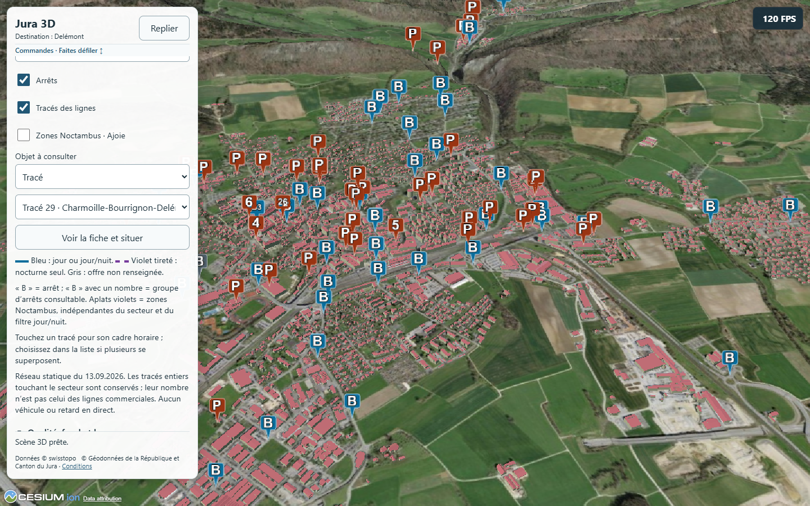

# Publication de test sur GitHub Pages

**26 octobre 2026 — PUB2 préparé localement :** accueil commun, accès Jura/Bâle et retour au choix ; assemblage et workflow manuel adaptés sans envoi ni déploiement. [État, revue et procédure PUB2](PUBLICATION_PUB2.md). Le site effectivement publié reste PUB1 Jura `29a4089`. La suite de ce document conserve la preuve historique de cette première publication.

25 octobre 2026 — étape ajoutée entre P7 et P8 à la demande du propriétaire. La publication n'était pas un lot explicite du plan ; le dépôt avait seulement un contrôle de compilation GitHub Actions. Le propriétaire autorise les commits, l'envoi et le déploiement nécessaires à cette publication. L'ancienne consigne « aucun commit/push/déploiement » reste historique pour P1–P7 ; elle ne bloque pas cette opération autorisée.

## État

**Site public disponible et vérifié : [https://jackseg80.github.io/jura3d/](https://jackseg80.github.io/jura3d/).** Première publication terminée le 25 octobre 2026 à **21:40:13 Europe/Zurich**, contrôle Chrome public terminé à **21:41:01**. Commit servi : `29a4089a94bd5a3a5626da5c33cf1c1276a497ae`. P8 Bâle non commencé au moment de PUB1, depuis qualifié localement avec réserves.

Le lien fonctionne depuis un navigateur connecté à Internet, sans serveur PC ni câble. Aucun nouveau parcours sur appareil Android physique n'a été effectué lors de la publication ; les réserves P6 restent applicables.

## Configuration PUB1 et historique de mise à jour

- Source : dépôt public `jackseg80/jura3d`, branche `main`.
- `.github/workflows/build.yml` vérifie les push et pull requests sans publier.
- `.github/workflows/pages.yml` publie uniquement sur déclenchement manuel, depuis `main`. Installation verrouillée `npm ci`, tests configuration/géométrie, build et contrôle des fichiers avant envoi de `dist/` à GitHub Pages. Aucun secret ajouté.
- Permissions de publication limitées au job de déploiement : `pages: write` et `id-token: write`, environnement `github-pages`. Les pushes ultérieurs ne publient pas automatiquement.
- `JURA3D_BASE_PATH=/jura3d/` adapte les chemins Vite, données et Workers/Assets Cesium ; le défaut `/` conserve l'aperçu local. `VITE_TERRITORY=jura` est fixé pour le site public.
- La licence CesiumJS et son inventaire tiers sont livrés sous `cesiumStatic/LICENSE.md` et `cesiumStatic/ThirdParty.json`.
- `build-info.json` identifie le commit Actions, la base et le territoire servis. En build local, la révision vaut `null` pour ne pas attribuer des modifications non committées à un ancien commit.

Commandes historiques PUB1. Pour la préparation actuelle à deux territoires et sa future publication, suivre [PUB2](PUBLICATION_PUB2.md), notamment le nouveau probe de site commun :

```powershell
git push origin main
gh workflow run pages.yml --ref main
gh run list --workflow pages.yml --limit 3
# Après réussite du déploiement :
$env:JURA3D_URL='https://jackseg80.github.io/jura3d/'
$env:JURA3D_EXPECTED_REVISION='<SHA du commit déployé>'
$env:JURA3D_PROBE_GPU='high'
node scripts/probe-published.mjs
```

Ne pas forcer un push ni écraser une divergence. Un commit documentaire après publication peut être plus récent que le site : c'est attendu, puisque la publication est manuelle. Consigner séparément le commit servi et le dernier état du dépôt. Pour revenir à une version antérieure, construire/publier une révision examinée via un workflow adapté explicitement, ou rétablir les fichiers sur `main` par un nouveau commit ; ne pas réécrire l'historique. Aucune ancienne version Pages ne précède cette première publication.

## Vérification

**Avant publication, 25 octobre à 21:37:23 Europe/Zurich :** tests configuration/géométrie et contrôles des builds racine/sous-dossier réussis. Probe complet P1/P3/P4/P6 sur `127.0.0.1:4304/jura3d/` réussi, Chrome 156.0.8078.47/RTX 4080 Laptop GPU, zéro erreur. Les 400 fichiers du build éprouvé sont identiques après ajout des deux fichiers de licence ; aucun second parcours complet nécessaire pour ces seuls ajouts statiques. Rapport local `.vite/publication/probe-before-publish.json` et inventaire `tested-build-hashes.json`.

Avant publication : compilation locale `/` et `/jura3d/`, présence des sept fichiers cantonaux/conditions et ressources Cesium, tests de configuration et des 140 tracés. Probe complet des interactions 3D sur le build en sous-dossier. Ensuite : réussite Actions, lecture HTTPS de la révision servie et contrôle Chrome normal sans `?probe` : navigation des quatre localités, patrimoine/transports/fiches, lien de conditions, crédits et absence d'erreurs de ressources. Ces contrôles PC ne prouvent pas de nouvelles performances Android.

Les rapports temporaires restent ignorés dans `.vite/publication/`. Les sources, données préparées et images de documentation choisies sont versionnées ; ni `node_modules/`, `dist/`, archives/caches temporaires, captures de probe ou secrets ne sont envoyés. L'inventaire initial a contrôlé 120 fichiers (~74,7 Mo), aucun fichier > 10 Mo et aucun motif de clé privée/token détecté ; il s'agit d'un contrôle ciblé, pas d'une certification générale.

## Données et limites de diffusion

Publication d'un prototype exploratoire : dépendance au réseau, instantanés cantonaux et liens externes, absence de suivi des bus en direct, limites A53/Tab S8 conservées. Les deux crédits restent visibles et les conditions cantonales restent jointes. Aucun changement de licence des données ni copie des PDF de fiches individuelles.

Les [conditions FSDI](https://www.geo.admin.ch/en/general-terms-of-use-fsdi), relues le 25 octobre 2026, permettent l'intégration sous conditions d'attribution et de fair use. Elles donnent comme repère les applications web ayant en moyenne 20 000 utilisateurs par jour ; ce chiffre n'est ni une capacité mesurée de Jura 3D ni une garantie. Cette mise en ligne de test n'est pas une campagne de diffusion à grande audience. Revoir trafic et conditions avant une telle diffusion.

Références techniques consultées le 25 octobre : [Vite et le sous-dossier GitHub Pages](https://vite.dev/guide/static-deploy.html#github-pages), [workflow Pages personnalisé](https://docs.github.com/en/pages/getting-started-with-github-pages/using-custom-workflows-with-github-pages). Les conditions cantonales préparées en P2 restent applicables, voir [DONNEES.md](DONNEES.md).

## Résultat vérifié

- Commit applicatif/publication : [`29a4089`](https://github.com/jackseg80/jura3d/commit/29a4089a94bd5a3a5626da5c33cf1c1276a497ae), contenant les évolutions Jura P1–P7 auparavant locales et les fichiers de publication, sans perte des modifications existantes.
- [Compilation CI](https://github.com/jackseg80/jura3d/actions/runs/40231781138) et [déploiement manuel Pages](https://github.com/jackseg80/jura3d/actions/runs/40231805506) réussis, jobs build/deploy terminés. Mode `workflow`, HTTPS imposé ; aucun domaine personnalisé.
- Lecture de [`build-info.json`](https://jackseg80.github.io/jura3d/build-info.json) : révision exacte ci-dessus, territoire `jura`, base `/jura3d/`, source `github-actions`.
- Contrôle Chrome **sans `?probe`** du 25 octobre **21:40:42–21:41:01 Europe/Zurich** réussi : quatre destinations prêtes, retour initial, patrimoine/arrêts/fiches et fiche de tracé, conditions PDF HTTP 200/signature correcte, crédits visibles, zéro erreur JavaScript/ressource relevée. Qualité Moyen fixée pour le contrôle PC ; aucune conclusion de performance ou validation Android déduite. Les liens d'horaires externes ne sont pas tous ouverts ni requalifiés.
- Sept ressources cantonales servies identiques par SHA256 aux blobs du commit publié ; licence et inventaire tiers identiques aux fichiers du paquet installé. Les deux index de contrôle de liens avaient des fins de ligne CRLF dans le dossier Windows : Git les livre en LF. Leur contenu JSON est identique ; cette seule normalisation explique la différence d'empreinte avec le build local, aucune modification d'attributs.
- Rapports locaux ignorés : `.vite/publication/probe-before-publish.json`, `tested-build-hashes.json`, `published-probe.json`, `host-check.json`, journaux de build/Actions et inventaires de revue. Capture de rendu sélectionnée et examinée ci-dessous ; aucun navigateur utilisateur ni réglage Android modifié. Preview de contrôle 4304 arrêtée, preview locale 4300 conservée.
- Un commit documentaire ultérieur enregistre le bilan et peut être plus récent sur `main` que le commit public. Il ne déclenche pas de déploiement. La version servie reste identifiée par son marqueur ; toute prochaine publication exige un déclenchement explicite autorisé.



Point mineur à harmoniser ultérieurement : l'aide bus contient encore la phrase P4 « les tracés entiers touchant le secteur sont conservés ». Depuis P6, les portions du secteur sont découpées à 5,25 km ; le réseau entier reste disponible via le sélecteur. Le rendu, la documentation P6/P7 et le README décrivent déjà cette différence. Aucune nouvelle correction fonctionnelle introduite dans PUB1.
