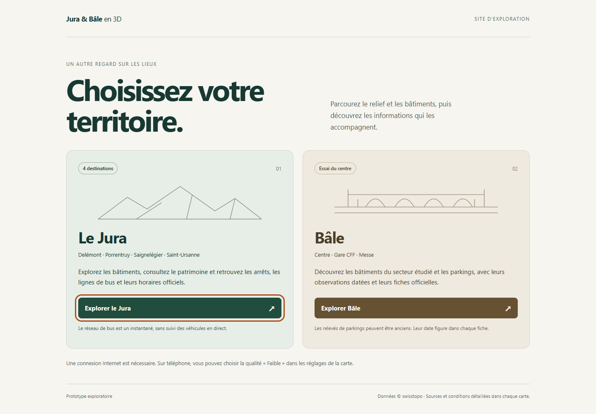

# PUB2 — Accueil commun Jura et Bâle

**Après B1, 26 octobre :** la preview commune4306 sert désormais l'assemblage `.vite/b1/site-delivery/` avec les transports Bâle. Les builds et rapports PUB2 ci-dessous sont conservés comme références antérieures ; [B1](VALIDATION_B1.md) donne les nouvelles vérifications, empreintes et limites. Aucun nouveau déploiement, qualification A53 B1 ouverte.

**Revue du 26 octobre :** mise à jour des documents et commit de sauvegarde autorisés. Le propriétaire confirme l'ordre transports → lieux/patrimoine → services et juge insuffisant le Bâle limité aux parkings : [plan révisé](PLAN_BALE_ENRICHISSEMENT.md). Publication différée ; aucun push/déploiement exécuté par cette sauvegarde. Les mentions « aucun commit autorisé » ci-dessous décrivent l'autorisation initiale de préparation, désormais complétée pour le commit seulement.

26 octobre 2026. Préparation locale autorisée par « ok » après la proposition d'un accès commun. **Aucun commit, push ou déploiement autorisé par cette préparation.** PUB1 reste le seul site effectivement publié : Jura `29a4089`, à l'adresse https://jackseg80.github.io/jura3d/. Les modifications P8 et les preuves PC/A53 sont préservées ; P9 non commencé.

## Résultat préparé

- Accueil statique français : deux entrées « Explorer le Jura » / « Explorer Bâle », clavier et affichage étroit. Aucun Cesium, géodonnée, police ou service distant chargé à l'accueil ; illustrations vectorielles décoratives écrites dans le projet.
- Une page par territoire, navigation normale du navigateur. Dans le panneau de chaque carte, lien « Choisir un territoire » vers l'accueil ; panneau replié à ouvrir sur téléphone. Aucun changement de ville dans une scène active ni deux cartes chargées ensemble.
- Avec la base GitHub Pages `/jura3d/` : accueil `/jura3d/`, Jura `/jura3d/jura/`, Bâle `/jura3d/bale/`. L'ancienne adresse d'accueil Jura deviendrait le choix des territoires lors d'une future publication. Les données Jura se trouvent dans le sous-dossier de son application, dont les chemins sont recalculés au build.
- Réglage de qualité partagé par origine comme auparavant ; revenir à l'accueil ne l'efface pas. Aucune réinitialisation de préférences, de navigateur ou de réglage système.
- Bâle garde le cadre centre/gare/Messe, les seize parkings avec observations datées, ses sources et crédits. Aucune extension, arbre, forêt, pont ou nouvelle ville ajouté. Le dessin de pont sur l'accueil est une illustration, pas une couche de données.

## Compilation et contrôle

`npm run build` conserve une seule application autonome et ses variables habituelles. `npm run build:site` construit les deux configurations dans le dossier dédié ignoré `dist-site/`, puis génère l'accueil et un `build-info.json` commun ; chaque enfant possède également son marqueur. La révision locale reste null ; en Actions, même `GITHUB_SHA` pour les trois marqueurs.

Le constructeur refuse de remplacer un dossier `dist-site/` non vide dépourvu de son marqueur `kind: territory-site`. Son chemin de sortie est fixe dans ce dépôt ; aucun nettoyage de `.vite/`, de `dist/` ou d'un chemin libre. Une compilation interrompue reste marquée `status: building`, et le contrôle exige `ready`.

`JURA3D_BASE_PATH` définit la racine commune. Le constructeur fixe `VITE_TERRITORY`, la base de chaque enfant et `JURA3D_SITE_HOME`. Cette dernière variable est réservée au lien d'accueil : chemin local validé, parent de la base de la carte ; absente pour une compilation autonome. Le lien est inséré au build dans le panneau défilant, sans modifier les algorithmes de rendu ou la configuration des sources.

```powershell
$env:JURA3D_BASE_PATH='/jura3d/'
npm run build:site
node scripts/check-site.mjs dist-site /jura3d/
node node_modules/vite/bin/vite.js preview --outDir dist-site --host 127.0.0.1 --port 4306 --strictPort
# Autre terminal :
$env:JURA3D_URL='http://127.0.0.1:4306/jura3d/'
$env:JURA3D_PROBE_GPU='high'
npm run probe:site
```

La preview conservée pour la revue utilise une copie du build Pages sous `.vite/pub2/pages-dist/`, sur **http://127.0.0.1:4306/jura3d/**. Un second assemblage à la racine `/` est vérifié dans `dist-site/`. Les anciennes previews 4300/4305 et leurs builds P8 restent conservés.

Contrôles des fichiers : accueil/liens/bases/marqueurs cohérents, données Jura complètes, aucune donnée Jura livrée à Bâle, Workers/Assets/licences Cesium, révision commune. Tests configuration, 18 cas parkings et géométrie des 140 tracés exécutés et réussis. Trois liens d'accueil invalides refusés : externe, hors parent ou vers la carte elle-même. Sept fichiers cantonaux identiques par SHA256 à P8, moteur et sources inchangés ; références physiques et builds P8 conservés.

## Résultats PC

- Chrome **156.0.8078.47/RTX 4080 Laptop GPU**, processus de test isolés. Aucun réglage Windows global ni nouvel accès Android.
- Parcours commun **sans diagnostic terminé à 14:02:28 Europe/Zurich** : accueil sans service externe, clavier, Jura quatre destinations/patrimoine/bus/fiches/PDF, Bâle trois destinations/parkings/fiches/liens, crédits et retours à l'accueil ; **zéro erreur**. Accueil vérifié à **320×700, 390×844, 722×274**, liens tactiles ≥44 px et retours depuis les cartes en portrait/paysage simulés. Captures examinées, sans débordement horizontal.
- Probe complet Jura P1/P3/P4/P6 **terminé à 14:12:47 Europe/Zurich**, zéro erreur. Navigation/caméra/sélection, presets et récupération, gestes, douze fiches de patrimoine/groupes/filtres, bus/secteurs/tracés/groupes/liens et pannes contrôlés sur le nouvel emplacement.
- Probe Bâle six groupes **terminé à 14:15:58 Europe/Zurich**, zéro erreur : modèle et adresse réelle, absence de doublon, trois fiches/positions, fraîcheur et cache, pannes/réessais/annulation et toucher simulé. Contrôle du cycle de vie Jura réussi, dont destruction pendant six requêtes : aucune source tardivement réactivée ; rapport daté 14:08:28.
- Probe Bâle rendu reproductible depuis un checkout propre : les cas injectés réutilisent en mémoire le relevé déjà validé dans le parcours, sans dépendre de `.vite/p8/sources/records.json`. Aucun instantané ajouté à l'application ou au dépôt comme secours de disponibilité. Dernier résultat et horodatage dans `.vite/pub2/basel/probe-basel.json`.
- Builds réussis : application Jura autonome, site à racine `/`, site sous `/jura3d/`. Avertissement Cesium >500 ko connu, pas d'échec de compilation.

Le nouvel accueil et le lien de retour n'ont pas été éprouvés sur Android physique. Les mesures A53 P8 restent celles de leurs empreintes conservées, sans nouvelle promesse de performance. Les contrôles locaux n'établissent ni publication, ni disponibilité permanente du fournisseur bâlois.

**Contrôle final à 14:16:37 Europe/Zurich :** sources/outils et fichiers du build stables depuis les contrôles, sept fichiers locaux servis conformes à leurs empreintes ; moteur, données et builds physiques P8 préservés. HEAD `24e42af`, index Git vide, diff contrôlé, site public toujours Jura `29a4089`. Aucun commit/push/déploiement. Rapport `.vite/pub2/final-check.json` avec empreintes des quatre rapports finaux ; manifests sources et build séparés.



[Accueil étroit simulé à 320 px](images/pub2-accueil-mobile-simule-2026-10-26.png).

## Incidents conservés

Le premier parcours commun s'arrête sur une tuile Bâle bloquée par CORS ; requête documentaire ultérieure de la même URL : HTTP 200 et `Access-Control-Allow-Origin: *`. Aucun proxy, contournement CORS, changement de serveur fournisseur ou de navigateur. Cause du premier échec non isolée ; tentative conservée et exclue de la validation finale.

Le premier probe complet Jura échoue sur son glissement tactile à coordonnées fixes : nouveau lien de retour, panneau ouvert couvrant la zone de geste. Test corrigé pour replier le panneau, vérifier que les points touchent réellement le canvas, puis rouvrir avant les commandes. Aucun correctif du moteur 3D déduit de cet échec. Un ancien rapport racine copié par l'enveloppe malgré l'échec a été identifié comme périmé et isolé sous `probe-jura-stale-on-failure.json` ; il ne constitue pas une preuve PUB2.

Le passage suivant termine P1 mais l'ancien filtre de requêtes patrimoine confond toute URL contenant `/jura/` avec un téléchargement de données : le nouveau chemin de l'application contient lui-même ce segment. Les contrôleurs patrimoine et cycle de vie ciblent désormais l'URL du dossier de données résolue depuis la page ; même correction pour l'interception des six requêtes du test de destruction. Ce sont des adaptations des preuves au sous-dossier, sans changement de chargement dans l'application. Journaux des deux échecs complets conservés séparément.

Preuves locales sous `.vite/pub2/`, références sources/P8 dans `baseline/` et `before.json`. Le probe Bâle accepte désormais `JURA3D_PROBE_OUTPUT` pour ne pas écraser les rapports P8 ; ses données injectées restent propres aux pages de test. Rapports finaux `probe-site.json`, `probe-jura.json`, `basel/probe-basel.json`, `lifecycle/probe-jura.json`, intégrité des données, empreintes des sources/builds et `final-check.json`. Ne pas supprimer les preuves P5/P6/P7/P8/PUB1.

## Publication future

Le workflow Pages local est préparé pour construire/vérifier puis envoyer **dist-site/**. Il reste exclusivement manuel, sur main, avec permissions limitées au job de déploiement. Le workflow CI compile l'application autonome et l'assemblage Pages, sans publier. Tests parkings ajoutés aux deux workflows. Aucun déclenchement Actions, stage, commit ou push réalisé par PUB2.

Après revue et autorisation explicite : vérifier les changements P8/PUB2, committer et envoyer le périmètre examiné, déclencher `pages.yml`, attendre la réussite et tester **le site public** avec `JURA3D_URL` et `JURA3D_EXPECTED_REVISION` puis `npm run probe:site`. `probe-published.mjs` reste le contrôleur historique du site PUB1 Jura seul. Une réussite locale ne prouve pas le déploiement, le CORS depuis GitHub Pages ou une performance Android du nouvel assemblage.

Limites P8 conservées : FPS et pauses A53 variables, S23 non testé, observations parkings encore anciennes ; les liens d'horaires/parkings externes ne sont pas tous requalifiés. Aucun nouveau test physique Android PUB2. La publication exige un contrôle HTTPS réel des deux cartes et de leurs crédits/conditions, en plus de la révision.
