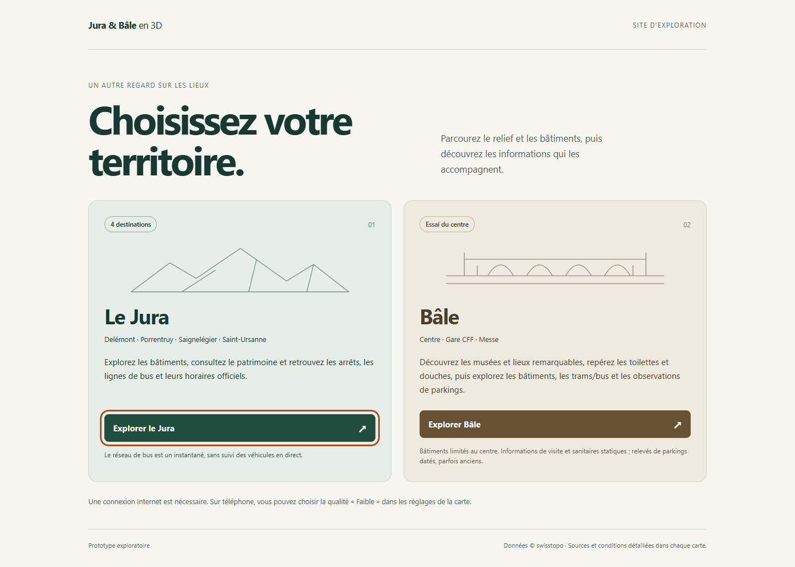

# Revue locale PUB2 après enrichissement de Bâle

27 octobre 2026. Base `6981792`, Git propre à la reprise ; commits locaux autorisés, aucun push ou déploiement. Revue des livrables B1/B2/B3 clos avec réserves, sans ajout de ville ou de couche. **Revue locale terminée avec succès ; publication en attente d’accord explicite.**

## Périmètre présenté au visiteur

| Entrée | Contenu disponible | Limites conservées |
| --- | --- | --- |
| Jura | Quatre destinations, relief/bâtiments swisstopo, patrimoine et réseau de bus avec fiches/liens officiels. | Instantanés cantonaux datés, pas de suivi des véhicules ou départs en direct. |
| Bâle | Centre/gare CFF/Messe, bâtiments cantonaux dans le cadre étudié, tram/bus/quais, lieux à visiter, sanitaires et observations de parkings. | Couverture des bâtiments limitée au centre ; les couches peuvent dépasser ce cadre. Données de visite/sanitaires statiques, parkings datés et parfois anciens. Pas d'ouverture actuelle, d'accès universel ou de disponibilité garantie. |

Sources et qualifications : [B1](VALIDATION_B1.md), [correction mobile](CORRECTION_BALE_A53.md), [B2](VALIDATION_B2.md), [B3](VALIDATION_B3.md), [données et conditions](DONNEES.md). Les effectifs reçus restent ceux de chaque source et date de contrôle, pas une garantie de couverture exhaustive ou de lieux physiques uniques. Les fontaines IWB100008 restent conditionnelles/non intégrées ; aucune potabilité déduite des repères remarquables B2.

L'accueil reste statique, sans moteur 3D ou service externe. Chaque lien ouvre une carte distincte avec retour au choix ; pas de deuxième scène chargée en parallèle. Les couches d'information sont volontaires. Seule la préférence de qualité partagée par origine est persistée comme auparavant. Cette revue ne modifie ni rendu3D, données, filtres ni réglages Android.

## Changements de cette revue

- Description de l'accueil mise à jour pour refléter lieux/sanitaires ; note Bâle précisant cadre des bâtiments, données statiques et parkings datés.
- `probe-site.mjs` étendu aux lieux, sanitaires, quais et tracés de Bâle avec fiches/liens/crédits, en plus des parkings et du Jura. Parcours normal sans diagnostic ou interception réseau ; coexistence des quatre couches. Les liens détaillés sont contrôlés dans la page, pas tous ouverts à l'extérieur.
- Marqueurs servis de chaque carte comparés à celui de l'accueil : révision, source, base et lien d'accueil. Le contrôle public futur utilisera également `JURA3D_EXPECTED_REVISION`.

## Livraison et preuves locales

Build autonome, assemblage racine `/` et assemblage Pages `/jura3d/` compilés/contrôlés. Copies figées `.vite/pub2-review/root-delivery/` et `pages-delivery/` ; aperçus respectifs4325 et4324. Références B3/4322 et B2/4320 préservées. Métadonnées locales avec révision null ; ne pas leur attribuer la révision Git du prochain déploiement.

**Réutilisation établie par empreintes :**27 entrées de compilation hors seul accueil modifié identiques à B3 ; les402 fichiers Jura et395 fichiers Bâle de la livraison Pages sont tous identiques à la copie figée B3. Bundles Jura `index-ZvXbDZqX.js`, Bâle `index-Bdb7QS-S.js`, CSS `index-BIPXuHPI.css`. Les preuves 3D et physiques acquises sont donc conservées ; aucune nouvelle campagne Android ou régression3D complète répétée pour ce changement d'accueil et d'outil de contrôle.

Preuves ignorées `.vite/pub2-review/` : logs de build/check, `reuse-check.json`, parcours racine/Pages et captures, `source-check.json` et réponses officielles. Parcours Pages terminé21:25:55UTC et racine21:27:01UTC, quatre groupes chacun/zéro erreur. Accueil/clavier, Jura quatre destinations/patrimoine/bus/PDF, Bâle trois destinations/parkings/lieux/sanitaires/quais/tracés/fiches/liens/crédits, retours et tactile simulé320/390/722px réussis. Captures desktop et320px examinées : pas de débordement/recouvrement observé. Contrôle final completed relie empreintes des entrées, copies figées et11 fichiers servis par variante, marqueurs et rapports ; maintien éveillé PC temporaire relâché en finally, aucun accès Android utilisé. Aucune publication ou réussite CI distante déduite des contrôles locaux.

## Sources et diffusion réexaminées

Le27 octobre, [conditions FSDI](https://www.geo.admin.ch/en/general-terms-of-use-fsdi), [conditions géodonnées Basel-Stadt](https://www.bs.ch/en/node/29871) et [service 3D officiel](https://www.bs.ch/en/node/28694) reçus HTTP200 et relus. Le service bâlois décrit l'intégration des3D Tiles dans un globe ; les fichiers du modèle ne sont pas redistribués dans le site. Ne pas lui attribuer la licence des parkings. Attributions et conditions distinctes préservées dans les cartes : ©swisstopo, géodonnées Jura avec PDF joint, canton bâlois, parkings et OpenStreetMap/ODbL pour les transports. Les licences CC BY des autres jeux ne remplacent pas ces mentions.

La FSDI soumet l'usage aux conditions de chaque donnée et au fair use ; son repère de20 000 utilisateurs/jour pour une application web n'est pas une capacité mesurée de ce prototype ni une garantie de service. Préparation d'une diffusion exploratoire limitée ; portée et trafic à réexaminer avant une campagne importante. Aucun mode hors ligne, miroir des services ou nouveau mécanisme de cache persistant ajouté.

## État distant constaté, puis publication sur accord distinct

Lecture seule le27 octobre à21:23UTC : le [marqueur public](https://jackseg80.github.io/jura3d/build-info.json) répond200 et indique PUB1 Jura `29a4089a94bd5a3a5626da5c33cf1c1276a497ae`. Ce relevé ne constitue pas un nouveau parcours fonctionnel public. `git ls-remote` donne `main` distant `24e42af408a887dc6cd1241b9112c8a6e17699cf`, ancêtre du HEAD local,12commits locaux supplémentaires avant cette revue ; aucun fetch modifiant les références, push ou déclenchement Actions. La différence entre dépôt distant et site public est attendue : publication manuelle.

Après contrôles locaux et autorisation explicite du propriétaire pour **push et déploiement** :

1. Vérifier de nouveau Git, la branche distante et le périmètre à envoyer ; ne pas forcer une divergence. Sauvegarder la révision examinée et celle actuellement publiée.
2. Envoyer les commits examinés sur `main`, vérifier la CI, déclencher manuellement `pages.yml` sur cette branche. Il construit/contrôle puis envoie `dist-site/` ; un push ne déclenche pas Pages. Permissions d'écriture Pages limitées au déploiement.
3. Après réussite, vérifier le SHA servi par l'accueil **et les deux cartes**, puis exécuter le parcours enrichi sur l'URL publique :

```powershell
$env:JURA3D_URL='https://jackseg80.github.io/jura3d/'
$env:JURA3D_EXPECTED_REVISION='<SHA complet effectivement déployé>'
$env:JURA3D_PROBE_OUTPUT='.vite/publication-enriched/<SHA>'
$env:JURA3D_PROBE_GPU='high'
npm run probe:site
```

Vérifier les requêtes des couches depuis l'origine HTTPS publique : une réussite locale ne démontre pas ce CORS ni un déploiement. Consigner le résultat effectif et ses limites, distinguer panne fournisseur et défaut livré. Ne pas déclarer la publication acquise avant ce contrôle. PUB1 reste la référence publique tant qu'aucune opération autorisée ne l'a remplacée.



[Accueil étroit contrôlé à 320 px](images/pub2-enrichi-320.png).
