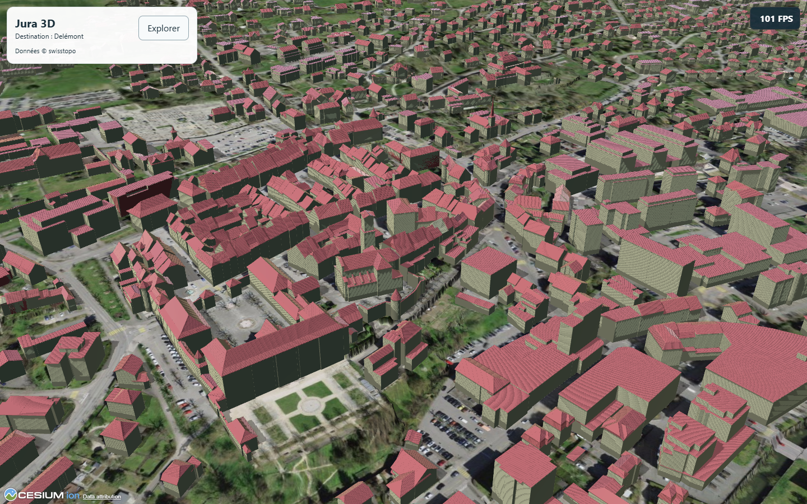
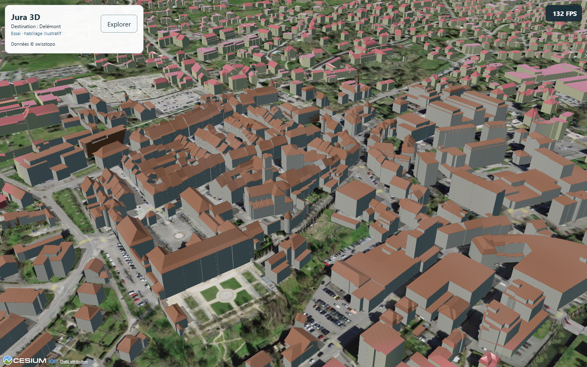

# C1 — Essai visuel du centre de Delémont

**Version révisée du 28 octobre : retrait d’Ambiance douce approuvé.** Le contrôle et la modification de brume sont supprimés. Matière discrète et ombres restent disponibles. Les96fenêtres/888lectures et captures ci-dessous décrivent la première livraison ; ils restent historiques, sans nouveau résultat de performance revendiqué pour la révision. Builds autonome/Pages et probe C1 révisé réussis : cinq groupes/zéro erreur, portrait/paysage simulés, brume native inchangée dans les quatre profils. Copie révisée servie au même port4335, contrôlée le 28 octobre 2026 à 15:46:37 Europe/Zurich :800fichiers identiques au build,11ressources relues, shader de matière inchangé. Preuves : .vite/c1/no-atmosphere/final-check.json, probe/ et delivery-hashes.json. Les probes globaux précédents sont réutilisés car scène commune/main/style/données/configuration et probe général sont inchangés ; les chemins C1 modifiés ont été revérifiés. Première copie .vite/c1/site-delivery/ conservée, serveur temporaire4336 arrêté.

28 octobre 2026, Europe/Zurich. Lot local autorisé à partir de `5f146b1`, sans commit/push/déploiement ni appareil. P9 en attente. **Bilan PC terminé avec réserves.** Aucun essai physique mobile dans ce lot.

Dernier probe C1 sur livraison figée : 28 octobre 2026 à 10:41:09 Europe/Zurich, cinq groupes/zéro erreur. [Ouvrir l’aperçu local](http://127.0.0.1:4335/jura3d/jura/) (serveur actif sur ce PC). Les captures et mesures portent sur PC ; le toucher est simulé.

## Utilisation et retour arrière

Dans Jura → Delémont → « Essai visuel du centre », choisir un cadrage puis Original/Essai. La bascule conserve caméra, heure, couches, résolution et géométrie. Matière et ombres peuvent être comparées séparément ; Faible ne conserve que la palette. « Revenir au centre historique » retrouve la vue d'ensemble. Les trois boutons de visite activent le patrimoine et ouvrent ses fiches officielles existantes.

L'original est actif au chargement, sans préférence d'essai mémorisée. Quitter Delémont coupe l'essai. La palette est limitée à `[7.3405,47.3628,7.3485,47.3672]`, avec transition intérieure de 28 m. **La projection seule des ombres affecte toute la vue lorsque son centre au sol est dans cette emprise**, puis est restaurée. La brume native n’est plus modifiée. Le retour arrière immédiat est Original ; les changements de code du lot restent non committés et identifiables par Git.

## Référence, données et méthode

- Build autonome et site Pages avant modification réussis ; copie figée `.vite/c1/original/`, SHA-256 de tous ses fichiers dans `.vite/c1/original-hashes.json`. Références antérieures préservées. Sources applicatives de départ identiques à la livraison PUB2 ; seule la documentation a avancé jusqu'à `5f146b1`.
- Tuile swisstopo centrale relue : génération 20260520, 63 objets, géométrie Draco, deux matériaux colorés, aucune texture/image/UV. Matériaux de l'essai illustratifs, sans garantie sur les vraies façades, aucun arbre ou détail architectural ajouté. Orthophoto conservée, y compris ses ombres photographiques.
- Vidéo : image Marseille observée autour de 7:50 (palette chaude, toits distincts, interface discrète). Le lecteur a échoué à l'accès au passage Paris vers 10:30. Aucun moteur, méthode, source ou exactitude géographique déduit de cette démonstration.
- Cadrages autour de 7.344/47.3648, altitude échantillonnée 432,856 m dans le premier contrôle : ensemble 950 m/10°/−38°, proche 480 m/10°/−30°, opposé 700 m/190°/−38°. Les distances sont celles de caméra, pas une précision annoncée des données.
- Les mesures compilées enregistrent navigateur/GPU réellement utilisés, 1440×900 CSS, DPR 1, fuseau Europe/Zurich, 21 juin 2026 à 14:00 UTC, fonds et bâtiments identiques, couches facultatives masquées. Faible : échelle 0,6/MSAA1/sans ombres ; Élevé : échelle1/MSAA4/ombres. Les instantanés conservent les paramètres effectifs et les comptes de triangles/features.
- Pour chaque vue/profil : Original avant, effets séparés, Original après ; fenêtres fixes puis rotation reproductible, chauffe et chargement distingués. Cache/réseau non purgés : pas un benchmark froid. Une lecture FPS et les écarts de requestAnimationFrame sont complémentaires, pas une mesure de temps GPU.

## Vérifications

Probe C1 compilé réussi : cinq groupes, zéro erreur JavaScript/console. Trois cadrages et bascule sans mouvement ni changement d'heure/qualité/géométrie ; quatre profils, effets séparés, vraie sélection bâtiment et fiche, réessai des bâtiments, trois fiches RBC, annulation, départs/retour des quatre localités et restauration ombres/brume. Toucher simulé 390×844, 722×320 et 320×690 : fiche Saint-Marcel, fermeture, commandes ≥44 px, crédits et absence de débordement horizontal. Captures dans `.vite/c1/probe/`. Ceci n'est pas un essai physique. Le contrôle de remise `.vite/c1/delivery-probe/` repasse les cinq groupes sur la copie figée ; un contrôle ciblé supplémentaire confirme la suspension des ombres/ambiance en sortant du cadrage et leur retour (`outside-view-check.json`).

Build autonome final (`npm run build -- --outDir .vite/c1/final-standalone`), assemblage Pages (`npm run build:site` avec base `/jura3d/`) et contrôles des ressources/Workers/licences réussis. Le warning de taille du bundle reste présent, comme avant C1 ; aucune dépendance ajoutée ou mise à jour.

Régressions finales terminées : `npm run probe` (P1/P3/P4/P6), `npm run probe:site`, puis probes bâtiments/parkings, transports, lieux et sanitaires Bâle, tous code 0. Les parcours normaux, filtres/groupes/fiches/liens/crédits, annulations et pannes/réessais concernés passent. Rapports et journaux : `.vite/c1/regressions-final/`. Le premier P1 s'était arrêté car son clic tactile fixe `(300,600)` tombait sur le panneau agrandi ; la reprise confirme `previousTarget: ASIDE`, choisit un vrai point canvas `(370,607.68)` et réussit la sélection de terrain. Ce test conserve son assertion fonctionnelle ; l'échec initial reste dans `.vite/c1/regressions/`.

Le badge initial empiétait sur les crédits en paysage étroit : déplacé dans l'en-tête puis probe C1 complet repris, capture revue et contrôle de non-recouvrement ajouté. Dernier probe C1 : `.vite/c1/probe-final/`, cinq groupes/zéro erreur. La première campagne de mesure a été interrompue pour cette correction ; ses résultats partiels restent dans `.vite/c1/measure/` et ne constituent pas le bilan final.

## Mesures PC et budget

Quatre campagnes terminées sans erreur JavaScript/console : **96 fenêtres, 888 lectures FPS**. Chrome Windows **156.0.8078.49**, ANGLE/D3D11 ; renderer relu dans chaque contexte : NVIDIA GeForce RTX 4080 Laptop GPU (0x27E0), puis Intel UHD (0xA788). Préférences GPU demandées au seul processus, aucun réglage Windows modifié. Jamais deux campagnes graphiques en parallèle.

Référence chiffrée ci-dessous = moyenne des médianes Original avant/après du même bloc. Faible = palette seule ; Élevé = palette, matière, ambiance et projection seule. Les scènes fixes sont chargées ; plusieurs rotations contiennent encore du chargement terrain/imagerie, signalé dans chaque JSON.

| GPU / profil / vue | Fixe : référence → essai, FPS | Rotation : référence → essai, FPS |
| --- | --- | --- |
| RTX 4080 Laptop / Faible / Ensemble | 143.0 → 143.0 (0.0 %) | 143.0 → 143.0 (0.0 %) |
| RTX 4080 Laptop / Faible / Proche | 143.0 → 143.0 (0.0 %) | 143.3 → 143.0 (-0.2 %) |
| RTX 4080 Laptop / Faible / Opposé | 143.3 → 143.0 (-0.2 %) | 143.3 → 143.0 (-0.2 %) |
| RTX 4080 Laptop / Élevé / Ensemble | 139.8 → 133.0 (-4.8 %) | 130.5 → 126.0 (-3.4 %) |
| RTX 4080 Laptop / Élevé / Proche | 130.8 → 120.0 (-8.2 %) | 123.3 → 113.5 (-7.9 %) |
| RTX 4080 Laptop / Élevé / Opposé | 122.5 → 121.5 (-0.8 %) | 120.8 → 123.5 (2.3 %) |
| Intel UHD / Faible / Proche | 87.5 → 83.0 (-5.1 %) | 89.0 → 81.0 (-9.0 %) |
| Intel UHD / Élevé / Proche | 19.0 → 18.0 (-5.3 %) | 19.0 → 19.0 (0.0 %) |

Le pire écart des configurations livrées par défaut est **−9,0 %** dans ces fenêtres. La RTX en Faible est plafonnée vers143FPS : de petits coûts GPU peuvent être masqués. Intel Élevé reste lent déjà en Original (18–20FPS) ; privilégier Faible sur ce GPU. Aucune extrapolation à l'A53.

Les étapes palette → matière → ambiance → projection seule → complet sont mesurées séparément dans les rapports. À titre d'exemple, Intel proche/Élevé donne en fixe18/19/19/19/18FPS et en rotation18/19/19/19,5/19FPS ; Original avant/après20/18FPS fixe et19/19FPS rotation. Ce niveau de variation et les changements de cadence d'Original ne permettent pas d'attribuer un coût fin à chaque microeffet.

**Variations conservées, pas masquées :** sur RTX/ensemble/Élevé, la première rotation palette seule donne−29,1 %, avec chargement et dérive d'Original138→123FPS ; les autres étapes intermédiaires varient aussi. Une contre-mesure ciblée donne palette119FPS contre Original119,5→121FPS, soit−1,0 %, et complet124FPS (+3,1 %). Cause de la première baisse non établie ; ce n'est pas une preuve de correction du streaming. Sur Intel, une pause≥100ms apparaît dans deux fenêtres fixes (projection seule et complet) du premier passage ; le complet répété n'en reproduit aucune. Les pauses et minima des originaux sont également conservés. **Pas d'aggravation de pauses reproduite dans les contre-mesures ; aucune promesse d'absence de pauses.**

Les contre-mesures changent explicitement la stabilisation de1,8s à6s et utilisent8s de lecture par fenêtre, contre10s pour la campagne RTX principale (Intel principale8s). Chaque A/B/A conserve les mêmes conditions à l'intérieur de sa campagne ; leurs valeurs ne sont pas fusionnées comme une série homogène. GPU/fréquences/charge externe non verrouillés ; FPS et intervalles RAF ne sont pas du temps GPU isolé.

Premier état prêt :5,421s RTX et7,570s Intel dans les campagnes principales, à distinguer des fenêtres ensuite réchauffées. Cache/réseau non purgés ; pas de benchmark froid ni de comparaison de puissance entre les GPU. Rapports, paramètres effectifs, lectures et captures : .vite/c1/measure-final/, measure-integrated/, repeat-rtx/, repeat-intel/ ; résumé .vite/c1/summary.json.

La recompilation de remise reprend exactement le même shader et les mêmes paramètres graphiques. Seule une remise à zéro du message d'échec lors d'une nouvelle demande de cadrage a été ajoutée ensuite ; le contrôle C1 de remise est repris sur la copie figée. Le premier build de remise a rencontré EPERM dans un dossier généré Cesium ; journal conservé, reprise limitée à dist/dist-site réussie.


## Résultats, limites et suite

Même cadrage rapproché, Chrome PC, Élevé, 1440×900, 21 juin 2026 à 14:00 UTC, sans couches facultatives :





Première comparaison visuelle PC : toits moins roses, surfaces mates, enduits plus neutres et retrait des stries avec projection seule. Les façades restent des volumes sobres ; aucune amélioration photoréaliste revendiquée. Grain volontairement discret, ambiance atmosphérique légère et dépendante du cadrage. Le mode de projection seule retire aussi la réception d'ombres entre bâtiments : compromis visible, désactivable, et non une correction de précision des shadow maps.

Qualification A53 physique et appréciation du propriétaire ouvertes. Aucun résultat PC ne prouve 30 FPS, consommation ou température sur téléphone. Extension conseillée : d’abord Saint-Ursanne, déjà présente dans le Jura et adaptée à un secteur historique compact, après retour sur cet essai, vérification locale des matériaux et qualification A53 distinctement autorisée. Commencer par la palette seule ; réévaluer ensuite grain et ombres. Bâle utilise une autre source : qualifier séparément ses matériaux, sans transposer le shader national automatiquement. Aucune extension ou nouvelle ville exécutée dans C1.

## Reprise et intégrité

Livraison figée `.vite/c1/site-delivery/`, 800 fichiers identiques au build remis, SHA-256 dans `delivery-hashes.json`. Référence initiale de 800 fichiers intacte, empreintes `original-hashes.json` et capture avant modification `reference-before.png` (cadrage natif distinct des comparaisons C1). Le shader est identique entre mesures et remise (`shader-fingerprint.json`). Sources, contrôles et résultats reliés dans `final-check.json` ; aucun commit ou publication.

Si nécessaire, relancer l’aperçu figé :

```powershell
node node_modules/vite/bin/vite.js preview --host 127.0.0.1 --port 4335 --strictPort --base /jura3d/ --outDir .vite/c1/no-atmosphere/site-delivery
```

Les serveurs de développement4332 et de contrôle4333 sont arrêtés après remise ; les anciennes références restent préservées. Prochaine action : retour du propriétaire sur la comparaison et la navigation, puis décision de qualification A53 séparée avant extension. Bon point pour compacter avec le relais, sans créer automatiquement un autre chat.

## Complément du 28 octobre — retour sur les effets discrets

Le propriétaire perçoit la matière en zoomant et confirme le retrait des stries ; il ne distingue pas l’ambiance douce malgré ses essais. Cela ne constitue pas une acceptation globale des performances ni une qualification A53. La matière reste en place.

Vérification ciblée dans l’aperçu figé4335, profil Élevé, cadrage proche, même caméra/heure/options : captures d’une zone centrale1000×600px, ambiance désactivée → activée → désactivée. Les trois PNG sont strictement identiques, tandis que l’état effectif passe false/true/false et le paramètre de brume0,15/0,3/0,15. Preuves `.vite/c1/ambiance-review/verification.json` et captures. Cette conclusion concerne la zone et le cadrage testés, pas toutes les distances de vue.

Le code Cesium1.145 atténue la densité selon l’altitude et l’orientation, puis n’active le rendu de brume des objets/tuiles qu’au-delà d’un seuil. Le facteur visuel ne suffit donc pas à produire une différence proche. Les anciens probes vérifiaient le changement de paramètre, pas un effet visuel démontré. L’utilité de « Ambiance douce » avait été surestimée pour cette visite. Conclusion du diagnostic initial : retirer cette option actuelle du panneau, avant de proposer une ambiance à nouveau prouvée visuellement. Le propriétaire a ensuite approuvé ce retrait ; voir la révision en tête de ce document.
