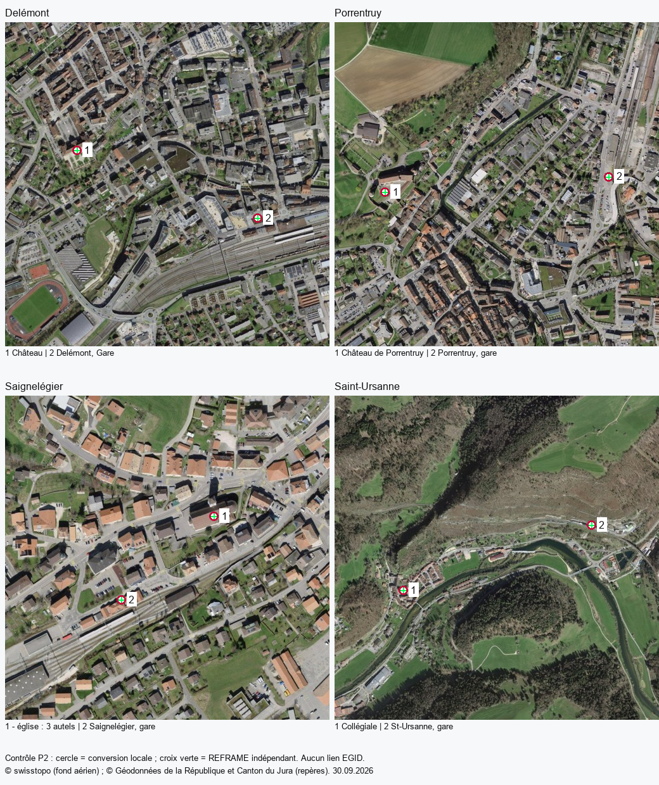

# Validation P2 — préparation des données Jura

Ce document conserve le résultat de préparation P2. P3 utilise désormais le patrimoine et copie ses conditions dans le site ; les transports restent hors de l'application. Voir [VALIDATION_P3.md](VALIDATION_P3.md) pour la version courante et les interactions de cette couche. Les données préparées et leurs empreintes restent celles de P2.

**30 septembre 2026, contrôles achevés à 18:41:53 Europe/Zurich.** P2 autorisé par le propriétaire ; vérification du menu Tab S8 reportée à sa demande, sans clôturer les limites mobiles de P1. Dépôt principal `D:\Python\Jura3D`, `main`, base `57eb361`, changements préexistants conservés. Aucun stage, commit, push ou déploiement.

## Livraisons et provenance

Les deux archives cantonales publiques ont répondu au téléchargement et sont verrouillées par SHA256 dans [la configuration](../data/sources-jura.json). ZIP patrimoine : 1 790 053 octets, SHA256 `72b4fcc3129ba191e7f32bd606c28dc1c14a828906173c2bb6e98bed3eb8bdd2`. ZIP bus : 6 015 705 octets, SHA256 `ba212b8c8314d363bf4d23a87dcbe020902a4403e5e1d63d0ed648927b076f9f`. Le manifeste conserve aussi empreintes GeoPackage, PDF de modèle/fiche, conditions et sorties ; récupération 30 septembre, export indiqué 13 septembre.

Les deux PDF de conditions sont identiques (`fb3ff36198e79575c2e9a8a78dbcd3adb2ee806159456f151d1533438cd6a4eb`). Texte et **deux pages rendues examinés** : §§4–5 autorisent reproduction/publication des données publiques avec source lisible et conditions jointes à la transmission. Le document intégral est [joint aux livraisons](../data/jura/Conditions_utilisation_geodonnees.pdf). Crédit cantonal, auteur, titre et URL sont documentés en plus du crédit swisstopo existant. Le catalogue RBC et les règles générales opendata.swiss ont été consultés ; API CKAN et page bus non accessibles dans cette session (HTTP 403/échec de récupération), sans remplacer les conditions de l'archive par une licence supposée. Les fiches PDF individuelles et leurs illustrations ne sont pas redistribuées.

| Livraison | Source / sortie | Géométries utilisables | Sommets source | Octets GeoJSON | Gzip indicatif |
| --- | ---: | ---: | ---: | ---: | ---: |
| Patrimoine | 1 159 / 1 159 | 1 156 | 1 159 | 1 206 937 | 198 699 |
| Arrêts | 464 / 464 | 464 | 464 | 355 072 | 29 957 |
| Tracés | 140 / 140 | 140 | 47 625 | 1 898 385 | 700 098 |
| Zones Noctambus | 2 / 2 | 2 | 3 433 | 132 378 | 54 583 |

Gzip calculé localement, pas une preuve de compression HTTP déployée. Ces fichiers sont dans [data/jura](../data/jura/README.md), hors `public/` ; aucune nouvelle requête, couche ou case n'est ajoutée au site. Pas de simplification nécessaire pour P2 ; chargement séparé et éventuelle optimisation se mesureront à l'intégration.

## Conversion et anomalies

Python 3.13, pyproj 3.7.2 / PROJ 9.5.1, Shapely 2.1.2, NumPy 2.5.3 ; dépendances verrouillées dans [requirements-data.txt](../scripts/requirements-data.txt), environnement `.vite/p2-venv`. SQLite en lecture seule. En-tête GeoPackage, EPSG:2056, tables, cardinalités et types effectifs vérifiés ; les tables déclarées MULTICURVE contiennent ici des MultiLineString WKB, sans approximation de courbes. Géométries source valides, sans Z/M. Conversion WGS84 avec ordre longitude/latitude explicite, sans opération ballpark, GeoJSON RFC 7946 sans membre `crs`, orientation des polygones normalisée. Attributs inchangés.

Trois points RBC sont mathématiquement valides mais mal placés dans la source :

| ID source / fiche | Objet et localité | Coordonnées source EPSG:2056 | Position transformée inutilisable |
| --- | --- | --- | --- |
| 229 / 1934 | Borne des Trois Evêchés, Les Bois | 2 555 998 / 1 556 997 | 6,82377° E / 50,15820° N |
| 247 / 1986 | Les Vacheries : ancienne école, Les Breuleux | 2 466 468 / 1 228 667 | 5,67637° E / 47,19543° N |
| 766 / 1225 | Temple réformé, Miécourt | 2 580 468 / 1 525 712 | 7,16719° E / 49,87859° N |

Aucun enregistrement perdu : `geometry: null` pour ces trois fiches, propriétés intégrales dans le GeoJSON et géométrie d'origine/motif dans le manifeste. Aucun chiffre corrigé au jugé. Les trois ID sont explicitement attendus ; tout nouvel écart arrête la génération. L'étendue régionale de contrôle est volontairement large, elle ne découpe pas les réseaux à la frontière cantonale.

Un premier arrondi à sept décimales rendait dégénéré un petit composant du tracé `id=92` ; cette transformation a été abandonnée avant livraison. Toutes les coordonnées gardent leur précision double et les sommets des géométries utilisables sont conservés. Distance de retour vers EPSG:2056 (Hausdorff), maximum **0,001287 m**, contrôlée sur toutes les géométries utilisables. Ce retour interne vérifie la transformation numérique, pas la vérité du lieu. Précision annoncée par l'opération PROJ : **1 m**.

## Contrôles indépendants et revue visuelle

Huit appels réels au [service REFRAME swisstopo](https://www.swisstopo.admin.ch/fr/rest-api-geodesique-reframe-web), un repère patrimonial et un arrêt par localité. Réponses, coordonnées source et URL exactes conservées dans [jura-control-points.json](../data/jura-control-points.json) ; reprise en ligne avec `--online` réussie. Écart géodésique maximal entre sortie locale et réponse indépendante : **0,013313 m**, sous le seuil de contrôle de 2 m. Cela n'élève pas la précision générale des sources à 1,3 cm.

- Delémont : Château (fiche 2285) et Delémont, Gare.
- Porrentruy : Château de Porrentruy (fiche 1304) et Porrentruy, gare.
- Saignelégier : « - église : 3 autels » (fiche 2184, désignation source conservée) et Saignelégier, gare.
- Saint-Ursanne : Collégiale (fiche 1657) et St-Ursanne, gare.



Revue visuelle des quatre panneaux sur fond SWISSIMAGE effectuée : repères cohérents avec château/église/collégiale et secteur de gare, croix REFRAME superposées aux positions converties à cette échelle. Fond crédité © swisstopo ; repères crédités au canton. Ce contrôle ne valide ni l'emprise exacte d'un bien, ni une jointure EGID, ni l'alignement de toute la couche, ni son rendu Cesium/mobile. Aucun point patrimonial n'est automatiquement associé à un bâtiment 3D.

## Commandes reproductibles

Python **3.12 ou plus récent** nécessaire pour les versions verrouillées ; testé avec 3.13. Ne pas installer ces paquets dans le Python global :

```powershell
python -m venv .vite/p2-venv
& .vite/p2-venv/Scripts/python.exe -m pip install -r scripts/requirements-data.txt
& .vite/p2-venv/Scripts/python.exe scripts/prepare-jura-data.py --download
& .vite/p2-venv/Scripts/python.exe scripts/validate-jura-data.py --online
```

Pour reconstruire avec les archives en cache, omettre `--download`. `prepare-jura-data.py --check` compare sans remplacer les livraisons ; `validate-jura-data.py` reconvertit, vérifie toutes les propriétés contre SQLite et les références sauvegardées. `--online` relit huit réponses REFRAME sans modifier le fichier de référence. Un nouvel export ou de nouvelles conditions arrêtent la commande tant que la configuration n'est pas revue. Rapport local ignoré : `.vite/p2-validation.json`.

Résultats : reproduction identique, **36 201 valeurs de propriétés comparées à la source sans changement**, 1 159 noms patrimoine, 1 142 descriptions renseignées, 464 noms d'arrêts, noms/liens de 140 tracés et 2 zones conservés. Tous les liens syntaxiquement HTTP(S), disponibilité complète encore ouverte. Absence de champ EGID et de cotation d'importance indépendante dans le GeoPackage RBC ; pas d'inférence. Dates de mise à jour des entités vérifiées : 2 avril pour RBC, 13 septembre pour transports ; les fiches de modèle peuvent avoir une date plus ancienne.

Contrôle final du téléchargement `--download --check` réussi : empreintes officielles inchangées et reconversion identique. Deux entrées volontairement altérées en mémoire (empreinte d'archive inconnue et anomalie RBC non déclarée) sont refusées ; les livraisons restent inchangées après ces deux refus. Contrôle documentaire : liens locaux des documents concernés et `git diff --check` réussis, index vide, fichiers bruts et environnement bien ignorés.

`npm run build` réussi à la suite de la validation. Empreintes des trois fichiers d'application identiques au contrôle P1 de 17:20 : JS `index-CiVAcsIl.js`, CSS `index-CYlPrV01.css`, `dist/index.html`. Avertissement de taille Vite existant. Aucun flux/interactif 3D modifié ; le probe P1 du même jour reste la preuve des interactions, aucune nouvelle validation physique revendiquée. Vérification du menu sur Tab S8 différée par le propriétaire. P3/P4 devront contrôler les futures couches dans Cesium et sur appareil réel.

## Suite

P2 prêt localement, données et droits documentés ; aucune publication. Prochain lot **P3** : couche patrimoine activable, fiches et filtres, crédits visibles, absence de position gérée et liens officiels contrôlés sur un échantillon. Prévoir ensuite P4 pour transports statiques ; Noctambus est une variante distincte. Résoudre les trois coordonnées douteuses seulement sur preuve officielle, sans bloquer les 1 156 lieux exploitables. Moiré, fluidité A53, campagne prolongée et menu physique restent des limites P1/P5/P6 séparées.
