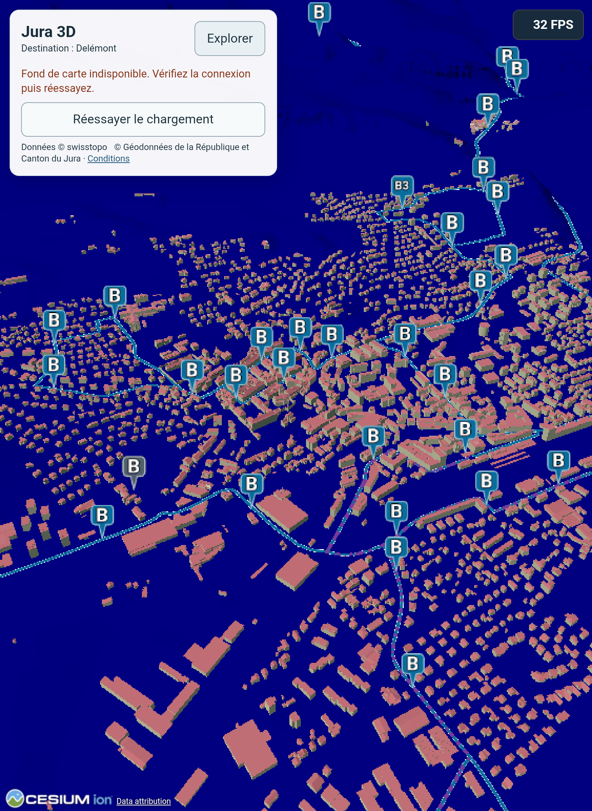
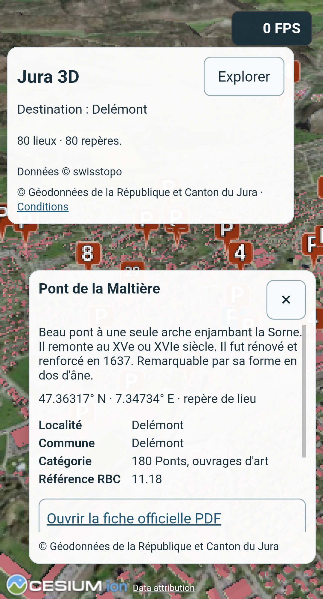
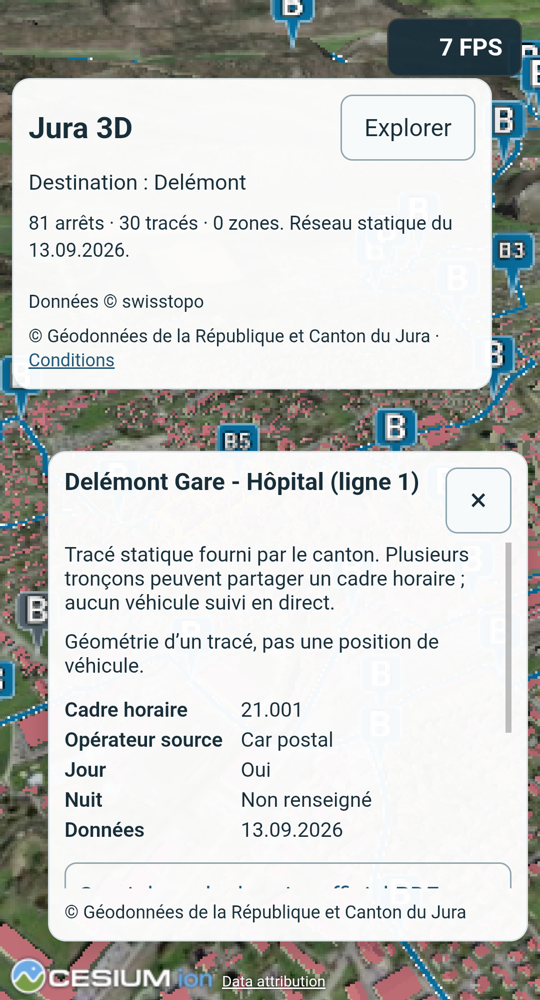
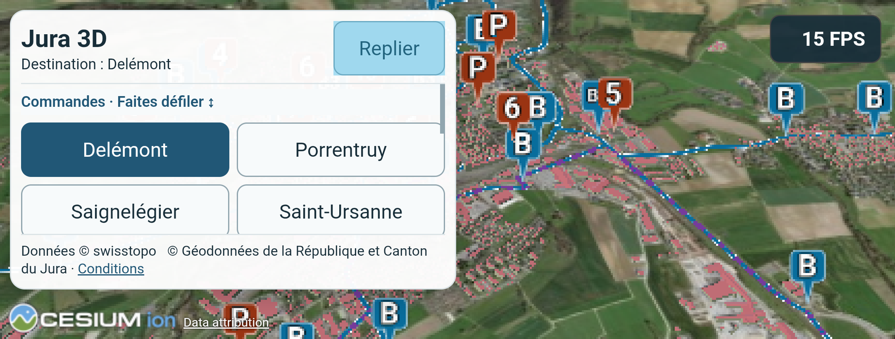

# P5 — mesures de performance

## Reprise du 1er octobre — contrôles de clôture

**P5 clos au 01.10.2026 23:47:38 Europe/Zurich : mesures et bilan de validation terminés.** Retour final du propriétaire : « ressenti normal », « tout me semble OK » sur Tab S8, après confirmation des essais portrait/paysage et du réessai réseau. Cette validation globale ne devient pas une preuve instrumentée ni une confirmation séparée de chaque destination, sélection de bâtiment ou filtre. Les réserves restent au bilan : 30 FPS A53 non acquis, S23 indisponible, détail manuel non exhaustif, cause CPU/GPU non profilée, USB instable après les campagnes. P6 proposé seulement après cette clôture, non commencé.

Reprise dans le dépôt principal `main`, base `57eb361`, changements existants conservés. Aucun stage, stash, commit, push ou déploiement. Au relevé P5, la preview `http://127.0.0.1:4300/` servait l'index SHA256 `bbf979262ff0990856a4594cd4b5abebd835e01a823bf176b756d8ae56afcb01`, bundle du panneau corrigé. Les rapports historiques ci-dessous gardent leur version et leur portée. L’optimisation ultérieure et la version actuellement servie sont documentées séparément dans [VALIDATION_P6.md](VALIDATION_P6.md).

| Point P5 | Preuve disponible / contrôle restant |
| --- | --- |
| Campagne A53 prolongée | Terminée, 28 phases/616 lectures, sur le bundle antérieur à la retouche du panneau. |
| Panneau corrigé | Build/probe et toucher injecté A53 paysage réussis ; confirmation générale A53 conservée. Tab S8 : essais du panneau et fiches dans les deux orientations déclarés réalisés. Pas de détail manuel A53 équivalent déduit du retour tablette. |
| Comparaison prolongée PC | Terminée à 12:25:11 Europe/Zurich, Faible effectif, 28 phases/616 lectures, aucune erreur ni échec de nettoyage ; résultats ci-dessous. |
| Comparaison prolongée Tab S8 | Faible commun terminé à 13:04:07 Europe/Zurich par Wi-Fi appairé, 28 phases/616 lectures, aucune erreur/coupure, nettoyage confirmé. Moyen terminé à 23:11:32 par USB, 28/616 et nettoyage confirmé ; essais manuels dans deux orientations déclarés réalisés, diagnostic bus physique et coupure/réessai réalisés. |
| Réseau/réessai Android réel | Tab S8 : Wi-Fi coupé par propriétaire, fond topographique en erreur, réessai visible panneau replié ; clic physique de réessai et scène prête à la reconnexion, confirmation du propriétaire. |
| Complément manuel | Gestes, fiches, défilements et liens dans deux orientations déclarés réalisés ; bus et réseau/réessai documentés. Retour final : ressenti normal, fonctionnement global OK sur Tab S8. Destinations, bâtiment et filtres non confirmés séparément dans ce dernier retour : limite de détail conservée. |
| S23 | Indisponible ; Tab S8 reste une comparaison distincte. |

Pour le réseau manuel, le site local reste accessible par USB tandis que les services swisstopo dépendent du réseau Android. Après une scène prête, couper soi-même le Wi-Fi (et éviter une relève mobile), changer de fond ou de destination pour demander des tuiles absentes, relever le message et la disponibilité de Réessayer panneau replié. Rétablir la connexion, toucher Réessayer, vérifier nouvelle scène et commandes. Consigner toute absence d'erreur : une ancienne vue conservée peut seulement venir du cache. Aucun réglage radio n'est modifié par les scripts.

**Clôture :** P5 terminé pour les mesures et le bilan, avec validation globale du propriétaire et réserves conservées ci-dessus. Cette clôture ne garantit ni 30 FPS A53, ni des performances identiques sur une autre tablette/téléphone. P6 reste une proposition, aucune optimisation commencée. Les sections datées suivantes conservent les états historiques des essais.

## Session PC prolongée — 1er octobre 2026

**Contrôle terminé à 12:25:11 Europe/Zurich.** Parcours instrumenté **12:13:15–12:25:11**, **11 min 56 s**, sept configurations/quatre destinations : **28 phases, 616 lectures toutes en état prêt**, aucune erreur ni échec de nettoyage. Chrome Windows **154.0.8037.92 sans interface**, GPU WebGL **NVIDIA GeForce RTX 4080 Laptop GPU**, fenêtre **1440 × 900 CSS**, DPR **1**, paysage ; preset **Faible 0,6 / MSAA 1**, tampon **864 × 540**, vérifiés pendant le parcours. Même heure solaire et commandes caméra que la campagne A53. Accès aux services externes par le réseau PC, débit/liaison et applications actives non caractérisés, autres onglets conservés. Aucun relevé thermique ou consommation PC.

Version : bundles `index-DISvxeB6.js` / `index-C8D1Jt4F.css`, index servi/build SHA256 `bbf979262ff0990856a4594cd4b5abebd835e01a823bf176b756d8ae56afcb01`. Rapport local ignoré `.vite/p5/2026-10-01T10-13-06.232Z-desktop-session.json`, SHA256 **`0e057f1c519849cb5f0f5b8b155a7db26e627b96d1618d09a53987cd4787fb41`**. La campagne A53 garde ses anciens bundles : il s'agit d'une comparaison au même protocole et preset, avec retouche d'interface entre les deux versions, pas d'une comparaison strictement sur un bundle identique.

Chaque cellule : **médiane / P10 des sept lectures FPS Cesium en mouvement** ; mêmes limites de quantiles que pour l'A53.

| Configuration | Delémont | Porrentruy | Saignelégier | Saint-Ursanne |
| --- | ---: | ---: | ---: | ---: |
| Terrain/fond seul | 143 / 143 | 143 / 143 | 143 / 143 | 143 / 143 |
| Bâtiments | 143 / 143 | 143 / 143 | 143 / 143 | 143 / 143 |
| Bâtiments + ombres | 119 / 108 | 122 / 108 | 126 / 125 | 126 / 125 |
| Bâtiments + patrimoine | 126 / 126 | 126 / 124 | 127 / 126 | 127 / 126 |
| Bâtiments + bus | 126 / 125 | 126 / 125 | 126 / 126 | 126 / 125 |
| Bâtiments + patrimoine + bus | 127 / 126 | 127 / 127 | 126 / 126 | 127 / 125 |
| Bâtiments, répétition | 127 / 126 | 126 / 126 | 127 / 126 | 127 / 126 |

La cadence observée est élevée sur ce PC, sans établir un ressenti interactif ou la fluidité Android. La référence répétée baisse de 143 à 126–127 FPS : comparaison ordonnée, sans répétition indépendante ; la différence des phases patrimoine/bus avec la première référence ne peut pas être entièrement attribuée à ces couches. La cause de la variation n'est pas isolée. Les quatre vues bâtiments comportent **421/392/260/124 commandes** et **917 716/774 476/315 508/150 748 triangles** ; elles diffèrent de l'A53, comme le tampon et le format de fenêtre. Aucun rapport de puissance entre appareils n'est déduit du seul preset commun.

- Lancement normal, cache HTTP contourné : état prêt **5,388 s** ; rechargement cache normal **1,655 s** ; visite instrumentée distincte **1,867 s**. Aucun cache global/GPU/OS/CDN purgé, aucun débit réseau de référence établi ; ces délais PC ne valident pas l'objectif A53 d'environ dix secondes.
- Navigations des phases : **1,206–1,621 s**. Un écart de callbacks RAF ≥100 ms, maximum **961,5 ms**, conservé même si les lectures FPS restent hautes ; pas une mesure exhaustive de chaque frame ou une attribution CPU/GPU.
- Mémoire JS en fin de phase **267,3–581,2 MiB** ; mémoire estimée du tileset **75,1 → 154,8 MiB**. Caches et collectes possibles, aucune preuve de fuite ou mesure de RAM/GPU totale.
- Réseau cumulé de l'onglet, chargements inclus : **46 883 288 octets encodés**, **15 842 requêtes terminées**, **12 512 réponses cache disque**, aucun service worker observé. Aucun trafic global ou benchmark de débit revendiqué.

Le script a restauré la préférence et le cache HTTP puis fermé son seul Chrome de mesure. Code applicatif/configuration inchangés pendant cette reprise ; build/probe réussis à 11:40:39 conservés car l'empreinte du bundle est identique. Aucun nouveau contrôle Android n'est revendiqué à la fin du parcours PC : volet de notifications A53 au premier plan lors du précontrôle, puis A53 déconnecté. Retrait des tunnels tenté à 12:29 mais appareil absent ; liste des forwards PC vide, reverse A53 non vérifiable avant reconnexion. Preview PC 4300 conservée. Le propriétaire confirme ensuite préparer la Tab S8 ; sa campagne et les compléments manuels/récupération Wi-Fi/réessai restent ouverts. P6 non commencé.

## Préparation Tab S8 — coupures USB à la reprise

Tablette **SM-X706B, Android 16**, Chrome **154.0.8037.57**, Wi-Fi avec NordVPN actif observé ; autres applications/onglets conservés, débit non caractérisé. Précontrôle : **27 %**, charge USB, batterie **25,6 puis 25,9 °C**, thermique **0**, économie d'énergie désactivée. Batterie sous la cible conseillée de 50 %, consignée. Le propriétaire confirme la liaison stabilisée et autorise le test après une première coupure de préparation.

Nouvelle coupure au contrôle court, **12:33:52–12:33:57 Europe/Zurich**, avant toute phase : `page.waitForFunction: Target page, context or browser has been closed`. Les transports ADB observés passent de **2 à 4**, puis **5 à 7** ; les forwards disparaissent après la coupure. La cause matérielle/Android n'est pas isolée. Rapport partiel conservé/exclu de toute performance : `.vite/p5/2026-10-01T10-33-52.798Z-android-smoke.json` ; précontrôle normalisé `.vite/p5/tab-s8-preflight-2026-10-01.json`. Aucun échec du rendu ou des données déduit de cet arrêt.

Relances USB suspendues. Débogage sans fil constaté désactivé ; aucun port Android activé automatiquement. Appairage Wi-Fi par code demandé au propriétaire pour une liaison stable, conformément à la [méthode officielle Android](https://developer.android.com/tools/adb#connect-to-a-device-over-wi-fi). Vérifier la nouvelle identité ADB et le numéro matériel avant mesure ; conserver les conditions réseau/charge et retirer les seuls tunnels de test. L'appairage reste enregistré jusqu'à suppression du PC dans les appareils associés, distincte de la désactivation du débogage sans fil. Aucun changement de modèle, d'effort, de code applicatif ou de P6.

### Reprise Wi-Fi et nettoyage — 12:49 Europe/Zurich

Le propriétaire active le débogage sans fil, fournit les codes et confirme la pause des VPN. Adresse Wi-Fi de la tablette vérifiée **192.168.1.177** ; l'adresse VPN affichée **10.5.0.2** est aussi celle du PC et n'est pas utilisée pour viser l'appareil. Port local d'abord inaccessible malgré écoute sur la tablette, puis accessible après la pause ; rôle exact des VPN non isolé. Appairage sécurisé et connexion réussis ; numéro matériel **R52T401B6LN / SM-X706B** confirmé via le transport Wi-Fi. Aucun code d'appairage conservé dans les fichiers.

L'onglet du contrôle USB interrompu existe encore et porte la préférence `low`, alors que `__p5OriginalQuality` vaut `null`. Son heure de création correspond au rapport interrompu. Préférence restaurée, cache réactivé et ce seul onglet fermé à **12:47:50**, rapport `.vite/p5/tab-s8-interrupted-smoke-recovery.json`. Correctif du script : identifiant de session dans l'onglet, trois preuves de nettoyage et `cleanupFailure` si l'onglet est inaccessible. Rapport USB historique inchangé, absence de champ d'erreur de nettoyage antérieure non assimilée à une réussite.

Syntaxe et `npm run build` réussis ; bundles/index applicatifs identiques aux preuves P1/P3/P4 de 11:40:39. Contrôle court Wi-Fi terminé à **12:49:03**, `.vite/p5/2026-10-01T10-47-56.282Z-android-smoke.json` : sept configurations, aucune erreur ; `preferenceRestored`, `httpCacheRestored`, `testPageClosed` tous vrais. Fenêtre réelle **753 × 1030 CSS**, DPR **2,125**, portrait, Chrome **154.0.8037.57**. Ces FPS courts sont exclus des performances. Campagne prolongée Faible lancée ensuite, résultat à consigner après achèvement.

## Session physique Tab S8 — Faible, 1er octobre 2026

Parcours instrumenté **12:50:40–13:04:07 Europe/Zurich**, **13 min 27 s**, **28 phases / 616 lectures toutes prêtes**, sans erreur, coupure ou échec de nettoyage. **SM-X706B, Android 16**, Chrome **154.0.8037.57**, GPU **Adreno 730**, portrait réel **753 × 1030 CSS**, DPR **2,125**, tampon **451 × 618**, Faible **0,6 / MSAA 1** vérifiés. Même parcours/heure/preset que PC et A53 ; fenêtres et version du panneau A53 distinctes, pas de rapport de puissance matérielle déduit.

Site/CDP par tunnels **ADB Wi-Fi appairé**, Wi-Fi Android, VPN en pause selon le propriétaire ; USB conservé pour charge, autres onglets/applications conservés, débit non caractérisé. Batterie **27→24 %**, température batterie **26,9→28,4 °C**, économie désactivée et thermique Android **0 à tous les relevés**. Batterie sous la cible conseillée de 50 % ; baisse sous charge sans mesure de courant/puissance ni fréquences CPU/GPU. Rapport local `.vite/p5/2026-10-01T10-50-19.530Z-android-session.json`, SHA256 **`4474998a922eae8546a6eecc361aedddd4a7dd4a8282a197e6629d69fdddefa`**. Bundle/index corrigés identiques à la campagne PC.

Cellules : **médiane / P10 des sept lectures FPS Cesium en mouvement**, mêmes limites que les autres campagnes.

| Configuration | Delémont | Porrentruy | Saignelégier | Saint-Ursanne |
| --- | ---: | ---: | ---: | ---: |
| Terrain/fond seul | 59 / 59 | 59 / 58 | 59 / 58 | 60 / 59 |
| Bâtiments | 59 / 59 | 55 / 54 | 60 / 59 | 59 / 59 |
| Bâtiments + ombres | 22 / 22 | 26 / 25 | 49 / 45 | 59 / 57 |
| Bâtiments + patrimoine | 47 / 38 | 56 / 54 | 60 / 59 | 60 / 59 |
| Bâtiments + bus | 34 / 33 | 39 / 37 | 59 / 59 | 60 / 59 |
| Bâtiments + patrimoine + bus | 34 / 30 | 38 / 37 | 59 / 59 | 59 / 59 |
| Bâtiments, répétition | 47 / 46 | 54 / 51 | 60 / 59 | 60 / 59 |

Ombres et couches pèsent surtout dans les centres denses ; la référence Delémont baisse aussi de 59 à 47 FPS au passage final. Effet de l'ordre/cache/allocations/chauffe non isolé : pas d'attribution CPU/GPU ou de coût marginal exact. Cadence de lecture ≥30 pour les deux couches ensemble dans cette campagne Faible, sans qualification d'une autre orientation ou du preset Moyen, ni garantie de chaque frame. L'A53 reste sous l'objectif dans ses centres denses.

- État prêt au lancement normal/cache HTTP contourné **6,706 s**, rechargement normal **6,196 s**, visite instrumentée séparée **6,797 s**. Réseau/cache global non contrôlés comme une référence froide ; aucune garantie générale de dix secondes.
- Navigations **1,299–3,549 s** ; **16 écarts RAF ≥100 ms**, maximum **166,8 ms**. Mémoire JS de fin de phase **279,8–571,4 MiB**, pas RAM/GPU totales ni preuve de fuite.
- Réseau cumulé de l'onglet **17 254 031 octets encodés**, **9 113 requêtes terminées**, **7 364 réponses cache disque**, aucun service worker observé.
- `preferenceRestored`, `httpCacheRestored`, `testPageClosed` tous vrais. Aucun autre onglet fermé. Tablette laissée au repos après la campagne avant le complément Moyen ; températures suivantes à consigner séparément.

## Session physique Tab S8 — Moyen terminé le 1er octobre 2026

Parcours instrumenté **22:59:04–23:11:32 Europe/Zurich**, **12 min 28 s**, **28 phases / 616 lectures**, toutes visibles en état prêt, aucune erreur enregistrée ni coupure USB. Rapport `.vite/p5/2026-10-01T20-58-44.247Z-android-session.json`, SHA256 `26b5792a833b3327b83d88073cf34b84a573fe2703b2538d11d24de87d335399`. Les trois preuves de nettoyage sont vraies ; préférence initiale **Moyen** enregistrée et restaurée. Le partiel du midi reste distinct, sans données recollées.

Même bundle du panneau corrigé, index SHA256 `bbf979262ff0990856a4594cd4b5abebd835e01a823bf176b756d8ae56afcb01`, JS `index-DISvxeB6.js`, CSS `index-C8D1Jt4F.css`. Tab **SM-X706B / Android 16 / Chrome 154.0.8037.57 / Adreno 730**, portrait **753×1030 CSS**, DPR **2,125**, tampon **564×773**, Moyen effectif **0,75 / MSAA 1**, SSE initial 12. Ombres désactivées au départ et activées seulement pour leur configuration de diagnostic.

Le propriétaire a choisi l'USB ; précontrôle court réussi avant ce parcours, aucune boucle après une perte. Serveur local/CDP par reverse/forward USB, données en Wi-Fi tablette, VPN déclaré désactivé. Connexion ADB Wi-Fi encore inaccessible au PC, autres apps/onglets conservés et débit non caractérisé. Batterie **88→85 %**, température batterie **26,3→27,6 °C**, **thermique 0** à tous les relevés, économie désactivée, charge USB. Conditions différentes de Faible du midi (27→24 %, liaison ADB Wi-Fi) : comparaison descriptive, aucune mesure isolée du coût du preset ou rapport de puissance matérielle.

Médiane / P10 des sept lectures FPS en mouvement de chaque phase :

| Configuration | Delémont | Porrentruy | Saignelégier | Saint-Ursanne |
| --- | --- | --- | --- | --- |
| Terrain/fond seuls | 59 / 59 | 59 / 59 | 59 / 59 | 59 / 59 |
| Bâtiments | 59 / 59 | 57 / 51 | 59 / 59 | 59 / 59 |
| Bâtiments + ombres | 23 / 22 | 26 / 24 | 47 / 46 | 59 / 54 |
| Bâtiments + patrimoine | 46 / 46 | 52 / 51 | 60 / 56 | 60 / 59 |
| Bâtiments + bus | 32 / 31 | 34 / 34 | 59 / 59 | 59 / 59 |
| Patrimoine + bus réunis | 33 / 31 | 34 / 33 | 58 / 53 | 59 / 59 |
| Bâtiments répétés | 46 / 46 | 52 / 49 | 59 / 59 | 59 / 59 |

Les ombres et les couches pèsent dans les centres denses. Référence bâtiments **59→46 FPS** à Delémont, **57→52** à Porrentruy : cette dérive interdit d'attribuer tous les écarts aux seules couches ; cause non isolée. Les deux presets donnent environ 60 FPS dans plusieurs vues moins chargées, sans garantie de cadence constante.

- État prêt normal/cache contourné **6,211 s**, rechargement normal **6,233 s**, visite instrumentée **7,086 s** ; navigation **1,254–3,913 s**.
- **12 pauses RAF ≥100 ms**, maximum **266,7 ms** ; métrique de callbacks, pas preuve d'un coût GPU.
- Mémoire JS **279,2–554,6 Mio**, ni RAM Android ni mémoire GPU totale ; aucun diagnostic de fuite déduit.
- Réseau de cet onglet : **15 154 944 octets encodés**, **8 595 requêtes terminées**, **5 254 réponses cache disque**, zéro service worker.
- Aucun geste physique n'est revendiqué par ce parcours. Complément manuel et véritable coupure réseau/réessai encore ouverts ; P5 non clos et aucun P6 engagé.

## Moyen Tab S8 — interruption et reprise

**Actualisation du 1er octobre à 22:31:56 Europe/Zurich : parcours interrompu, résultat complet non acquis.** Le rapport reste `completed:false`, **14/28 phases / 308 lectures**, sans `endedAt` ni preuve de nettoyage. Processus de mesure absent, aucun appareil ADB/forward détecté. Les champs `failure` et `issues` vides ne prouvent pas une fin normale ; cause de l'arrêt non établie. Conserver ce partiel, retrouver seulement l'onglet marqué par son identifiant si la tablette revient, vérifier le nettoyage puis reprendre une session Moyen complète sous un nouveau rapport. Les contrôles Faible réussis ne sont pas invalidés.

Reprise du soir après préparation confirmée par le propriétaire : nouveau port de connexion fourni **34557**, détection ADB/mDNS vide et accès à la dernière adresse Wi-Fi encore indisponible. Vérification du réseau actuel demandée, aucun réglage VPN/pare-feu modifié par l'agent. Preview locale 4300 relancée et HTTP 200 confirmé. Script corrigé pour conserver la préférence initiale aux rechargements et la sauvegarder dans le rapport ; syntaxe/build réussis, index/bundles applicatifs identiques. Contrôle court PC en cours, distinct d'un benchmark ; prochain essai Android conditionné à la liaison et au nettoyage vérifiés.

Contrôle de régression terminé à **22:41:37 Europe/Zurich**, `.vite/p5/2026-10-01T20-40-53.988Z-desktop-smoke.json` : sept configurations, aucune erreur ni échec de nettoyage, `originalQuality:null`, trois champs de restauration/fermeture vrais et assertions aux deux navigations réussies. Aucun FPS de ce parcours court ajouté au bilan de performances. Nouveau port d'appairage fourni ensuite, également inaccessible sur la dernière IP Wi-Fi ; adresse IPv4 actuelle et pause des VPN à confirmer. Aucun nouveau parcours Android lancé.

**Relevé du 1er octobre à 13:13 Europe/Zurich : pas encore un résultat achevé.** Rapport `.vite/p5/2026-10-01T11-10-56.122Z-android-session.json`, parcours commencé à **13:11:17**, 3 phases terminées, zéro erreur/échec enregistré. PID Node **79840** constaté, à revalider ; ne pas lancer une mesure parallèle. La fin et les statistiques doivent être lues dans le rapport à la reprise, avec les trois preuves de nettoyage.

Dernier contrôle à **13:16:59** : **11/28 phases**, `completed:false`, zéro erreur/échec enregistré ; dernier relevé physique **23 %, 28,8 °C batterie, thermique 0**, charge USB et économie désactivée. Aucun tableau Moyen définitif ou résultat manuel revendiqué avant achèvement.

Onglet vide temporaire au premier plan **13:07:42–13:10:51** pour repos, autres onglets conservés, seul onglet vide fermé ; `.vite/p5/tab-s8-cooldown.json`. Précontrôle Moyen : **24 %**, **28,6 °C batterie**, **32,9 °C AP / 33,9 °C SKIN**, thermique **0**, charge USB, économie désactivée. Batterie pas revenue à la température initiale de Faible : sessions ordonnées, conditions distinctes à conserver. Même transport Wi-Fi/pause VPN et orientation que Faible. Complément manuel préparé et non exécuté ; voir le [relais de sauvegarde](RELAIS.md).

**1er octobre 2026, reprise USB vers 22:57 Europe/Zurich.** Le propriétaire a branché la Tab S8 en USB : identité R52T401B6LN / SM-X706B vérifiée, portrait 753×1030, batterie 89 %, 25,9 °C, thermique 0 et économie désactivée. Wi-Fi réel 192.168.1.177 ; port de connexion 44053 communiqué, mais inaccessible au PC en contrôle TCP borné (3 s). Aucun nouvel appairage tenté. Un contrôle USB borné est utilisé, sans boucle de relance après perte de transport.

L'ancien onglet Moyen est identifié par son marqueur exact puis fermé ; cache HTTP réactivé, préférence **Moyen observée conservée**. La valeur initiale de la campagne interrompue est inconnue : aucune restauration initiale revendiquée. Preuve : `.vite/p5/tab-s8-medium-interrupted-recovery.json`.

Le contrôle court `.vite/p5/2026-10-01T20-54-01.923Z-android-smoke.json` échoue à 22:55:34 sur délai de 90 s, **0 phase**, sans perte USB ; état relief/bâtiments en erreur constaté. Ses trois preuves de nettoyage sont vraies, préférence initiale Moyen enregistrée/restaurée. Un onglet temporaire séparé retrouve la scène prête et le propriétaire confirme « ça s'affiche » ; rapport `.vite/p5/2026-10-01T20-56-22.850Z-tab-s8-manual.json`, fermé avec préférence restaurée. Cela ne prouve pas un clic physique sur Réessayer ni le complément gestuel complet. Nouveau contrôle court Moyen lancé après rétablissement constaté ; vérifier son résultat avant campagne complète. Tunnels temporaires USB : 9228 vers Chrome, 4175 vers preview 4300 ; aucun tunnel Wi-Fi ni réglage radio/firewall ajouté.

## Complément physique et question sur le coût des bus — 1er octobre, vers 23:17 Europe/Zurich

Le propriétaire confirme explicitement avoir testé gestes, fiches, défilements, liens officiels en **portrait et paysage** ; baisse de cadence avec le réseau bus signalée. Confirmation déclarative de tests réalisés, pas une trace instrumentée complète : après le parcours Moyen terminé, USB passe du transport 2 à 4 puis 6, tunnels perdus et capture du complément impossible. Rapport initial `.vite/p5/2026-10-01T21-12-07.450Z-tab-s8-manual.json` ne suffit pas à prouver chaque geste. Le propriétaire indique avoir remué le câble et demande de renvoyer : tunnels rétablis à cette demande, preview PC toujours HTTP 200. Nouveau complément `.vite/p5/2026-10-01T21-18-11.623Z-tab-s8-manual.json`, marqueur identique au timestamp ; pas de nouveau benchmark complet.

Lecture du code, sans modification : tracés entiers sélectionnés si un segment passe dans le secteur d'environ 5 km, **sans découpe géométrique du reste de la ligne**. Lignes de 5 px avec bordure/pointillés, `clampToGround` et classification terrain ; arrêts ancrés au terrain et clustering écran. [Nature des polylignes sur terrain dans Cesium](https://cesium.com/learn/cesiumjs/ref-doc/GroundPolylinePrimitive.html). Coût de rendu plausible, causalité CPU/GPU non profilée ; aucun changement du moteur déduit.

Comptages des données réellement filtrées dans la campagne Moyen (sommets source, pas triangles GPU) :

| Localité | Arrêts | Tracés | Points source des tracés | Entités Cesium | Médiane en mouvement |
| --- | --- | --- | --- | --- | --- |
| Delémont | 81 | 30 | 9 503 | 125 | 32 FPS |
| Porrentruy | 62 | 20 | 8 376 | 94 | 34 FPS |
| Saignelégier | 27 | 14 | 6 666 | 53 | 59 FPS |
| Saint-Ursanne | 34 | 17 | 10 792 | 58 | 59 FPS |

Le nombre de sommets ne prédit donc pas seul la baisse ; interaction avec vue/bâtiments et coût des arrêts/tracés à isoler. Les compteurs triangles/commandes existants décrivent le **tileset bâtiments**, pas toute la scène ou les bus. Comparaison manuelle bus désactivés / arrêts seuls / tracés seuls demandée, même vue Delémont/Moyen, patrimoine désactivé. Coupure réseau réelle et réessai tactile encore à réaliser ; P5 demeure ouvert.

### Diagnostic bus physique — résultat déclaré vers 23:21 Europe/Zurich

À cadrage/zoom Delémont inchangés, Moyen, patrimoine désactivé, pendant rotation selon la consigne, le propriétaire relève :

| Bus | FPS approximatifs déclarés |
| --- | --- |
| Désactivés | 46–47 |
| Arrêts seuls | 45 |
| Tracés seuls | 33 |
| Arrêts + tracés | 30–32 |

Les tracés expliquent principalement la baisse dans **cette comparaison physique courte**. Les arrêts seuls ont ici un coût limité. Cohérent avec la campagne prolongée (bus 32 FPS à Delémont, référence finale 46), sans remplacer celle-ci ni isoler CPU/GPU. Ancrage des lignes au relief, bordures, géométrie entière dans le secteur : mécanismes plausibles à profiler ; aucune optimisation/P6 commencée.

## Coupure réseau et réessai physiques — Tab S8, 1er octobre 2026

À la demande du protocole, le propriétaire coupe le Wi-Fi, choisit physiquement **Carte topographique** (événement à **23:22:09**), puis replie le panneau (**23:22:23**, clic de confiance). Nouvelle demande de fond ; état **erreur**, message « Fond de carte indisponible. Vérifiez la connexion puis réessayez. » et fond bleu confirmés par le propriétaire. Relevé **23:23:33** : bouton Réessayer affiché, actif et entièrement dans la fenêtre, **310×44 CSS px**, malgré panneau replié. `navigator.onLine` reste vrai : ce drapeau n'est pas utilisé comme preuve d'accès swisstopo ou de Wi-Fi actif.

Wi-Fi rétabli par le propriétaire, clic physique sur Réessayer enregistré à **23:24:07**, `isTrusted:true`, puis scène **prête**. Retour explicite « ça fonctionne, tout se charge » ; mouvements de caméra ensuite enregistrés. Aucun geste ou panne réseau injecté dans ce scénario. Source : `.vite/p5/2026-10-01T21-18-11.623Z-tab-s8-manual.json`, 136 événements récupérés après la dernière perte USB ; preuve ponctuelle `.vite/p5/tab-s8-physical-offline-proof.json`. La capture hors réseau a été examinée :



La liaison USB change après ce test (transport 6→8), sans invalider la scène prête précédemment relevée. Pas de capture finale disponible : tentative CDP refusée après disparition du tunnel ; aucune image de rétablissement inventée. Récupération ponctuelle du journal persistant pour le nettoyage : seul onglet manuel identifié fermé, page de nettoyage temporaire fermée, préférence **Moyen observée conservée**, clé temporaire actuelle retirée. Aucun forward/reverse restant au contrôle final. `.vite/p5/tab-s8-final-cleanup.json`. Les onglets non identifiés restent préservés.

## Session physique A53 — 1er octobre 2026

**Première campagne complète réussie, P5 encore ouvert.** Campagne ci-dessous réalisée avant le correctif du panneau décrit plus bas, sans modification du rendu, des presets ou des données pendant la comparaison. Branche `main`, base `57eb361`, modifications antérieures conservées ; aucun stage, stash, commit, push ou déploiement. Comparaison prolongée PC/Tab S8, paysage, ressenti manuel et récupération réseau encore à compléter ; S23 indisponible.

Appareil réellement identifié par ADB : **SM-A536B, Android 16**, Chrome **154.0.8037.57**, WebGL **ANGLE (ARM, Mali-G68, OpenGL ES 3.2)**. Le user-agent réduit annonce Android 10, sans remplacer la version 16 relevée sur l'appareil. Portrait **360 × 666 pixels CSS**, DPR **3**, tampon **216 × 400** : Faible **0,6 / MSAA 1**, vérifié à chaque phase. L'heure solaire est le 21 juin 2026 à 10:00 UTC. Site et CDP par tunnels USB temporaires ; services externes sur Wi-Fi Android validé. Autres applications non inventoriées, autres onglets conservés ; la page de test reste au premier plan. Batterie **45 → 44 %**, charge USB, température batterie **29,2 → 32,0 °C** ; économie d'énergie désactivée et état thermique Android **0** à chaque relevé. Batterie sous la cible conseillée de 50 %, consignée ; cela et le statut thermique ne permettent pas de conclure aux fréquences CPU/GPU effectives.

Parcours instrumenté **10:43:18–10:56:35 Europe/Zurich**, **13 min 17 s** : **28 phases, 616 lectures**, aucune erreur enregistrée, perte USB ou erreur de nettoyage. Lectures : 612 en état « prêt », quatre en chargement pendant les mouvements ; cela participe aux limites de la comparaison. La préférence initiale et le cache HTTP ont été restaurés, seul l'onglet de mesure fermé. Rapport local ignoré : `.vite/p5/2026-10-01T08-42-00.861Z-android-session.json` ; SHA256 du rapport **3200dfc4f6ecf0256408ff03a8b26b48faf00caaf5586c3b727761eccab27dde**. SHA256 index reçu par Chrome/build : **35e7c5c5d9b99afa38a350e3901efadd74417917dc79dcc7675fd7c55f79c0cf** ; bundles `index-Dkk-GRe5.js` / `index-JhXtplOw.css`.

### Cadence pendant les commandes caméra

Chaque cellule indique **médiane / P10 des lectures FPS Cesium**, sept lectures en mouvement par phase. Ces quantiles de fenêtres courtes ne sont pas ceux des temps de chaque frame ; pour ces sept lectures, le P10 est la lecture minimale. Quinze autres lectures sont au repos. Pas de geste manuel dans ce parcours.

| Configuration | Delémont | Porrentruy | Saignelégier | Saint-Ursanne |
| --- | ---: | ---: | ---: | ---: |
| Terrain/fond seul | 58 / 42 | 58 / 41 | 56 / 53 | 57 / 39 |
| Bâtiments | 20 / 13 | 24 / 16 | 33 / 23 | 54 / 46 |
| Bâtiments + ombres | 7 / 4 | 10 / 8 | 21 / 20 | 28 / 24 |
| Bâtiments + patrimoine | 28 / 10 | 28 / 24 | 42 / 37 | 50 / 45 |
| Bâtiments + bus | 18 / 14 | 21 / 19 | 35 / 34 | 43 / 20 |
| Bâtiments + patrimoine + bus | 22 / 20 | 23 / 20 | 36 / 32 | 43 / 39 |
| Bâtiments, répétition | 31 / 27 | 22 / 18 | 43 / 36 | 54 / 53 |

Les bâtiments et les ombres sont les charges majeures observées sur ces cadrages. Le patrimoine n'occasionne pas de dégradation systématique dans cette session ; le bus pèse surtout dans les deux centres denses, mais la comparaison reste ordonnée, sans répétition indépendante ni attribution précise CPU/GPU. La référence répétée Delémont passe de 20 à 31 FPS ; Porrentruy de 24 à 22. Cache, allocations, collecte mémoire et ordre de passage peuvent influer. Le seuil provisoire de 30 FPS n'est donc **pas acquis** dans les centres denses, même au preset Faible ; aucune conclusion de changement de moteur.

Dans les quatre centres, l'estimation des seules commandes/triangles de bâtiments après mouvement est respectivement **260 / 641 338**, **260 / 625 970**, **142 / 212 720**, **81 / 134 908**. Ces statistiques diagnostiques Cesium ne couvrent pas toutes les passes GPU ni les entités P3/P4. Patrimoine : **80/86/20/43 entités** ; bus : **125/94/53/58 entités**, tracés multi-parties inclus, zones Noctambus désactivées. Les caches mémoire des bâtiments/données subsistent après masquage : terrain/fond seul est une comparaison d'affichage, sans promesse de mémoire vide.

### Chargements, pauses et mémoire

- État applicatif « prêt », lancement normal avec cache HTTP contourné : **40,179 s** ; rechargement avec cache normal : **17,791 s** ; troisième visite instrumentée : **17,674 s**, conservée séparément. Ce critère attend terrain/imagerie/bâtiments visibles ; le délai de la première image utilisable n'est pas mesuré. Aucun cache global, shader/GPU, OS ou CDN purgé. Le contrôle court préalable a aussi réchauffé des ressources. La référence « environ dix secondes » n'est pas établie.
- Navigations durant les phases : **1,254–12,589 s**. Le maximum est le premier passage bus à Delémont ; le suivant avec les deux couches prend 3,357 s. Pas de mesure autonome du chargement/parsing de chaque couche.
- Pauses RAF au premier plan : maximum **475,8 ms** à Delémont avec ombres ; **102 callbacks espacés d'au moins 100 ms** dans cette phase de 22 lectures. Bâtiments seuls, premier Delémont : 57 et maximum 292,3 ms ; répétition : 1 et 150,1 ms. Ce sont des écarts de callbacks, pas un décompte exact de frames rendues ou une trace GPU.
- Mémoire JS CDP en fin de phase : **248,4–456,0 MiB**, avec baisse après collecte possible ; aucun diagnostic de fuite. Mémoire estimée du tileset **40,8 → 120,4 MiB** ; pas la RAM/GPU totale Android. Réseau de l'onglet sur l'ensemble des visites/parcours : **14 457 544 octets encodés**, **4 866 requêtes terminées**, **2 740 réponses cache disque**, aucun service worker observé ; pas le trafic total de l'appareil ni un benchmark de débit Wi-Fi.

### Complément tactile injecté et captures physiques

Huit étapes réussies, **10:59:39–11:01:09 Europe/Zurich**, rapport local `.vite/p5/2026-10-01T08-59-39.254Z-a53-interactions.json` : glissement/pincement, bâtiment réel, repère P et titre comparé à la source, groupe patrimoine à Saignelégier et membre, arrêt B, tracé bus réel avec choix en cas de superposition, groupe bus et membre, coexistence P3/P4 et filtre nuit comparé aux attributs. Groupe patrimoine : erreur d'ancre terrain **0 px** dans l'échantillon, pas une preuve sur tous les groupes ou orientations. Titres, fermeture et crédit de fiches contrôlés dans le viewport physique. Les touches sont injectées par CDP, les valeurs des filtres sont modifiées par DOM ; aucun doigt, rotation physique, ouverture d'un PDF externe ou récupération réseau revendiqués.

Captures de l'appareil examinées : texte/titre/fermeture/crédits lisibles, carte très pixellisée en Faible. Le panneau replié et la fiche couvrent une grande partie du portrait ; ergonomie à confirmer manuellement. Les FPS ponctuels visibles dans ces captures suivent aussi les recherches de cibles et sélections du test ; ils ne remplacent pas le tableau de la campagne isolée. Aucune capture desktop présentée comme A53.

| Patrimoine physique, portrait | Bus physique, portrait |
| --- | --- |
|  |  |

### Correction du protocole et prochaine action

Le premier contrôle Android a échoué avant les phases : `page.request.get` partait du PC vers le port reverse existant seulement sur le téléphone. Empreinte de l'index désormais calculée sur les octets récupérés par `fetch` **dans le navigateur mesuré**. Le contrôle court corrigé `.vite/p5/2026-10-01T08-40-13.077Z-android-smoke.json` réussit, sept configurations ; il ne fournit pas les résultats ci-dessus. Un premier complément tactile s'est arrêté sur une attente erronée de type de fiche bus (`transport` au lieu de `transport-stop/line`) ; correction du contrôle ponctuel, aucun correctif du produit déduit. Rapports partiels conservés et exclus des campagnes terminées.

Windows réserve maintenant les ports **4156–4255** : preview temporaire PC **http://127.0.0.1:4300/**, reverse A53 `tcp:4175 → tcp:4300`, CDP `tcp:9228`. Aucune exclusion de port ou règle Windows modifiée. Adapter le port local dans les commandes ci-dessous, sans toucher à la configuration du projet.

Prochaine action : recueillir les gestes/portrait-paysage/ressenti manuels, tester la récupération après réseau interrompu puis rétabli, faire les sessions prolongées de comparaison PC et Tab S8 au preset commun, puis diagnostic P6 ciblé (coût des bâtiments et ombres, tracés classifiés, chargement/primitives/sélection) avant toute optimisation. Aucun nouvel appareil ou seuil de fluidité déclaré validé par le seul test A53.

## Retour manuel et panneau corrigé après la campagne

Le propriétaire confirme le fonctionnement général, repères B et lignes visibles ; il signale que le menu paysage ne laisse quasiment aucune place, Explorer/Replier peu différenciés, défilement portrait peu évident. Ce retour ne valide pas individuellement tous les gestes ou le réseau. Relevé sur sa page A53 : **722 × 274 CSS**, paysage réel, ancien bandeau replié **226 px**.

Correctif : en-tête compact avec destination, résumés P3/P4 dans leurs rubriques, indication persistante « Faites défiler ↕ », portrait ouvert jusqu'à 80 % de hauteur utile, paysage ouvert 360 px de large. Crédits complets conservés dans le bas fixe ; chargements/erreurs des couches et bouton de réessai restent accessibles même replié. Aucun changement des sources, groupes, presets, LOD ou rendu des bâtiments.

Build final : JS `index-DISvxeB6.js`, CSS `index-C8D1Jt4F.css`, index SHA256 `bbf979262ff0990856a4594cd4b5abebd835e01a823bf176b756d8ae56afcb01`. Sur **A53 physique laissé en paysage par le propriétaire**, contrôle terminé **11:35:03 Europe/Zurich** : bandeau replié **107,1 px**, menu ouvert **226 px**, zone de commandes **121 px**, crédits visibles ; Explorer/Replier, défilement tactile injecté (**544,3 → 594,7 px**), fiches patrimoine et arrêt bus réussis. Rapport local `.vite/p5/2026-10-01T09-34-27.708Z-a53-panel.json`, aucune erreur. Les premières tentatives de ce complément sont exclues : état 3D pas encore prêt, puis hypothèse erronée de repli automatique en paysage dans le script ponctuel ; ces limites ont été contrôlées avant le résultat final.

Capture physique examinée : commandes/défilement/crédits lisibles ; fiche paysage encore courte, texte défilable. Le propriétaire confirme ensuite le fonctionnement général du bandeau à 11:55 ; pas de détail individuel des deux orientations. Le benchmark du tableau porte sur le **build précédent**, pas sur ce nouveau bundle ; aucune campagne prolongée refaite ou optimisation de cadence revendiquée.



Build et probe complet final P1/P3/P4 réussis à **11:40:39 Europe/Zurich**, Chrome **154.0.8037.92**, zéro erreur normale (issueCount 0, erreurs P3/P4 vides), cinq récupérations 3D réussies. Hauteur A53 avec les deux couches actives et réessai patrimoine panneau replié vérifiés. Confirmation générale du bandeau reçue à 11:55 ; détails de chaque geste/orientation non établis. Le probe précédent a réussi le 1er octobre à **11:06:17 Europe/Zurich**, mais précède la retouche. Nouvelles assertions bureau/toucher simulé : fenêtre A53 722×274 avec les deux couches actives, commandes d'au moins 100 px, bandeau de moins de 140 px, réessai patrimoine accessible panneau replié. Récupération réseau Android réelle non effectuée.

Tunnels CDP 9228 et reverse USB 4175→4300 retirés après les contrôles et la confirmation du bandeau. Chrome Android et ses autres onglets conservés ; fermer manuellement la page Jura 3D pour arrêter le rendu et laisser refroidir.

## Confirmation finale et chauffe après les essais

1er octobre 2026, 11:55 Europe/Zurich : propriétaire confirme « le bandeau me semble normal […] ça fonctionne » et rapporte une chauffe sensible. Confirmation générale du correctif, sans détail de chaque geste/orientation. Relevé ADB hors benchmark : batterie 40 %, 33,6 °C, capteur AP 42,4 °C, SKIN 37,4 °C, état thermique Android 1 (léger), charge USB, économie d’énergie désactivée. Ces valeurs sont postérieures à la campagne (état 0 pendant celle-ci) et ne la réécrivent pas ; limitation de fréquence réelle CPU/GPU non mesurée. Source de la nomenclature : https://developer.android.com/reference/android/os/PowerManager#THERMAL_STATUS_LIGHT.

Les contrôles logiciels du panneau sont terminés. P5 reste ouvert pour les comparaisons prolongées PC/Tab S8 et la récupération réseau réelle. Nouvelle discussion dédiée à ces mesures recommandée conformément au plan ; ne pas relancer l’A53 chaud ni considérer les premiers tests comme une qualification complète.

## Préparation du 30 septembre 2026

**30 septembre 2026 : préparation locale, campagne physique non réalisée.** Aucun appareil disponible selon le propriétaire. P5 n’est pas terminé ; aucune conclusion sur le coût mobile des couches P3/P4. Script [measure-performance.mjs](../scripts/measure-performance.mjs), rapports uniques dans `.vite/p5/`, ignorés par Git. Aucun changement du rendu, des données ou des presets du site.

## Parcours préparé

Sept configurations au même preset de base : terrain/fond seul ; bâtiments sans ombres ; bâtiments avec ombres ; bâtiments + patrimoine sans ombres ; bâtiments + bus sans ombres ; bâtiments + patrimoine + bus sans ombres ; bâtiments seuls répétés. Zones Noctambus désactivées pour cette comparaison. Filtres autour de la destination ; les nombres d’entités réellement actives sont enregistrés.

« Terrain/fond seul » décrit l’affichage : les bâtiments chargés au démarrage peuvent rester en mémoire/cache après masquage. P3/P4 gardent aussi leurs fichiers en mémoire après désactivation. Ce protocole compare le rendu et le parcours ; ses différences de mémoire ne sont pas des mesures de sessions froides indépendantes ni une preuve de fuite mémoire.

Session complète : quatre destinations P1 pour chaque configuration, soit 28 phases ; chaque phase comporte 22 lectures espacées d’environ une seconde, réparties entre repos, commandes caméra alternées et repos. Plus de dix minutes de session, chargements en supplément. Même heure solaire absolue : 21 juin 2026 à 10:00 UTC / 12:00 Europe/Zurich. Preset demandé explicitement, résolution/MSAA effectivement vérifiés, Auto interrompu pour la comparaison. Orientation et dimensions doivent rester fixes ; sélectionner une orientation avant la session et faire une session séparée pour l’autre.

Le mode `--smoke` fait seulement sept phases de trois lectures à Delémont. C’est une vérification du script ; ses FPS, délais et différences entre couches ne sont pas des résultats de performance, particulièrement si d’autres contrôles tournent simultanément.

## Mesures et limites

- Version : SHA256 du `dist/index.html` comparé à celui servi par la preview, noms des bundles, Chrome, GPU WebGL effectif, catégorie PC/Android, viewport/DPR, heure/fuseau, preset de base et paramètres réellement appliqués.
- Chargements : première visite normale avec cache HTTP contourné dans l’onglet, puis rechargement avec cache HTTP normal. Aucun cache global purgé ; cache shader/GPU, OS et CDN non vidés. Un second chargement n’est donc pas une preuve de cache entièrement chaud. Le preset sauvegardé est appliqué au lancement normal ; sa valeur est contrôlée. La troisième visite instrumentée `?probe=1` est mesurée séparément et n’est pas confondue avec le lancement normal.
- Mode diagnostic : le site démarre volontairement en Élevé pour les probes existants. Le script applique explicitement le preset demandé avant les phases, puis vérifie profil, résolution et MSAA. Les premières tentatives de préparation ne faisaient pas cette application ; elles sont exclues. Aucun défaut Auto du produit n’est déduit de ce comportement propre au probe.
- FPS : compteur natif Cesium, minimum/P10/médiane/P90/maximum des **lectures de fenêtres courtes**, séparées repos/mouvement. Ces quantiles ne sont pas ceux des temps de chaque frame. Les pauses de callbacks `requestAnimationFrame` de 100 ms ou plus sont conservées séparément ; elles ne prouvent pas à elles seules un coût GPU ou le nombre exact d’images rendues.
- Après l’état prêt de l’application, deux secondes d’attente précèdent les phases complètes. Cela ne garantit pas la stabilisation de chaque primitive GPU ; les lectures conservent le statut prêt/chargement et les octets réseau observés pendant le mouvement.
- Mémoire : `JSHeapUsedSize` fourni par CDP et estimation mémoire du tileset Cesium ; ni RAM totale Android, ni mémoire GPU totale. Réseau : octets encodés des requêtes terminées de cet onglet et réponses cache disque/service worker ; pas le trafic total du PC/appareil.
- Android : numéro ADB explicite et correspondance du tunnel Chrome vérifiés ; user-agent Android obligatoire. Modèle/version, batterie, charge USB/secteur, température batterie, état thermique et économie d’énergie lus avant et aux limites des configurations. Une lecture manquante interrompt le contrôle. La température batterie ne représente pas la température du SoC.
- Le mouvement utilise les commandes caméra de l’application déclenchées par le script. Il ne valide pas le geste réel d’un doigt, le pincement, la rotation physique, les fiches ou le ressenti ; ces points nécessitent le complément manuel ci-dessous. Chrome bureau sans interface n’est pas le navigateur intégré de Codex.

Rapport enregistré au départ et après chaque phase ; phase en cours conservée lors d’une interruption traitée. Arrêt si arrière-plan, changement d’orientation, erreur, perte CDP/ADB ou configuration incohérente. Le script ne relance pas indéfiniment une liaison instable. Il tente de restaurer la préférence de qualité d’origine et le cache HTTP, signale un échec de nettoyage, ferme seulement son onglet et son Chrome de bureau ; aucun `Browser.close` sur Android, réglage Android, purge du cache global ou fermeture des autres onglets.

## Conditions à noter avant chaque session physique

Appareil chargé (viser au moins 50 % pour la comparaison), déverrouillé, Chrome au premier plan, économie d’énergie désactivée par le propriétaire si nécessaire ; état réellement constaté consigné. Laisser refroidir entre sessions. Noter charge USB, réseau Wi-Fi/mobile, navigateur, applications actives et orientation ; fermer manuellement les anciens onglets Jura 3D et applications lourdes si l’on veut limiter leurs effets. A53 en Faible comme première référence, Tab S8 en Moyen ; pour comparer directement les matériels, ajouter un essai au **même preset**. Ne pas comparer leurs FPS sans tenir compte de la résolution/DPR, du cadrage et des couches.

Le script ne modifie pas ces conditions à la place du propriétaire. Les anciens relevés A53/Tab S8 restent dans P1 ; ni recharge, ni preset, ni puissance théorique ne garantit la fluidité.

## Lancement PC

Dans deux terminaux PowerShell depuis `D:\Python\Jura3D`. Si la preview PC est déjà active et sert le bon build, la réutiliser ; ne pas créer un second serveur sur le même port.

```powershell
npm run build
npm run preview -- --port 4173 --strictPort
```

Vérification courte, puis session complète quand les conditions sont fixées :

```powershell
node scripts/measure-performance.mjs --device desktop --preset medium --smoke --network "Preparation PC"
node scripts/measure-performance.mjs --device desktop --preset medium --network "Wi-Fi PC, reseau et applications consignes"
```

## Lancement Android futur — aucun tunnel créé par cette préparation

Méthodes officielles : [ADB et choix de l’appareil](https://developer.android.com/tools/adb), [accès au serveur local par reverse](https://developer.android.com/develop/ui/views/layout/webapps/access-local-server). Utiliser le numéro réellement affiché, Chrome au premier plan et un transport autorisé. Ne pas reprendre un numéro de transport d’une session passée.

```powershell
$juraAdb = 'C:\Users\jacks\AppData\Local\Android\Sdk\platform-tools\adb.exe'
& $juraAdb devices -l
$juraSerial = 'REMPLACER_PAR_LE_NUMERO_REEL'
if ($juraSerial -eq 'REMPLACER_PAR_LE_NUMERO_REEL') { throw 'Choisir le numero reel avant de continuer.' }
& $juraAdb -s $juraSerial get-serialno
& $juraAdb forward --list
& $juraAdb -s $juraSerial reverse --list
```

Vérifier que 9228 et 4175 ne sont pas déjà utilisés par un autre tunnel ; réutiliser uniquement un tunnel identifié comme celui de ce test. Sinon créer les deux tunnels temporaires pour cet appareil précis, puis lancer la mesure :

```powershell
& $juraAdb -s $juraSerial reverse tcp:4175 tcp:4173
& $juraAdb -s $juraSerial forward --no-rebind tcp:9228 localabstract:chrome_devtools_remote
node scripts/measure-performance.mjs --device android --preset low --cdp http://127.0.0.1:9228 --serial $juraSerial --url http://127.0.0.1:4175/ --network "USB pour le site et CDP; connexion Internet Android a consigner"
```

Pour Tab S8, remplacer `--preset low` par `--preset medium`. Pas de `--smoke` pour la session d’au moins dix minutes. Le user-agent doit rester Android ; un navigateur en présentation bureau pouvant le masquer doit être identifié avant le test, sans le classer comme PC ou contourner ce contrôle.

Après usage, retirer **seulement les tunnels créés pour ce test** :

```powershell
& $juraAdb -s $juraSerial forward --remove tcp:9228
& $juraAdb -s $juraSerial reverse --remove tcp:4175
```

Tab S8 : anciennes coupures USB connues, non réparées. Si elles reviennent, conserver le rapport partiel, suspendre la session et décider d’un transport stable. Un accès Wi-Fi au site ne stabilise pas à lui seul le canal CDP. Aucun serveur LAN, port ADB réseau, VPN ou règle de pare-feu ouvert par cette préparation.

## Complément manuel et critères de clôture P5

Après la session, essayer les quatre destinations, glissement/pincement, rotation, sélection réelle d’un bâtiment, repères/groupes patrimoine, arrêts/tracés superposés, filtres et liens. Vérifier portrait/paysage, menu ouvert jusqu’au bas utile, fiche défilante avec fermeture/crédit lisibles, récupération après coupure/rétablissement du réseau. Noter ressenti, pauses et chauffe ; distinguer action manuelle, toucher injecté et simulation PC.

P5 est clos avec sessions physiques identifiées, résultats/limites et retour global du propriétaire ; le détail manuel non exhaustif reste explicite. Objectifs du plan encore provisoires : environ 30 FPS pendant un parcours A53 adapté et scène utilisable en environ dix secondes sur réseau de référence ; ils ne sont pas garantis. S23 indisponible : conserver cette limite et utiliser Tab S8 comme comparaison disponible sans l’assimiler au S23. Si les mesures restent insuffisantes, diagnostic ciblé P6 avant choix d’un autre moteur.

## Vérifications historiques de la préparation du 30 septembre

Build réussi, bundle applicatif inchangé `index-Dkk-GRe5.js` / `index-JhXtplOw.css` ; avertissement de taille déjà connu. `npm run probe` complet P1 + P3 + P4 réussi à **23:11:45 Europe/Zurich**, Chrome 154.0.8037.92, zéro erreur normale. Les interactions concernées restent contrôlées sur bureau et toucher simulé ; aucune nouvelle vérification de layout physique.

Dernier parcours court terminé à **23:09:40 Europe/Zurich**, Chrome bureau sans interface 154.0.8037.92, RTX 4080 Laptop GPU observée dans WebGL, viewport 1440 × 900, DPR 1. Sept configurations à Delémont, preset Moyen effectivement vérifié dans chaque phase : résolution 0,75, MSAA 1, tampon 1080 × 675. Aucun échec, erreur ou échec de nettoyage. Rapport local `.vite/p5/2026-09-30T21-08-52.872Z-desktop-smoke.json`. SHA256 index servi/build : `35e7c5c5d9b99afa38a350e3901efadd74417917dc79dcc7675fd7c55f79c0cf`. Les premiers rapports à paramètres différents sont exclus ; les FPS du parcours court ne qualifient aucune performance.

Aucune session complète de dix minutes, branche Android du nouveau script ou mesure physique P3/P4/P5 vérifiée. Batterie/thermique, réseau et gestes physiques restent à consigner quand un appareil sera disponible. La préparation est prête, P5 reste ouvert.
