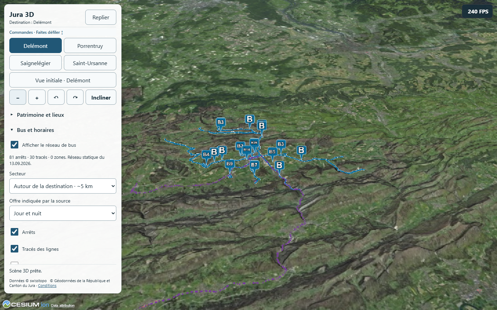
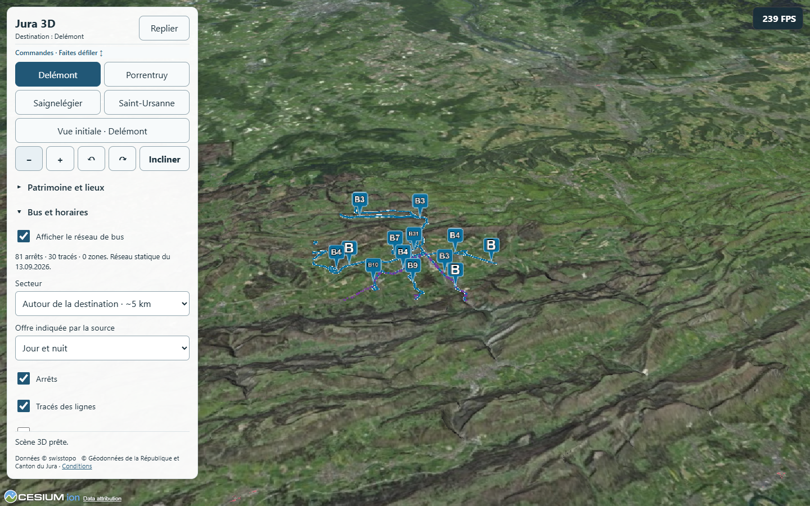
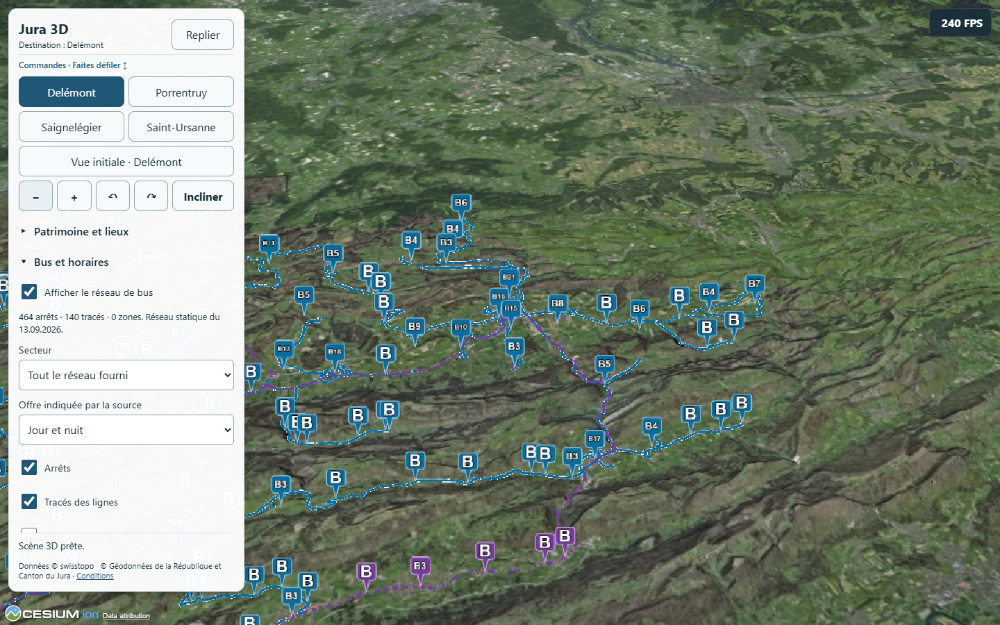

# P6 — optimisation des tracés de bus

## Bilan P6 clos avec réserves — 25 octobre 2026, après A53

**Mesures, contrôles fonctionnels et bilan P6 terminés sur PC, Tab S8 et A53 ; usage exploratoire accepté par le propriétaire.** Après le retour positif Tab S8, il juge l’A53 réactif et « tout à fait honorable pour un téléphone de ce type », puis dit « moi, je valide ». Cette acceptation permet de clore le lot avec ses limites documentées ; **elle ne valide pas 30 FPS constants**, un gain uniforme ni une justesse/qualification exhaustive. CesiumJS est conservé pour le prototype ; aucune migration justifiée par ces seuls résultats. **P7 peut être proposé, il n’est pas commencé.** Aucun stage/stash/commit/push/déploiement, modèle/effort conservés.

### Campagne A53 Faible

A53 SM-A536B/R5CT309CGAV, Android 16, Chrome 155.0.8059.87, Mali-G68, écran portrait 360×666 CSS/DPR 3, tampon 216×400 ; Faible (échelle 0,6, MSAA 1, SSE9.6), bâtiments actifs, ombres/patrimoine désactivés, solaire 21 juin 2026 à 14:00 UTC. Wi-Fi actif sans VPN détecté au précontrôle ; USB pour le site et CDP, charge USB. Aucun réglage radio, rotation système ou écran modifié. Pas de comparaison de puissance entre ce téléphone et la Tab S8/PC (presets, dimensions et versions Chrome distincts).

**17:51:03–18:05:47 Europe/Zurich, 14 min 44 s ; 40/40 étapes et 400 lectures.** Même protocole que la campagne Tab S8 : ordre avant/après inversé une ville sur deux, cinq états par version, dix secondes de rotation après préchauffage ; mêmes vue/preset/GPU/heure/dimensions contrôlés. Zéro erreur JavaScript/HTTP et aucune coupure observée. Source et bundles inchangés ; empreintes des deux versions vérifiées depuis le navigateur. Caméras égales à l’arrondi numérique, nombres de triangles/bâtiments et fiches filtrées identiques entre versions pour chaque état. CPU = callbacks RAF, pas profil complet ; pas de timer GPU Android ni de fréquences mesurées.

Avec arrêts + tracés :

| Localité | FPS médians avant → après | Minimum FPS relevé avant → après | Pauses RAF ≥ 100 ms avant → après | CPU callbacks RAF médian (ms) avant → après |
| --- | --- | --- | --- | --- |
| Delémont | 30 → 32 | 17 → 31 | 8 → 7 | 16.8 → 16.0 |
| Porrentruy | 17 → 27 | 13 → 25 | 26 → 5 | 23.4 → 18.8 |
| Saignelégier | 42 → 40 | 33 → 36 | 0 → 0 | 15.9 → 17.3 |
| Saint-Ursanne | 51 → 45 | 38 → 41 | 0 → 0 | 13.5 → 15.5 |

**Lecture mesurée :** amélioration dans les vues denses Delémont/Porrentruy, mais médianes plus basses à Saignelégier/Saint-Ursanne. Les minima des quatre états « ensemble » augmentent dans cet essai ; ce n’est pas une garantie générale. Porrentruy reste à 27 FPS médians avec bus complets : objectif 30 FPS stables non acquis. Les références sans bus fluctuent fortement : Delémont 42 → 35 au sein du bloc original, 28 → 41 au sein du bloc optimisé ; Porrentruy 26 → 38 et 29 → 40. Aucun gain FPS uniforme ou pourcentage causal global revendiqué.

Sur les vingt fenêtres de chaque version : **126 → 76 intervalles RAF ≥ 100 ms** observés. Ce sont des intervalles de frames, pas 126 blocages indépendants confirmés par l’utilisateur. Quatre lectures en chargement dans l’original, aucune dans l’optimisé ; des pauses existent aussi à l’état prêt. Les causes CPU/GPU/GC/fréquences/charge système ne sont pas isolées. À Porrentruy/lignes seules : médiane 7 → 32, minimum 4 → 29, pauses 40 → 5 ; conserver ces valeurs et leur contexte sans sélectionner seulement la meilleure séquence. Une seule paire par localité, caches et charge système non complètement verrouillés. **Ne pas remplacer cette campagne par le smoke** (six étapes de préparation seulement).

Relevés physiques de la campagne : batterie 39 → 37 %, température 22,5 →26,7 °C, état thermique Android 0 à tous les relevés, économie désactivée, Chrome au premier plan ; écran physiquement allumé/déverrouillé confirmé en cours de parcours. Ces indicateurs ne prouvent pas des fréquences CPU/GPU constantes. La chauffe subjective n’a pas été détaillée séparément dans le retour global.

Rapport .vite/p6/2026-10-25T16-51-03.156Z-android-comparison.json, SHA256 6758ffaea34b4541c99be42134e01597a1552f0ceb7e7db168e367e79d491ca0 ; synthèse .vite/p6/2026-10-25-a53-summary.json. Contrôle court .vite/p6/2026-10-25T16-48-00.331Z-android-smoke.json completed:true, six étapes et nettoyage vérifié. Précontrôle .vite/p6/a53-preflight-2026-10-25.json.

### Gestes, clic de ligne et nettoyage A53

Observateur manuel : **148 événements, 58 fins de gestes dont 8 séquences à deux doigts**, portraits 360×666 et paysage 722×274 effectivement relevés, Delémont/Saint-Ursanne/Porrentruy visités ; groupes d’arrêts, bâtiment, groupe de trois tracés et choix secteur/réseau entier enregistrés. Retour global positif et validation explicite du propriétaire. Pas de confirmation inventée de chaque sous-geste ou lien externe. Rapport .vite/p6/2026-10-25T17-06-51.215Z-a53-manual.json ; préférences initiales restaurées, stockage temporaire de l’observateur retiré et seul onglet fermé.

Contrôle distinct par toucher injecté physique : ligne 13/N22 sélectionnée à CSS 207×265, bon identifiant/titre source, fiche et surbrillance visibles ; choix réseau entier/local contrôlé sans redimensionnement. .vite/p6/2026-10-25-a53-touch-line.json passed:true. [Capture examinée A53](images/p6-a53-trace-2026-10-25.png), compteur instantané hors benchmark.

Préférence **Auto** initiale restaurée et relue sur l’A53, tous les targets identifiés fermés ; onglets non identifiés préservés. Forward 9228 et reverse 4175/4176 retirés du seul A53, listes vides ; preview originale temporaire 4301 arrêtée, optimisée locale 4300 HTTP 200 conservée. .vite/p6/a53-final-cleanup-2026-10-25.json et a53-proof-hashes-2026-10-25.json. Aucun Browser.close Android, cache HTTP/historique/cookie purgé ou réglage système changé. Le téléphone peut être débranché.

**Suite proposée :** P7, extraction minimale de la configuration territoriale et du contrat des couches, avec les mêmes comportements et budgets de performance de référence, avant la preuve Bâle P8. Les limites A53 et les pauses restent des sujets de profilage/optimisation ciblée si leur impact devient gênant ; elles ne justifient pas à elles seules un changement de moteur. Les limites historiques P5, S23 indisponible et paysage physique P6 non relevé sur Tab S8 restent au dossier.

## Compléments, acceptation et limites — 25 octobre 2026

**Bilan intermédiaire Tab S8, avant la reprise A53 :** campagne et bilan tablette terminés ; A53 alors indisponible. Clôture P6 ultérieure et réserves dans le bilan en tête. Retour global du propriétaire : « Tout réagit bien », passage de zone en zone sans lag ressenti ; fonctionnement jugé OK sur sa tablette puissante. Cette acceptation ne devient pas une mesure de chauffe ni une preuve itemisée de chaque geste demandé.

Observateur manuel : **126 événements, 59 fins de gestes tactiles dont 11 séquences à deux doigts**, fiches d’arrêts/groupes et autres sélections ; secteurs local et réseau entier utilisés ; Delémont, Saint-Ursanne et Porrentruy présents. **Seul le portrait est relevé.** Paysage P6, rotation manuelle à Saignelégier et ressenti spécifique de chauffe non établis par cette trace et ce retour global. Préférence initiale Moyen restaurée, stockage temporaire de l’observateur retiré et son seul onglet fermé. Rapport .vite/p6/2026-10-25T12-21-21.856Z-tab-s8-manual.json, retour du propriétaire ajouté séparément des événements.

Vérification ciblée Saignelégier, **13:26:00–13:28:05 Europe/Zurich**, mêmes dimensions/preset/caméra ; avant puis après, sans bus / ensemble / sans bus répété : **six étapes, 60 lectures, médianes et minima 59 FPS partout, zéro pause RAF ≥ 100 ms**. Aucun état de chargement relevé pendant les lectures. Instrumentation complémentaire FPS/pauses RAF via CDP brut, sans le wrapper CPU du parcours principal ; ne pas remplacer les résultats initiaux par cette répétition. L’épisode à 7 FPS n’est pas reproduit ici ; sa cause reste non isolée, les pauses liées aux chargements restent une limite. Rapport .vite/p6/2026-10-25T12-26-00.279Z-saignelegier-repeat.json, completed:true, préférences restaurées et seul onglet fermé.

Toucher **injecté** sur tablette physique en portrait : cible du tracé 13, coordonnées CSS 418×407, sélection de la bonne ligne et titre « Saignelégier - La Chaux-de-Fonds (Noctambus N22) » comparés à la source, fiche/surbrillance visibles ; bascule réseau entier/local contrôlée (rayon null / 5250). Ce contrôle est distinct des gestes manuels. Rapport .vite/p6/2026-10-25-tab-s8-touch-line.json, passed:true, préférence Moyen restaurée et seul onglet fermé. [Capture examinée](images/p6-tab-s8-trace-2026-10-25.png) ; FPS instantané hors benchmark.

**Nettoyage final vérifié :** onglets de mesure, observateur, répétition, toucher et onglet web de dépannage identifiés fermés ; onglets non identifiés préservés. Forward 9228 et reverse 4175/4176 retirés de la Tab S8, listes restantes vides ; seule preview originale temporaire 4301 arrêtée, aperçu optimisé 4300 HTTP 200 conservé sur le PC. Préférence actuelle Moyen relue avant retrait. Preuve .vite/p6/2026-10-25-final-cleanup.json ; empreintes des quatre rapports dans 2026-10-25-proof-hashes.json. La tablette peut être débranchée ; le propriétaire réactive NordVPN et sa protection s’il le souhaite.

Action prévue à ce point historique : **A53 en Faible lorsqu’il est disponible**, accès/identité/Chrome/orientation vérifiés à neuf ; ne pas réutiliser un ancien socket/PID/transport. Mesurer les deux versions dans les mêmes conditions et conserver les pauses/références, puis bilan P6 et décision avant P7. Pas de migration, commit, push ou déploiement ; même modèle/effort, sources applicatives préservées. Les contrôles P6 actuels n’établissent ni 30 FPS A53 ni le paysage physique de cette nouvelle version.

## Campagne Tab S8 complète — 25 octobre 2026

**Terminée de 12:57:46 à 13:11:19 Europe/Zurich**, 13 min 33 s ; **40/40 étapes et 400 lectures**, aucune erreur JavaScript/HTTP ni coupure observée, dimensions/orientation/qualité/GPU/heure contrôlés. Écran portrait 753×1030 CSS / DPR 2,125, tampon 564×773, Moyen, ombres/patrimoine désactivés, bâtiments actifs, solaire 21 juin 14:00 UTC. Chrome 156.0.8078.47 / Adreno 730 / Android 16 ; ne pas comparer quantitativement aux anciennes mesures Chrome 154.

Deux origines USB servent les bundles original et optimisé vérifiés par SHA256. Ordre : Delémont avant/après, Porrentruy après/avant, Saignelégier avant/après, Saint-Ursanne après/avant. Cinq états par version/localité, dix secondes de rotation alternée après préchauffage. Vues finales égales à l’arrondi numérique, triangles et nombres de bâtiments égaux entre versions pour chaque état ; fiches filtrées identiques. Pas de mesure GPU, de fréquences ni de mémoire totale sur Android. Une paire par localité, pas une étude statistique.

Avec arrêts + lignes :

| Localité | FPS médians avant → après | Minimum FPS relevé avant → après | Pauses RAF ≥ 100 ms avant → après | CPU callbacks RAF médian (ms) avant → après |
| --- | --- | --- | --- | --- |
| Delémont | 36 → 40 | 35 → 40 | 0 → 0 | 17.9 → 13.6 |
| Porrentruy | 34 → 46 | 33 → 45 | 0 → 0 | 17.1 → 13.2 |
| Saignelégier | 60 → 59 | 59 → 7 | 0 → 15 | 11.0 → 11.1 |
| Saint-Ursanne | 59 → 59 | 59 → 59 | 0 → 0 | 10.8 → 11.3 |

**Réserves qui restent visibles :** référence Delémont sans bus 60 → 51 pendant le bloc original, puis 46 → 47 sur l’optimisé ; gain médian 36 → 40 bus complets, mais lignes seules 42 → 40. Le p10 empirique lignes seules passe 26 → 39. Ne pas conclure à un gain FPS uniforme ni expliquer la dérive par une cause non mesurée. Porrentruy est plus concluant : bus complets 34 → 46, références répétées sans bus 53 → 52 ; premier état sans bus 53 → 47, arrêts 53 → 53. Saignelégier et Saint-Ursanne proches du plafond observé 59–60 FPS : pas de gain visible en médiane.

Deux épisodes doivent être conservés : Saignelégier optimisé/ensemble descend à 7 FPS, 15 pauses RAF ≥ 100 ms (maximum 150,2 ms), avec une lecture en chargement ; Saint-Ursanne original/sans bus répété descend aussi à 7 FPS, 27 pauses (maximum 166,7 ms) et trois lectures en chargement. Le second existe sans bus : pas d’attribution exclusive aux tracés. Une médiane à 59 FPS ne prouve pas l’absence de saccades. Répétition ciblée et complément manuel ensuite terminés : voir bilan des compléments ci-dessus.

Batterie 47 →44 % malgré charge USB, température batterie 23,3 →25,0 °C ; état thermique Android 0 à tous les relevés, économie désactivée, Chrome au premier plan aux contrôles physiques. Aucun diagnostic de bridage CPU/GPU déduit de ces seuls capteurs. Préférences initiales des deux origines restaurées et relues, seul onglet de mesure fermé, preuves vraies ; aucun cache HTTP effacé.

Rapport ignoré : .vite/p6/2026-10-25T11-57-46.984Z-android-comparison.json, SHA256 1f20e4726672340e3caf76e9dd06464bca46fdaae0b6008d64ea32c1c506b481. Synthèse .vite/p6/2026-10-25-android-summary.json ; script scripts/measure-transport-android.mjs (empreinte consignée dans le rapport). Échec de reconnexion Playwright après retour au nouvel onglet natif ; accès CDP brut limité aux targets créés pour le complément, sans réglages automatiques du navigateur. Observateur manuel .vite/p6/manual-recorder-2026-10-25.mjs, rapport .vite/p6/2026-10-25T12-21-21.856Z-tab-s8-manual.json. Le contrôle court et les incidents initiaux ci-dessous restent distincts.

## Préparatifs Android historiques — 25 octobre 2026

Tab S8 USB identifiée R52T401B6LN / SM-X706B, Android 16, Chrome 156.0.8078.47, Adreno 730, portrait 753×1030 CSS / DPR 2,125. Nouveau câble posé par le propriétaire après coupures initiales ; transport 20 observé, à revérifier après toute interruption. Préférence et onglets utilisateur préservés, aucun réglage d’orientation ou d’économie modifié.

Build et tests géométriques réussis à la reprise ; bundle optimisé identique au 2 octobre (index SHA256 911778575be515e6385a96d748af88ad70385a697d02b025dc8cc74cf6626be0). Nouveau scripts/measure-transport-android.mjs : avant/après physique, quatre destinations × cinq états × deux versions, ordre des versions inversé une localité sur deux, preset Moyen, dimensions/orientation/qualité/GPU/heure contrôlés ; dix secondes en mouvement par état après préchauffage. FPS/pauses RAF/CPU callbacks et batterie/thermique, aucune mesure GPU Android. Contrôle court séparé (six étapes, trois secondes) : préparation seulement, aucun gain déduit.

Difficultés de préparation conservées : preview 4300 ne répondait pas, redémarrage de son seul processus ; premier contrôle court 2026-10-25T11-38-52.972Z-android-smoke.json arrêté à zéro phase sur erreurs DNS swisstopo, nettoyage JSON d’abord incomplet puis préférence initiale null et fermeture du seul target confirmées par 2026-10-25-smoke-recovery.json. Nettoyage corrigé pour attendre le commit de navigation plutôt que DOMContentLoaded du visualiseur JSON.

NordVPN puis sa protection séparée désactivés par le propriétaire. Wi-Fi actif sans VPN dans les réseaux courants, cache DNS temporaire Chrome vidé via son outil interne, Chrome réaffiché depuis le lanceur Android ; racines terrain et bâtiments HTTP 200 confirmées dans 2026-10-25-chrome-dns-refresh-foreground.json. Aucun historique/cookie/cache HTTP effacé, aucune attribution causale exclusive au VPN déduite de ces actions combinées. [Procédure officielle NordVPN consultée](https://support.nordvpn.com/hc/en-us/articles/37816059882641-My-internet-disconnects-when-using-a-VPN-on-Android).

Contrôle court .vite/p6/2026-10-25T11-54-42.252Z-android-smoke.json terminé : completed:true, six étapes, préférences des deux origines restaurées et testPageClosed:true ; thermique 0, batterie 47 %, 23,3 °C à la fin. Campagne complète ensuite terminée, 40 étapes/400 lectures : voir bilan daté ci-dessus. Ce paragraphe conserve les préparatifs et leurs incidents. Le propriétaire réactivera ses protections après les essais. Aucun stage/stash/commit/push/déploiement, modèle/effort conservés, P7 non lancé.

## Bilan local — 2 octobre 2026

Le propriétaire autorise le travail sans Tab S8/A53 branchés après clôture P5. **Implémentation et validation PC terminées ; qualification Android P6 encore ouverte.** Modèle/effort conservés, aucun stage/stash/commit/push/déploiement. Git main, HEAD 57eb361 ; changements préexistants préservés. P7–P9 non commencés.

P5 a identifié physiquement le coût des lignes à Delémont/Moyen : 46–47 FPS sans bus, 45 arrêts seuls, 33 tracés seuls, 30–32 ensemble. La comparaison PC ci-dessous soutient un coût surtout GPU sur ce PC ; elle ne profile pas l’Adreno/Mali ni ne prouve une cause CPU/GPU sur les appareils.

## Changement et compromis

src/transport-geometry.js prépare une copie de rendu : simplification Douglas–Peucker à **1 m dans une projection locale approximative**, découpe circulaire à **5,25 km** pour le secteur actif de sélection de 5 km (marge de 250 m), calcul mémorisé par feature/secteur. Aucune revendication de précision géodésique ou d’altitude à 1 m. Données officielles, identifiants, propriétés, liens, couleurs, largeur, tirets/bordures et ancrage au terrain conservés. Les portions qui sortent puis rentrent sont séparées sans raccord inventé. Focus, picking et surbrillance utilisent la géométrie affichée.

Le secteur local affiche désormais seulement les portions proches des lignes sélectionnées : en dézoomant, leurs extrémités à la frontière sont visibles. **Tout le réseau fourni** restaure les lignes entières, simplifiées sans découpe. Ce choix peut coûter davantage ; aucune mesure du réseau entier n’est revendiquée ici. Ensemble des 140 tracés : **47 625 → 12 269 points** (−74,2 %) pour l’affichage complet, sources inchangées.

## Comparaison PC

Chrome Windows 154.0.8037.92 sans interface, GPU effectif **Intel UHD / ANGLE D3D11**, viewport 753×1030 CSS, DPR 1, tampon 564×772, Moyen (échelle 0,75, MSAA 1, SSE 12), bâtiments actifs, ombres/patrimoine désactivés, heure solaire **21 juin 2026 à 14:00 UTC**. Même GPU/fenêtre/preset/heure contrôlés par le script ; ne pas mélanger avec la RTX de P5 ou du probe fonctionnel. Aucun réglage Windows modifié.

scripts/measure-transport.mjs : quatre localités × cinq états (sans bus, arrêts seuls, lignes seules, ensemble, sans bus répété). Mouvement alterné préchauffé, huit secondes de lecture par état. CPU = durée des callbacks RAF + métriques CDP, pas profil complet ; GPU = timer WebGL de la scène entière entre premier clear/draw et callback après rendu, sans gl.finish, queries disjoint exclues. Le timer n’isole pas une couche ni une passe. Instrumentation identique avant/après. Une paire de campagnes, pas une analyse statistique de répétitions.

Avant : 23:59:40–00:04:59 Europe/Zurich ; après : 00:33:21–00:38:40. **20/20 scénarios chacun, aucune erreur.** Médianes avec arrêts + lignes :

| Localité | GPU scène (ms), avant → après | Baisse GPU | FPS, avant → après | CPU RAF (ms), avant → après | Points de lignes, source → affichés |
| --- | --- | --- | --- | --- | --- |
| Delémont | 21.50 → 14.85 | −30.9 % | 44 → 57 | 5.00 → 6.30 | 9503 → 1465 |
| Porrentruy | 21.53 → 12.85 | −40.3 % | 41 → 63 | 5.10 → 5.10 | 8376 → 1198 |
| Saignelégier | 12.33 → 7.15 | −42.0 % | 75 → 111 | 3.00 → 3.00 | 6666 → 927 |
| Saint-Ursanne | 10.74 → 6.73 | −37.3 % | 87 → 116 | 2.50 → 2.60 | 10792 → 1129 |

Lignes seules : baisse GPU de 34,2 % à Delémont, 39,6 % à Porrentruy, 47,0 % à Saignelégier et 39,4 % à Saint-Ursanne. Sans bus / arrêts seuls, les médianes GPU sont proches (écart absolu inférieur à 4 %), y compris la référence répétée. Les nombres de fiches filtrées restent identiques. Avec bus complets, nombres de triangles et de bâtiments exactement identiques entre sessions ; caméra finale identique à l’arrondi numérique (écarts angulaires <2e−14 rad), altitude inchangée. Appels de dessin moyens proches : 428/408/260/181 selon ville avant et après ; le gain ne vient pas d’une grande baisse du nombre d’appels.

CPU/FPS sans bus varient entre sessions : par exemple Delémont 90 → 76 FPS au premier état, 78 → 74 au dernier, malgré GPU stable. Aucun gain CPU général revendiqué ; Delémont avec bus CPU RAF 5,0 → 6,3 ms. Chargements naturels pendant rotation consignés : avant, quatre lectures « loading » à Porrentruy ; après, trois à Delémont/lignes seules. Tous les états « ensemble » ont huit lectures prêtes et les étapes retrouvent l’état prêt. Charges système, puissance/fréquences et caches réseau ne sont pas entièrement verrouillés. Le résultat soutient un allègement GPU local, sans garantir les FPS mobiles ni une absence de chauffe.

## Contrôles de qualité

- node scripts/test-transport-geometry.mjs réussi : synthétiques (franchissement, sortie/rentrée, tangence, doublons, boucle, seuil), puis tous les 140 tracés ; écart projeté borné, extrémités complètes conservées, séparation des parties, points locaux dans le rayon, source immutable.
- npm run build réussi, avertissement de taille de bundle préexistant conservé. JS index-DIfX6nSO.js, CSS index-C8D1Jt4F.css, index SHA256 911778575be515e6385a96d748af88ad70385a697d02b025dc8cc74cf6626be0.
- npm run probe complet P1/P3/P4 + invariants P6 réussi à **00:32:41**, zéro erreur. Préférence Chromium par processus JURA3D_PROBE_GPU=high, GPU effectif **RTX 4080 Laptop** ; aucun réglage système. Fiches, clics sur lignes dans quatre localités, superpositions/groupes, filtres, réseau complet, cache, annulations, bascules, coexistence, toucher simulé portrait/paysage, pannes/réessais et crédits contrôlés. Sources 464 arrêts / 140 lignes / 2 zones inchangées.
- Revue visuelle avant/après : Delémont et Saignelégier, vues élargies et réseau entier ; traces proches cohérentes et ancrées au relief, pas de raccord extérieur ajouté. Captures de bureau, FPS affichés instantanés **hors benchmark**. Couverture et beauté exhaustives non garanties.
- src/main.js, src/style.css et index.html restent identiques aux empreintes de reprise P5 ; données non modifiées.

Premier essai du probe échoue sur hauteur du panneau court A53 simulé ; CSS inchangé, reproduction à scène prête = 120 px. Précondition scène prête explicitée après redimensionnement sans abaisser le seuil. Relance Intel interrompue après absence prolongée de jalon P3 (cause non isolée), preuve .vite/p6/probe-interrupted-intel.json ; aucun succès complet revendiqué pour cet essai. La relance RTX ci-dessus termine les mêmes contrôles. Premier benchmark .vite/p6/2026-10-01T21-53-56.973Z-before.json exclu : timer englobant attente inter-frame et arrêt sur chargement après 12 phases ; seuls les rapports corrigés sont comparés.

| Secteur original : lignes prolongées hors voisinage | Secteur optimisé : portions proches | Réseau entier optimisé |
| --- | --- | --- |
|  |  |  |

[Vue rapprochée optimisée de Delémont](images/p6-delemont-apres-2026-10-02.png). Captures à cadrage et réglages identiques, groupes de repères pouvant évoluer entre frames ; leurs FPS instantanés RTX ne sont pas les médianes Intel du tableau.

## Preuves locales et reprise

Artifacts ignorés à préserver pour reprise :

- Avant : .vite/p6/2026-10-01T21-59-40.324Z-before-corrected.json, SHA256 dcc35d29dcbc5e79110bd624f16db7c0f1c3bca942a8dfd926844e9043c6474f.
- Après : .vite/p6/2026-10-01T22-33-21.954Z-after.json, SHA256 2520dcc7a6526eb0368d35971852e0d0b9260834c3bff8b0fd31b78b264da4a1.
- Comparaison : .vite/p6/comparison.json ; probe : .vite/p6/probe-final.json ; captures/caméras : .vite/p6/visual*.png, visual-report.json, visual-wide-report.json et visual-edge-report.json.
- Référence applicative originale : .vite/p6/baseline et baseline.json. Preview originale temporaire reconstruite exactement (index P5 SHA256 bbf979262ff0990856a4594cd4b5abebd835e01a823bf176b756d8ae56afcb01) sous .vite/p6/before-dist ; version optimisée dans dist.

Nettoyage confirmé dans .vite/p6/cleanup.json : seul serveur temporaire 4301 retiré, aperçu optimisé HTTP 200. Les navigateurs headless créés par les scripts ont été fermés par leurs finally ; onglets utilisateur préservés.

La preview actuelle reste locale sur http://127.0.0.1:4300/. Aucun appareil requis pour le travail PC terminé. Prochaine preuve quand disponible : même comparaison sans bus / arrêts / lignes / ensemble sur Tab S8 et A53, mêmes vue/preset/orientation et conditions, puis gestes/fiches et ressenti/chauffe. Les anciens chiffres P5 ne sont pas rebaptisés résultats P6. Garder CesiumJS ; aucune migration décidée. Ne pas avancer P7 avant bilan des limites restantes et décision du propriétaire.
