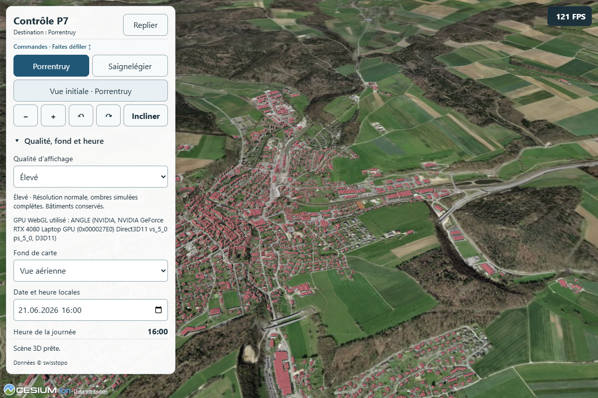

# P7 — Configuration territoriale et cycle de vie des couches

25 octobre 2026. Réalisation autorisée par « ok, continue » après clôture P6 avec réserves. Modèle et effort conservés ; aucun stage, stash, commit, push ou déploiement. **P7 clos pour son périmètre PC**, probe complet achevé à **21:13:52 Europe/Zurich**. Aucune nouvelle qualification physique Android.

## Portée réalisée

- `src/territories/jura.js` rassemble identité, destinations, caméra initiale, sources, plafonds d'imagerie, emprises, crédits, fichiers, effectifs et date des instantanés. Les valeurs Jura et les réglages de rendu P6 sont conservés.
- `src/territory.js` valide la configuration avant compilation et démarrage, puis configure titre, destinations, fonds, localités et crédits. Les panneaux des couches absentes sont masqués.
- `src/layers.js` définit un petit registre ; les adaptateurs possèdent leurs requêtes, écouteurs et sources Cesium. Activation à la demande, sélection prioritaire patrimoine puis transports, navigation, réaffichage et destruction sont explicites.
- `vite.config.js` choisit une configuration par `VITE_TERRITORY` (nom de fichier sans extension, `jura` par défaut). Il copie les seuls fichiers déclarés et déduplique les conditions communes.

## Contrat des couches

| Méthode | Effet |
| --- | --- |
| `setEnabled(boolean)` | Synchronise la commande ; charge à la première activation, annule et retire les entités à la désactivation. Cache validé conservé pendant la vie de l'adaptateur. |
| `refresh()` | Réapplique les filtres sur l'instantané en mémoire ; retente le chargement s'il n'existe pas encore. Aucun polling ni renouvellement automatique des données. |
| `navigate()` | Annule le cadrage de sélection et actualise les filtres liés à la destination. |
| `pick(picked, position)` / `select(id)` | Sélectionnent uniquement des objets réellement présents et visibles. Les fiches restent propres aux schémas cantonaux. |
| `clearSelection()` | Retire la surbrillance et annule le cadrage propre à la couche. |
| `destroy()` | Définitif et idempotent : annulation des requêtes/générations, des cadrages, des écouteurs DOM/groupes ; retrait des sources, listes et caches forts. Aucun réenregistrement sur un registre détruit. |
| `snapshot()` | Diagnostic sous `?probe=1`, sans lancement de chargement. |

`pagehide` détruit les couches lorsque la page quitte réellement la session ; une page conservée dans le cache de navigation n'est pas détruite. La scène et ses contrôles restent gérés dans `main.js` ; il ne s'agit pas d'un moteur empaqueté ou d'une API de plugins générale. Les adaptateurs `jura-heritage` et `jura-transport`, leurs validateurs de schéma, règles de liens et fiches restent spécialisés. Une future couche de parkings nécessite son propre adaptateur et panneau.

## Preuve de configuration alternative

`src/territories/navigation-control.js` réutilise les fournisseurs suisses existants, démarre à Porrentruy, propose deux destinations et aucune couche cantonale. Il utilise la même application, sans copier sa logique. C'est un témoin de configuration ; ce n'est pas un rendu validé de Bâle ou d'une autre ville.



```powershell
node scripts/test-territory.mjs
node scripts/test-transport-geometry.mjs
npm run build
$env:JURA3D_URL='http://127.0.0.1:4300/'
$env:JURA3D_PROBE_GPU='high'
npm run probe
node scripts/probe-territory.mjs
```

Pour construire le témoin dans un dossier distinct, puis le servir localement :

```powershell
$env:VITE_TERRITORY='navigation-control'
node node_modules/vite/bin/vite.js build --outDir .vite/p7/control-dist
node node_modules/vite/bin/vite.js preview --outDir .vite/p7/control-dist --host 127.0.0.1 --port 4302 --strictPort
# Dans un autre terminal, viser ce serveur pour le contrôle P7 :
$env:JURA3D_URL='http://127.0.0.1:4302/'
node scripts/probe-territory.mjs
# Retirer ensuite VITE_TERRITORY avant la construction normale du Jura.
Remove-Item Env:VITE_TERRITORY
```

Les autres configurations vont dans `src/territories/<nom>.js`. Les sources 3D actuelles supposent terrain quantized mesh, bâtiments 3D Tiles et fonds XYZ. Les fichiers d'instantané sont sous `data/<base>/<fichier>`, le dernier fichier de chaque adaptateur est l'index de liens (`checksSource`), les conditions sous `data/<conditions>`. Les adaptations de format, droits, attributions et coût restent à vérifier avant intégration d'une nouvelle source. La configuration choisit les couches disponibles ; elles restent désactivées au démarrage.

## Résultats et limites

- `node scripts/test-territory.mjs` réussi : configurations Jura/témoin, huit rejets, priorité du picking et contrat du registre.
- Géométrie P6 réussie : huit cas synthétiques et 140 tracés officiels, 47 625 → 12 269 points, écart projeté maximal 1 m et source inchangée.
- Compilations Jura et témoin réussies ; avertissement de taille du bundle Cesium déjà connu (> 500 kB). JS Jura `index-qujFUUtO.js`, CSS `index-C8D1Jt4F.css` inchangé. Index SHA256 `db2ddbe345d1c8d6750f9e4e004ab608c57b6861cf384e737b49ffb5d1c9f66a`.
- Sept fichiers publics comparés par SHA256 à P6 : GeoJSON, contrôles de liens et conditions identiques. Aucune livraison cantonale dans le build témoin.
- Contrôle P7 Jura réussi : activation, réaffichage en cache, retrait, destruction idempotente, écouteurs retirés ; destruction pendant six requêtes, sans réactivation tardive. Contrôle alternatif réussi : deux destinations, départ/retour à Porrentruy, titre/panneaux et absence de requêtes cantonales.
- `npm run probe` complet P1/P3/P4/P6 réussi à 21:13:52 : Chrome **156.0.8078.47** sans interface, **RTX 4080 Laptop GPU**, zéro erreur, navigation quatre localités, fiches/groupes, filtres/cache, picking et invariants géométriques, gestes simulés portrait/paysage, pannes/réessais. Captures du témoin et du paysage P1/P4 examinées. Ce parcours ne mesure pas un gain de performance.
- Les empreintes des sources/build sont identiques entre les contrôles P7 et le probe complet. Référence de reprise préservée avant modification ; index Git vide et `git diff --check` réussi.

Le premier lancement Chrome était limité par l'accès réseau de l'environnement d'exécution ; relancé avec l'accès nécessaire. Le premier probe applicatif a ensuite échoué au chargement des couches : le nouveau mapping de copie conservait les répertoires `data/` sous `dist/jura/`. Correction par `stripBase: true`, puis comparaison exhaustive des sept fichiers et nouveaux contrôles réussis. Les journaux d'échec restent distincts et ne comptent pas comme validation.

Rapports : `.vite/p7/probe-final.json`, `probe-jura.json`, `probe-navigation-control.json`, `data-integrity.json`, `validated-source-hashes.json`, `final-check.json`, journaux `build.log`, `control-build.log`, `probe.log` et échecs `probe-copy-layout-failed.log` / `probe-territory-copy-layout-failed.log`.

Preuves locales ignorées sous `.vite/p7/`, référence applicative P6 préservée dans `before-dist/` avec empreintes des sources dans `baseline.json`. Aucun fichier de données cantonales modifié ; aucun nouveau résultat Android revendiqué. Les mesures physiques P6 restent celles de leur build, pas un benchmark P7.

Prochaine étape proposée : P8, essai limité de Bâle après confirmation des conditions des modèles et de l'API de parkings, gestion du doublon swissBUILDINGS3D, observations horodatées et mesures. P8 non commencé par P7.
