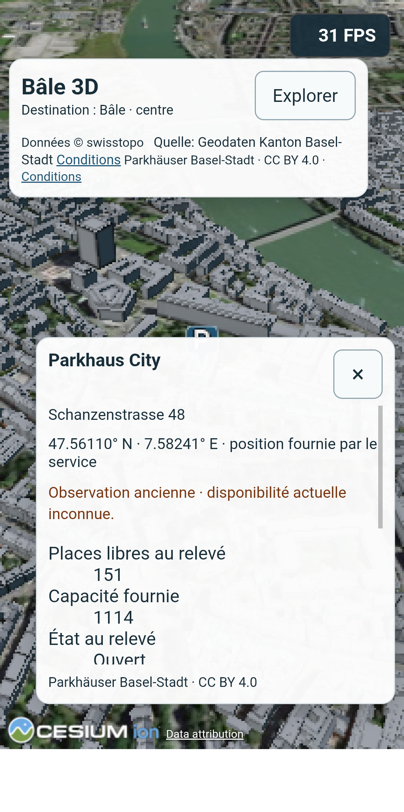
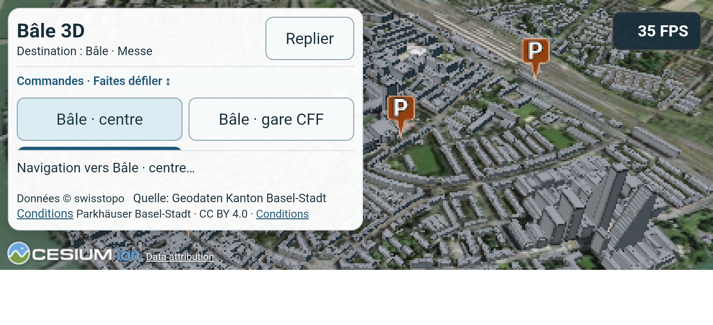
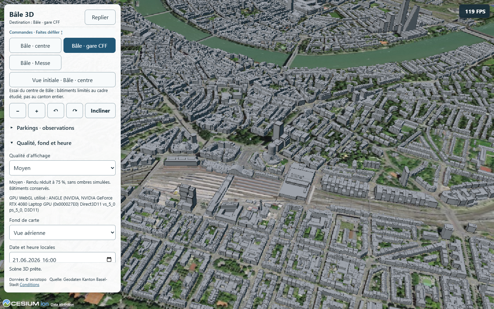
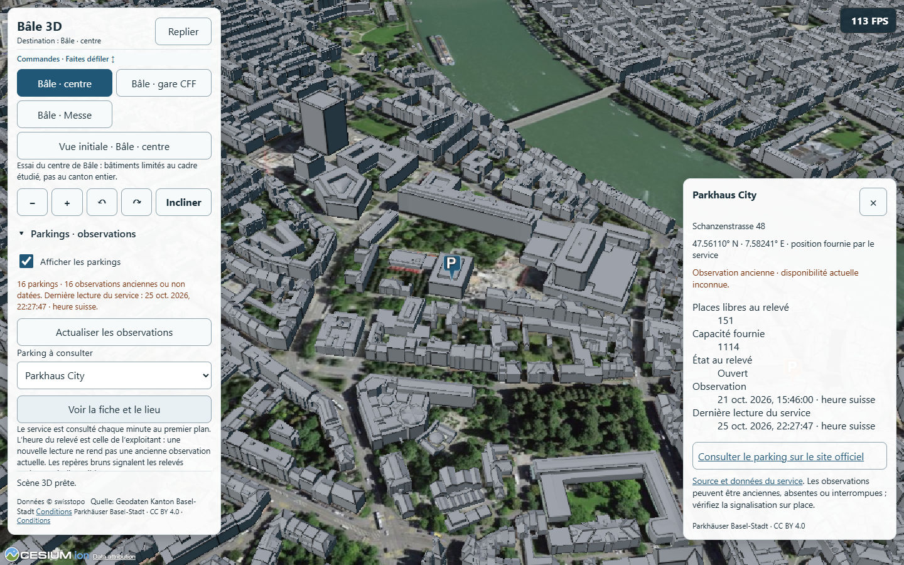
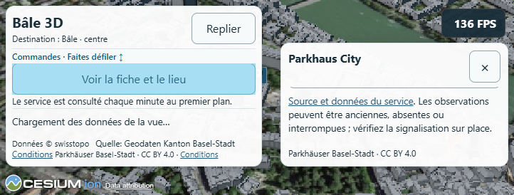

# P8 — Essai Bâle : bâtiments et observations de parkings

**Clarification de portée après revue du 26 octobre :** ce document valide une preuve technique limitée. Le propriétaire demande désormais un Bâle beaucoup plus informatif ; transports, lieux/patrimoine et services sont ajoutés au [plan d'enrichissement](PLAN_BALE_ENRICHISSEMENT.md). La validation de fluidité/fonctionnement ci-dessous ne signifie pas que le contenu de Bâle est terminé.

25 octobre 2026. Développement local autorisé après PUB1 ; modèle et effort conservés. Dépôt principal initialement propre, `main`/HEAD `24e42af`. Aucun commit, push ou déploiement P8. La version publique Jura reste `29a4089` ; elle ne contient pas Bâle.

**État au 26 octobre : P8 clos pour l'essai limité centre/gare/Messe et parkings, avec réserves.** Contrôles PC, parcours prolongé A53 Faible, référence Jura et usage physique portrait/paysage achevés ; le propriétaire juge le résultat utilisable et fluide. Les contrôles PC du 25 octobre restent valables sur les empreintes inchangées ; ils ne sont pas rebaptisés contrôles Android. 30 FPS constants non acquis, pauses mesurées, observations anciennes et S23 non testé restent des limites. Aucun élargissement ou déploiement déduit de ce bilan.

**Versions distinctes :** le [PUB2 préparé ensuite](PUBLICATION_PUB2.md) ajoute un accueil et un lien de retour, avec d'autres bases et empreintes de bundles. Les mesures physiques ci-dessous restent celles des builds P8 conservés ; elles ne constituent pas un benchmark ni une validation physique de l'assemblage PUB2, contrôlé séparément sur PC.

## A53 physique — 26 octobre 2026

**Parcours Bâle terminé : 09:33:08–09:45:37 Europe/Zurich**, soit `08:33:08.515Z` à `08:45:37.947Z`. Durée **12 min 29 s**, 24 étapes et **600 lectures**, dont dix minutes de fenêtres de mesure. Aucun échec de phase, aucune coupure USB ; aucune erreur JavaScript relevée par l'onglet, surveillance réseau/console sans nouvelle erreur observée depuis le début de son enregistrement à `08:33:44Z`.

Appareil `SM-A536B/R5CT309CGAV`, Android 16, **Chrome 155.0.8059.87/Mali-G68**, portrait **360×666 CSS/DPR 3**, tampon **216×400**. Faible explicitement choisi et vérifié : résolution 0,6, MSAA 1, SSE 9,6, ombres désactivées ; soleil **21 juin 2026 14:00 UTC**. Écran natif sans émulation/redimensionnement. Deux passages des trois destinations, ordre des destinations inversé au second passage ; pour chacune : terrain, bâtiments, bâtiments avec parkings, bâtiments répétés. Cadrage réinitialisé avant chaque étape, chargement prêt et deux secondes de stabilisation, rotation toutes les 250 ms pendant 25 s. FPS natifs lus chaque seconde ; pauses RAF mesurées séparément. Caches ordinaires, fréquences non verrouillées, USB branché : aucune mesure de puissance ou du temps GPU.

| Vue | Terrain, médianes passages 1 / 2 | Bâtiments | Avec parkings | Bâtiments répétés | Minima avec parkings |
| --- | --- | --- | --- | --- | --- |
| Centre | 59 / 59 | 32 / 33 | 23 / 28 | 26 / 22 | 12 / 20 |
| Gare CFF | 59 / 59 | 27 / 37 | 31 / 36 | 33 / 39 | 19 / 23 |
| Messe | 59 / 58 | 26 / 42 | 34 / 35 | 30 / 39 | 22 / 23 |

Les 24 fenêtres totalisent **378 intervalles RAF ≥100 ms**, maximum **375,7 ms** ; aucun dans les six fenêtres terrain. Ce sont des intervalles de callbacks, pas 378 blocages distincts ressentis ni une mesure du temps GPU. Les répétitions sans parkings varient aussi fortement : aucune estimation causale unique du coût des seize repères, ni garantie de 30 FPS constants. Le cache Cesium du modèle bâtiments atteint **398 916 684 octets** ; ce n'est ni toute la RAM/GPU du navigateur, ni le coût des parkings ou une preuve de fuite.

Batterie **89→88 %**, température **22,1 °C à la préparation →27,2 °C à la fin Bâle**, état thermique Android **0** à tous les relevés, économie d'énergie désactivée. Le téléphone est alimenté par USB ; les pourcentages ne mesurent pas l'autonomie hors câble. Aucune fréquence CPU/GPU observée : l'état thermique 0 ne prouve pas l'absence de toute variation de fréquence.

Les seize observations reçues le 26 octobre portent encore **21 octobre 2026 13:46 UTC**, avec ancienneté correctement signalée. Le modèle et le build sont ceux validés sur PC : index SHA256 `749bf3ff3405fe19e55aa27544e61f7ff3cf77a4b5d7a4e22c2016794bb814df` ; sources inchangées au précontrôle.

**Incident de préparation, hors mesures :** le paramètre diagnostic démarrait en Élevé avant sélection explicite de Faible ; avertissements WebGL `uniform3fv` et deux tuiles `ERR_HTTP2_PROTOCOL_ERROR`. Racines de services accessibles HTTP 200, réessai récupéré ; cause des deux erreurs réseau non isolée, aucun VPN/réglage réseau changé. Cette tentative est conservée dans `preparationFailure`, `a53-initial-network.json` et `a53-initial-console.json`, sans l'inclure dans les FPS. Faible et le rendu prêt ont été vérifiés avant le parcours.

**Référence Delémont terminée à 09:48:48 Europe/Zurich** : huit étapes/120 lectures, deux passages de fenêtres de 15 s, mêmes GPU, viewport, preset, soleil et rotation à 250 ms. Terrain médian **58 / 59 FPS** ; bâtiments **19 / 28** ; bâtiments + bus **18 / 22** ; bâtiments répétés **23 / 21**. Minima avec bus **14 / 14** ; 148 intervalles RAF ≥100 ms sur toutes les fenêtres, maximum 242,2 ms. Cache bâtiments observé environ 75,1 millions d'octets. Batterie finale 88 %, 27,6 °C, thermique 0. Statuts prêts contrôlés avant/après chaque étape ; absence de préférence initiale restaurée et relue, seul onglet de référence fermé. Une tentative de relever sa console après fermeture a échoué : pas de preuve rétrospective de zéro erreur console/réseau Jura. Autre ville, source et couche ; fenêtres plus courtes, référence réalisée après Bâle, cache/fréquences variables : pas de ratio causal entre villes. La cadence des rotations diffère aussi de P6 ; ne pas déduire une régression P6 de ces chiffres.

**Toucher injecté sur l'écran physique** : repères City, Kunstmuseum et Messe réellement trouvés et touchés, titre/lien/crédit/ancienneté comparés aux observations ; sélection et fermeture réussies. Un bâtiment réel est également touché, crédit Basel-Stadt et attributs source relevés. Cela ne remplace pas les gestes du propriétaire. Capture portrait inspectée : repère, fiche défilante, fermeture, ancienneté et crédits présents.

**Usage par le propriétaire :** il juge l'A53 « tout à fait utilisable, fluide », confirme les fiches et l'ouverture du lien, sans problème signalé. Le paysage est ensuite explicitement vérifié : léger ralentissement au changement d'orientation puis retour à la normale, panneau/fiche et commandes jugés OK. Trace distincte des injections : **193 événements**, 78 fins de gestes, 15 événements à au moins deux doigts (pas nécessairement 15 pincements distincts), trois destinations, cinq identifiants de fiches ; **360×666 puis 722×274 et retour 360×666**, fiche visible en paysage. Capture paysage du panneau inspectée. Pas de confirmation subjective explicite sur la chauffe ; relevé final objectif **28,4 °C**, batterie 88 %, thermique 0 à **09:54:02 Europe/Zurich**.





**Nettoyage terminé à 09:54:03 Europe/Zurich :** préférence Bâle initiale **Auto** restaurée et relue ; référence Jura initialement sans préférence, absence restaurée et relue. Seuls les deux onglets créés fermés ; absence du target Bâle vérifiée avant retrait du forward CDP 9228 et des reverses A53 4175→4305/4176→4300, préalablement contrôlés, listes finales vides. Autres onglets conservés, aucun Browser.close Android, réglage radio/rotation système ou VPN modifié. Appareil débranchable ; previews PC 4300/4305 conservées en boucle locale.

Preuves locales ignorées : `.vite/p8/a53-active-session.json`, `a53-basel-summary.json`, `a53-protocol.json`, `a53-live-console.json`, `a53-jura-reference.json`, `a53-touch-checks.json`, `a53-manual-summary.json`, `a53-target-closure.json`, `a53-final-check.json` et scripts diagnostiques `a53-*.mjs` ; adaptateur `.vite/p6/raw-cdp-pages.mjs` réutilisé sans modification. Préserver ces preuves. Le manifeste final donne les empreintes des outils réellement conservés ; le relevé initial `a53-protocol.json` précède le dernier ajout d'assertions au script Jura. Aucun commit/push/déploiement P8.

**Bilan commun/spécifique :** conserver la scène, les réglages, la navigation, les erreurs/réessais et le contrat des couches communs. Le fournisseur/attribution/découpe et les attributs de bâtiment, ainsi que le schéma, la fraîcheur et les liens des parkings, restent propres à Bâle. Ces mesures ne justifient ni migration de moteur ni ajout immédiat d'arbres/forêts/ponts. Prochaine décision avec le propriétaire : accès public à Bâle à côté du Jura, actuellement choisi au build ; packaging/navigation à définir et publication à autoriser séparément. P9 non commencé.

**Contrôle final à 09:58:06 Europe/Zurich le 26 octobre :** empreintes des sources et trois builds inchangées par rapport au manifeste PC ; previews Jura 4300/Bâle 4305 HTTP 200 avec index attendus, site public toujours `29a4089`, HEAD `24e42af`, index Git vide, `git diff --check` réussi. Préférences/fermetures et listes de liaisons vides vérifiées, treize empreintes de preuves/outils enregistrées dans `.vite/p8/a53-final-check.json`. Aucun nouveau build/probe PC nécessaire pour cette qualification : application/configuration inchangées.

## Essai disponible

Configuration `src/territories/basel.js`, même application et même scène que le Jura : aucun code d'application copié, renommage de dépôt ou sélecteur multicité ajouté. Trois cadrages approximatifs : centre, gare CFF, Messe. Terrain et fonds swisstopo conservés ; seul le modèle bâlois est chargé pour les bâtiments, sans tileset swissBUILDINGS3D superposé.

Le rendu des bâtiments est découpé au cadre WGS84 `[7.57, 47.54, 7.615, 47.57]` par un polygone Cesium inverse. C'est une emprise d'essai, pas une limite administrative. Les tuiles qui coupent la frontière peuvent contenir des objets hors du cadre : la découpe du rendu ne promet pas un téléchargement strictement limité à chaque sommet intérieur. Aucun décalage vertical arbitraire appliqué. WebGL 2 requis pour cette découpe ; un navigateur incompatible affiche une erreur, sans charger silencieusement tout le modèle.

Le modèle cantonal fournit ses propres matériaux et attributs. La fiche reprend l'adresse `STR_HAUSNR`/`ORT` lorsqu'elle existe ; aucun nom de monument ou EGID déduit. La sélection et le crédit utilisent la source bâloise. Les arbres, forêts et ponts ne sont pas ajoutés à cet essai.



## Sources, attribution et fraîcheur

Références et empreintes dans [data/basel-sources.json](../data/basel-sources.json).

- [3D Tiles officiels](https://www.bs.ch/en/node/28694), [description du modèle](https://www.bs.ch/bvd/grundbuch-und-vermessungsamt/vermessung/3d-stadtmodell-mapbs-3d) et [conditions cantonales](https://www.bs.ch/en/node/29871), consultés le 25 octobre. Le fournisseur décrit explicitement l'intégration de son service gratuit dans un globe 3D. Crédit visible **« Quelle: Geodaten Kanton Basel-Stadt »**, avec lien vers les conditions. Aucun modèle téléchargé pour redistribution ou republié par le projet. Le champ de licence du tileset n'est pas renseigné ; ne pas étendre automatiquement aux modèles la licence du jeu de parkings. La fiche produit/licence d'une éventuelle redistribution de fichiers devra être confirmée séparément.
- [Parkings, jeu 100088](https://data.bs.ch/explore/dataset/100088/) : API publique sans clé, CC BY 4.0 et attribution **Parkhäuser Basel-Stadt** explicitement indiquées dans les métadonnées. Seize enregistrements reçus, avec coordonnées, compteurs et dates. Pas d'instantané de parkings servi comme secours : les réponses restent en mémoire dans l'onglet.
- Bien que le catalogue décrive une actualisation à la minute, toutes les observations reçues portent **21 octobre 2026, 13:46 UTC**, soit **15:46 heure suisse**. La lecture du 25 octobre ne les rend pas actuelles. Cause de cette ancienneté non isolée ; ne pas affirmer que l'exploitant ou le flux est nécessairement arrêté.

Politique locale explicite : demande à l'activation, puis au plus une demande automatique par minute lorsque l'onglet est visible. Bouton d'actualisation manuelle, requêtes simultanées dédupliquées, délai de 20 s et annulation au retrait/destruction. À plus de **5 minutes** de l'observation, la fiche et les repères signalent une observation ancienne ; date absente ou supérieure de plus de deux minutes à l'horloge locale : fraîcheur inconnue. Ce seuil est un choix du prototype, pas une garantie du fournisseur. Compteurs absents ou incohérents restent « Non renseigné », jamais zéro inventé.

Une erreur garde les derniers relevés et signale l'échec ; la date de dernière lecture réussie reste distincte de l'observation. Le rafraîchissement ne ferme pas la fiche lorsque les mêmes identifiants sont présents. Une réponse partielle, un identifiant dupliqué ou des coordonnées hors du cadre sont rejetés. Les URL externes sont limitées au domaine/chemin officiel en HTTPS et insérées comme liens/textes. Deux pages de parkings ont renvoyé 429 à la consultation documentaire : aucun contournement, ouverture future non garantie.

## Contrôles PC

- Tests de configuration et **18 contrôles parkings** : récent/ancien/inconnu/futur, zéro et valeurs absentes, compteurs incohérents, liens non autorisés, doublons, réponse partielle et cadence minimale. Géométrie P6 des 140 tracés toujours contrôlée.
- Builds Jura et Bâle séparés ; le build Bâle ne contient aucun GeoJSON Jura. Build en sous-dossier `/jura3d/` également contrôlé pour préparer un éventuel déploiement futur, sans publier.
- Probe Bâle : six groupes de contrôles, modèle réellement rendu dans trois cadrages, sélection d'un bâtiment réel, absence de requêtes swissBUILDINGS3D, trois fiches comparées à l'API (City, Kunstmuseum, Messe), clic réel sur repère, réaffichage sans doublon, récent puis vieillissement via horloge contrôlée, panne/réessai, réponse partielle et destruction pendant la requête. Toucher simulé **390×844, 844×390, 722×274**, défilement, fermeture et crédits accessibles.
- Comparaison des trois positions à l'API et inspection sur orthophoto/modèle. Ce contrôle n'est pas une mesure géodésique indépendante ni la validation d'une entrée automobile. Pas de précision verticale ou d'exhaustivité du modèle affirmée.
- Probe complet Jura et contrôles ciblés du cycle de vie requis pour les derniers changements partagés ; résultats finaux/empreintes ci-dessous. Les versions intermédiaires restent distinguées.





## Relevés PC courts

Chrome Windows sans interface, **RTX 4080 Laptop GPU**, **753×1030 CSS/DPR 1**, Moyen **0,75/MSAA 1**, ombres désactivées, soleil **21 juin 2026 14:00 UTC**. Rotation par la commande de l'application pendant huit secondes, huit lectures de FPS natifs par phase, callbacks RAF pour les pauses. Chargement prêt avant/après, cache ordinaire et deux secondes de stabilisation. Relevés descriptifs uniques ; aucun temps GPU isolé, consommation ou fréquence mesurés.

| Vue | Terrain : médiane / minimum FPS | Bâtiments | Bâtiments + couche |
| --- | --- | --- | --- |
| Bâle centre | 143 / 131 | 143 / 143 | Parkings : 143 / 139 |
| Bâle gare | 143 / 143 | 142,5 / 129 | Parkings : 143 / 128 |
| Bâle Messe | 143 / 143 | 143 / 116 | Parkings : 143 / 130 |
| Delémont, référence distincte | 143 / 126 | 108,5 / 60 | Bus : 121,5 / 97 |

Bâle : neuf phases/72 lectures, **22:20:56–22:23:02 Europe/Zurich**, aucune pause RAF ≥ 100 ms dans ces fenêtres. Delémont : trois phases/24 lectures, **22:24:09–22:24:52**, deux pauses ≥ 100 ms (maximum 403 ms). La référence avec bus dépasse la phase bâtiments seuls : ordre fixe, cache et fenêtres courtes interdisent d'en déduire un gain causé par les bus. Les villes, sources et couches sont différentes ; aucun ratio de puissance ou de coût intrinsèque entre elles.

Les médianes Bâle proches de 143 FPS ne permettent pas d'isoler un faible coût des parkings. Le champ mémoire Cesium du **tileset bâtiments** monte jusqu'à **398 916 684 octets** au fil du parcours (Delémont : environ 98 millions). Il inclut le cache conservé lorsque les bâtiments sont masqués ; il ne mesure ni la couche parkings, ni toute la RAM/GPU du navigateur et ne prouve pas une fuite. Les compteurs de triangles/features concernent les tuiles sélectionnées, pas un dénombrement exact des bâtiments rendus après découpe.

Ces relevés précèdent les derniers ajustements de fiche bâtiment et de message WebGL 2, sans changement des sources, paramètres ou algorithmes de rendu. Les rapports gardent l'empreinte du build mesuré. **Aucune fluidité ou consommation A53/S23 déduite.**

## Reproduire localement

```powershell
node scripts/test-territory.mjs
node scripts/test-parking.mjs
node scripts/test-transport-geometry.mjs
$env:VITE_TERRITORY='basel'
npm run build -- --outDir .vite/p8/basel-dist
node scripts/check-build.mjs .vite/p8/basel-dist / basel
node node_modules/vite/bin/vite.js preview --outDir .vite/p8/basel-dist --host 127.0.0.1 --port 4305 --strictPort
# Autre terminal :
$env:JURA3D_PROBE_GPU='high'
node scripts/probe-basel.mjs
$env:JURA3D_URL='http://127.0.0.1:4305/'
$env:JURA3D_PRESET='medium'
node scripts/measure-territory.mjs
# Retirer VITE_TERRITORY avant de reconstruire le Jura.
Remove-Item Env:VITE_TERRITORY -ErrorAction SilentlyContinue
```

Le script de mesure est **PC uniquement** : aucune connexion CDP ou modification de viewport Android à en déduire. Pour un contrôle ciblé du Jura, `scripts/probe-territory.mjs` accepte désormais `JURA3D_PROBE_OUTPUT` afin de conserver les preuves P7 séparées. Les probes/mesures P6 ne doivent pas être rebaptisés mesures P8.

## Résultat final et reprise

**Résultats finaux du 25 octobre :** probe Bâle terminé à **22:28:50 Europe/Zurich**, six groupes, zéro erreur ; adresse de bâtiment source réellement présente et comparée à la fiche. Probe complet Jura P1/P3/P4/P6 terminé à **22:34:36**, zéro erreur. Chrome **156.0.8078.47/RTX 4080 Laptop GPU** ; captures examinées. Tests configuration, 18 cas parkings et géométrie 140 tracés réussis. Les builds finaux Jura/Bâle et Bâle en sous-dossier sont contrôlés ; aucune donnée Jura modifiée ou livrée dans Bâle.

Versions : Jura JS `index-DeTK42r7.js`, index SHA256 `4929f1ceaf730058501cdc163fb0d8b5af9f138db2db921a77f97f6936be3267` ; Bâle JS `index-CsLwVbW5.js`, index `749bf3ff3405fe19e55aa27544e61f7ff3cf77a4b5d7a4e22c2016794bb814df` ; CSS commun `index-Dn3arHnn.css`. Variante sous-dossier Bâle JS `index-BnPHh7b-.js`, index `fec024edc5f40770269a0bd051265c1012b6945dcecdf85d4f32e1882a51e3d6`. Les empreintes finales des sources et des preuves sont conservées dans `validated-hashes.json` et `final-check.json`. Dernier contrôle à 22:39:56 Europe/Zurich : sources inchangées depuis les probes, sept fichiers publics Jura préservés, deux previews répondant HTTP 200, version publique toujours `29a4089`, index Git vide et `git diff --check` réussi.

Rapports ignorés sous `.vite/p8/` : `probe-basel.json`, `probe-jura-final.json` (final), `probe-jura-complet.json` (intermédiaire), `probe-jura-final-complet.log`, `final-jura/`, fichiers de mesure datés `2026-10-25T21-20-56.149Z` et `21-24-09.878Z`. Source brute des vérifications sous `sources/`, version Jura d'avant P8 sous `jura-before-dist/`. Préserver ces fichiers localement.

Une reconstruction Jura a échoué avec **EPERM pendant la copie de ressources Cesium**, laissant un dossier dist partiel ; le contrôle ciblé lancé à ce moment a expiré. Reprise de compilation réussie avec l'accès nécessaire, contrôle des fichiers complet et nouveau contrôle ciblé réussi. Journaux/rapport d'échec conservés, exclus de la validation. Aucun réglage système ou réseau modifié pour cette reprise.

Complément du 26 octobre ci-dessus : A53 Faible, référence courte Jura et gestes/ressenti portrait/paysage terminés, usage accepté avec réserves ; bilan P8 clos pour ce périmètre. Restent non qualifiés : S23, autonomie/puissance hors USB, fréquences et précision verticale ; fraîcheur des observations toujours ancienne et 30 FPS constants non acquis. Pour de futurs essais, vérifier identité/connexion/appareil à neuf et ne pas reprendre d'ancien port/transport. Publication Bâle et extension du cadre restent des décisions/opérations distinctes ; P9 non commencé.
